# LogNet3.0 方案设计与实现文档（V5）

| 项目 | 内容 |
|------|------|
| 文档名称 | LogNet3.0 方案设计与实现文档 |
| 版本 | V5.0 |
| 适用产品 | DME（分布式存储）/ MAE（网络） |
| 日期 | 2026-09-15 |
| 关键技术点 | 免人工配置异构日志解析、模板无关自适应参数异常检测、分词增强语义异常检测 |

---

## 目录

1. [概述](#1-概述)
2. [系统架构设计](#2-系统架构设计)
3. [模块交互与时序设计](#3-模块交互与时序设计)
4. [关键技术点一：免人工配置异构日志解析](#4-关键技术点一免人工配置异构日志解析)
5. [关键技术点二：模板无关自适应参数异常检测](#5-关键技术点二模板无关自适应参数异常检测)
6. [关键技术点三：分词增强语义异常检测](#6-关键技术点三分词增强语义异常检测)
7. [数量异常检测](#7-数量异常检测)
8. [异常检测结果融合与故障诊断](#8-异常检测结果融合与故障诊断)
9. [接口规格定义](#9-接口规格定义)
10. [配置体系](#10-配置体系)
11. [部署与运行](#11-部署与运行)
12. [评估指标体系](#12-评估指标体系)
13. [端到端示例](#13-端到端示例)

---

## 1. 概述

### 1.1 背景与目标

LogNet3.0 是面向 DME 分布式存储和 MAE 网络产品的日志智能感知系统，旨在实现对海量异构日志的**免人工配置解析**与**精准异常检测**。系统通过三大核心技术点实现端到端的高性能日志分析能力：

- **免人工配置异构日志解析**：基于自研 PIPLUP（Prefix-tree Indexed Parsing with LLM-assisted Universal Processing）算法，结合 LLM 智能格式学习引擎，实现对不同模块、不同格式日志的自动解析，无需人工逐模块配置正则规则。
- **模板无关自适应参数异常检测**：以外部专家规则作为高确定性主通道，规则未覆盖时由可开关的模板无关 AI 管道完成参数解析、正常剖面学习、多策略检测和校准融合，并将异常精确定位到原文字符区间。
- **分词增强语义异常检测**：通过领域专用 BERT 分词器训练 + 滑动窗口多粒度嵌入 + 异常基线相似度匹配，实现日志内容的语义级异常检测。

### 1.2 功能矩阵

| 场景 | 模板解析 | 数量异常 | 语义异常 | 参数异常 |
|------|---------|---------|---------|---------|
| DME & CN: CPU | PIPLUP / Drain | k-sigma | LogNetMini（轻量 BERT） | 规则优先 + 统计/序列/上下文/VAE可选 |
| DME & CN: NPU | PIPLUP / Drain | k-sigma | LogNetBig（MPNet 12层） | 规则优先 + 统计/序列/上下文/VAE可选 |

### 1.3 代码仓库结构

```
TIG_LogAnalysis/
├── main.py                          # Flask 服务入口，提供 /lognet_parse 和 /abnormal-check 接口
├── config/                          # 配置文件（格式定义、白名单、参数检测配置等）
├── src/
│   ├── common/                      # 公共组件
│   │   ├── llm_client.py            # LLM 客户端
│   │   ├── constant.py              # 常量定义
│   │   ├── atomic_op.py             # 原子操作
│   │   ├── global_config.py         # 全局配置
│   │   └── distributed_lock.py      # 分布式锁
│   ├── data_process/
│   │   ├── log_context.py           # 日志上下文管理（Drain 树、白名单、PIPLUP 实例）
│   │   ├── data_basic_structs/      # 基础数据结构（LRUCache）
│   │   ├── template_extractor/      # 模板提取核心模块
│   │   │   ├── log_formatter_parse.py        # 日志格式解析器
│   │   │   ├── log_template_parsing_process.py         # Drain 解析流程
│   │   │   ├── log_template_parsing_process_piplup.py  # PIPLUP 解析适配器
│   │   │   ├── log_template_repository.py    # 日志模板仓库（内存存储）
│   │   │   ├── parsing_algorithm/
│   │   │   │   ├── PIPLUP.py                 # PIPLUP 核心算法
│   │   │   │   ├── template_miner.py         # Drain3 算法
│   │   │   │   ├── template_miner_config.py  # Drain3 配置
│   │   │   │   ├── preprocessing.py          # 预处理（30种活跃正则）
│   │   │   │   ├── postprocessing.py         # 后处理（LUNAR 模板校正）
│   │   │   │   ├── LogAutoParsingEngine.py   # LLM 智能格式学习引擎
│   │   │   │   ├── extractor.py              # 格式提取器
│   │   │   │   ├── masking.py                # 掩码工具
│   │   │   │   ├── file_persistence.py       # 文件持久化
│   │   │   │   ├── persistence_handler.py    # 持久化处理器
│   │   │   │   ├── simple_profiler.py        # 性能分析器
│   │   │   │   ├── template_config.py        # 模板配置
│   │   │   │   ├── tools/llm_client_all.py   # LLM 客户端集合
│   │   │   │   └── prompts/                  # LLM Prompt 模板
│   │   │   └── multi_process.py
│   │   └── offline_data_plugin/    # 离线数据处理工具（DME/MAE 离线检测、参数配置生成等）
│   ├── anomaly_detection/
│   │   ├── anomaly_detection.py     # 异常检测编排器（三路检测融合）
│   │   ├── semantic_anomaly/        # 语义异常检测
│   │   │   ├── semantic_anomaly.py
│   │   │   ├── data_models.py       # 语义数据模型
│   │   │   ├── utils.py             # 语义工具函数
│   │   │   ├── semantic_detectors/  # 语义检测器基类
│   │   │   ├── bert_model/
│   │   │   │   ├── LogNetMini.py    # CPU 轻量 BERT 模型
│   │   │   │   └── LogNetBig.py     # NPU MPNet 模型
│   │   │   └── configurations/      # 异常基线、指纹库
│   │   ├── parameter_anomaly/       # 参数异常检测
│   │   │   ├── param_detector.py
│   │   │   └── configuration/       # 参数检测配置
│   │   │       ├── load_param_config.py  # 配置加载器
│   │   │       └── param_config.py       # 参数配置定义
│   │   ├── quantitive_anomaly/      # 数量异常检测
│   │   │   └── quantitive_detector.py
│   │   └── anomaly_base/            # 数据模型基类
│   └── evaluation/                  # 评估指标
│       ├── ParserMetrics.py         # 解析质量评估（GA/PA/FGA/FTA）
│       ├── metrics.py               # 检测指标评估
│       └── LogAnalysis.py           # 三级评估器
├── pre_train/                       # 预训练分词器与模型
│   └── LogTokenizerTraining/        # 6步分词器训练流水线
├── agent/                           # 现网案例复核与故障注入评估
├── test/                            # 测试用例
├── bin/start.sh                     # 部署启动脚本
└── design_doc/                      # 已有设计文档
```

> **代码边界说明**：上述目录树对应 `TIG-PIPLUP` 主服务。第 5 章已按新设计迁移到 `TIG-2026/dme_platform/`，其通用核心位于 `core/` 和 `detection/`，场景知识位于 `plugins/`，规则库位于 `config/rule_fallback.json`。两个代码库的职责不在本文中混写为同一目录树。

---

## 2. 系统架构设计

### 2.1 架构总览图

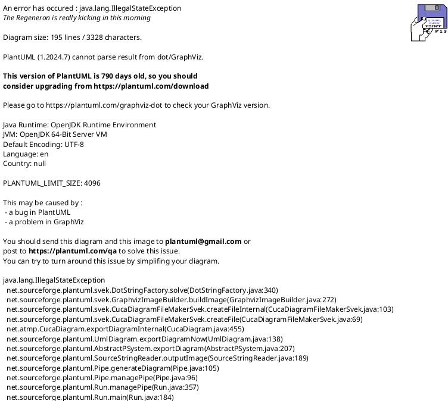

### 2.2 核心模块说明

| 模块 | 代码位置 | 职责 |
|------|---------|------|
| **接口层** | `main.py` | Flask Web 服务，提供日志解析和异常检测 REST 接口 |
| **上下文管理** | `src/data_process/log_context.py` | 管理全局状态：Drain 树映射、PIPLUP 实例、白名单、稳态学习、日志仓库 |
| **日志解析** | `src/data_process/template_extractor/` | PIPLUP / Drain 双引擎日志模板提取，含预处理、后处理、LLM 智能格式学习 |
| **语义异常检测** | `src/anomaly_detection/semantic_anomaly/` | 基于 BERT 嵌入 + 异常基线相似度匹配的日志内容异常检测 |
| **参数异常检测** | `TIG-2026/dme_platform/` | 规则模糊匹配优先；未命中时进入可开关的模板无关 AI 管道，输出日志级状态和可定位的参数证据 |
| **数量异常检测** | `src/anomaly_detection/quantitive_anomaly/` | 基于 k-sigma 留一法的日志频率突变检测 |
| **结果融合** | `src/anomaly_detection/anomaly_detection.py` | 三路检测结果按三元组去重合并，生成异常事件与诊断报告 |
| **模型层** | `src/anomaly_detection/semantic_anomaly/bert_model/` | LogNetMini（CPU）和 LogNetBig（NPU）双模型 |
| **预训练** | `pre_train/LogTokenizerTraining/` | 6步分词器训练流水线 + MLM 预训练 |

---

## 3. 模块交互与时序设计

### 3.1 核心交互时序

原图同时展开格式降级、解析器内部、三路检测和诊断细节，难以看清模块边界。这里拆成“解析入库”和“检测融合”两条主链路；各算法内部流程在对应技术章节中说明。

#### 3.1.1 解析入库

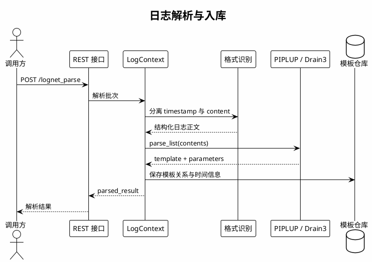

#### 3.1.2 检测与融合

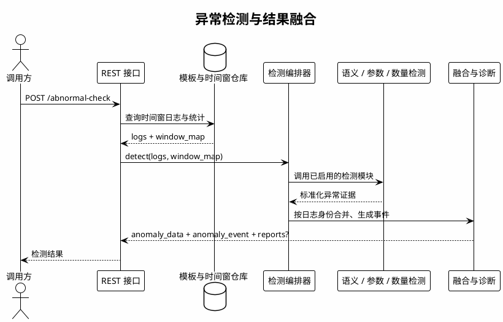


### 3.2 模块间交互接口

| 源模块 | 目标模块 | 接口方法 | 输入参数 | 返回值 |
|--------|---------|---------|---------|--------|
| main.py | LogContext | `parse_logs_piplup_adapter(log_info, context)` | `log_info: List[dict]`, `context: LogContext` | `List[dict]` (parse_results) |
| main.py | AnomalyDetection | `get_detector(mode, product).anomaly_detection(...)` | `source, module, start_time, end_time, window_size, repository, template_cache, white_list` | `(anomaly_data, anomaly_event[, reports])` |
| LogContext | LogFormatParser | `load_data(module, log)` | `module: str`, `log: str` | `(timestamp, content)` |
| LogContext | PIPLUP | `parser_piplup.parse_list(contents)` | `contents: List[str]` | `List[str]` (templates) |
| LogContext | LogTemplateRepository | `log_repository.add(LogTemplateRelation)` | `LogTemplateRelation(source, time, log_id, template_id, module, param_list)` | void |
| AnomalyDetection | SemanticAnomalyDetector | `detect(source, module, k_sigma, window_map, template_cache, white_list_dict)` | 6参数 | `(data, event)` |
| AnomalyDetection | QuantityAnomalyDetector | `detect(source, module, window_map, template_cache, white_list, k_sigma)` | 6参数 | `(data, event)` |
| AnomalyDetection / 离线评测器 | DetectionPipeline | `detect(log_text, ts=None, source=None, module=None, object=None)` | 原始日志、时间与流身份 | `DetectionOutput(status, score, evidence, param_predictions)` |
| DetectionPipeline | RuleFallbackDetector | `match(log_text)` | 原始日志 | `None` 或确定性 `DetectionOutput` |
| DetectionPipeline | TemplateFreeParser | `match(log_text)` | 规则未命中的原始日志 | `ParseResult`（含参数原文区间） |
| DetectionPipeline | FusionEngine | `fuse(parse_result, strategy_results)` | 解析结果与标准化策略证据 | 四态 `DetectionOutput` |
| AnomalyDetection | merge_results | `merge_results(semantic_data, parametric_data, quantitative_data)` | 3路结果列表 | `(combined_data, anomaly_event)` |
| SemanticAnomalyDetector | LogNetMini/Big | `model(input_ids, attention_mask)` | Tensor | `embeddings / logits` |
| DetectionPipeline | model package v5 | `save(path)` / `load(path)` | 模型目录 | 可复现的冻结推理管道 |

---

## 4. 关键技术点一：免人工配置异构日志解析

### 4.1 技术概述

传统日志解析方案（如 Drain3）需要为每种日志格式预配置正则表达式，且对参数变量的识别依赖固定规则。LogNet3.0 通过 **PIPLUP 算法** + **LLM 智能格式学习引擎** + **自动预处理剪枝** 三层机制，实现真正的"免人工配置"。

### 4.2 PIPLUP 算法核心设计

PIPLUP（Prefix-tree Indexed Parsing with LLM-assisted Universal Processing）是自研的日志模板解析算法，核心代码位于 `src/data_process/template_extractor/parsing_algorithm/PIPLUP.py`。

**模块输入示例**：`receive data from 192.168.1.100 failed, error code 0x80010001`

**模块输出示例**：`receive data from <*> failed, error code <*>`，并关联对应模板簇。

**具体职责**：消费格式识别模块分离出的日志正文，通过预处理、索引检索、相似度匹配和模板演化生成稳定模板。模板结果交给仓库及后续异常检测模块使用。

#### 4.2.1 数据结构

PIPLUP 采用**双层前缀树**结构：

```
shallow_tree (浅层索引)          storage_tree (深层存储)
┌──────────────────────┐       ┌─────────────────────────────────┐
│ "None": [cluster1,   │       │ "None": {                       │
│         cluster2,...]│       │   7: [cluster1, cluster3],      │
│ "recv": [cluster3,   │       │   5: [cluster2]                 │
│         cluster4,...]│       │ },                              │
│ "start": [cluster5]  │       │ "recv": {                       │
└──────────────────────┘       │   8: [cluster3, cluster4],      │
                                │   6: [cluster5]                 │
  按 frequent word 分组          │ }                               │
  (常量词作为一级索引)            └─────────────────────────────────┘
                                  按 frequent word + 序列长度 二级索引
```

- **shallow_tree**：`dict[str, List[Logcluster]]`，以常量词（frequent word）为键，快速缩小搜索范围
- **storage_tree**：`dict[str, dict[int, List[Logcluster]]]`，在常量词基础上再按序列长度分组
- **Logcluster**：每个聚类簇维护 `logTemplate`（当前模板）、`pathList`（分支路径列表，最多 `br_thresh` 条）、`templateList`（后处理后的候选模板集合）、`hit_time`（命中次数）

#### 4.2.2 解析流程

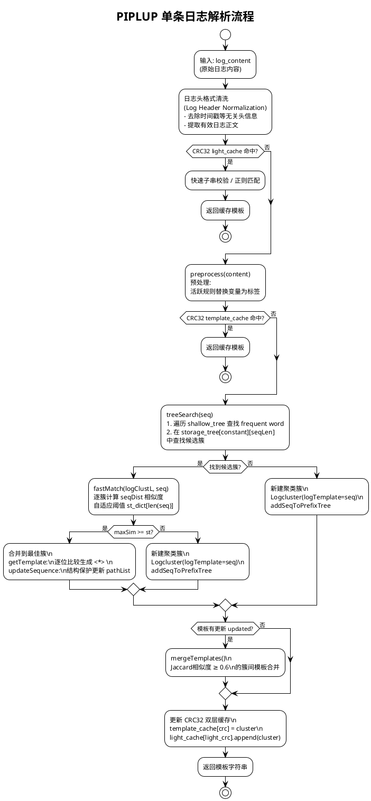

#### 4.2.3 自适应相似度阈值

PIPLUP 不使用固定相似度阈值，而是按日志序列长度自适应选择（`PIPLUP.py:146-158`）：

```python
self.st_dict = {
    1: 1,           # 1个token：必须完全匹配
    2: (2-1)/2,     # 2个token：允许0.5差异
    3: (3-1)/3,     # 3个token：允许0.33差异
    4: (4-1)/4,
    5: (5-2)/5,     # 5个token：允许0.6差异
    6: (6-2)/6,
    7: (7-3)/7,
    8: (8-3)/8,
    9: (9-3)/9,
    'others': 0.5   # 超过9个token：固定0.5
}
```

**设计原理**：短日志对参数变化更敏感，需要更严格的阈值；长日志包含更多常量词，可以容忍更多参数位置差异。

#### 4.2.4 CRC32 双层缓存

为加速重复日志的解析，PIPLUP 实现了两级 CRC32 缓存：

| 缓存层级 | 位置 | 键 | 计算方式 | 命中效果 |
|---------|------|---|---------|---------|
| **light_cache** | 预处理前 | `CRC32(数字替换为0后的日志)` | `_light_digit_re.sub('0', content)` → CRC32 | 跳过预处理，通过快速子串校验或正则匹配返回缓存模板 |
| **template_cache** | 预处理后 | `CRC32(预处理后日志)` | `' '.join(logmessageL)` → CRC32 | 跳过树搜索步骤 |

在重复日志高占比的生产场景下，大部分解析降为 O(1) 查表操作。

#### 4.2.5 常量词自动发现（模板演化）

当模板发生变化（`oldTemplate != newTemplate`）或命中次数达到 `update_population`（默认385次），且当前仍在 `'None'` 分组（`first_constant == 'None'`）时，自动提取分组依据（`PIPLUP.py:512-545`）：

1. 遍历当前模板中的 token，找到第一个不含 `<*>` 的常量词
2. 将该常量词作为 frequent word 加入 `shallow_tree` 和 `storage_tree`
3. 从 `'None'` 分组中迁移所有包含该常量词的簇到新分组
4. 后续日志优先按 frequent word 检索，大幅缩小候选集


#### 4.2.6 后处理：LUNAR 模板校正

`postprocessing.py` 实现模板规范化，主要规则包括：

- **输入示例**：`path = "<*>.<*>"  status = <*>`
- **输出示例**：`path = <*> status = <*>`
- **职责**：消除聚类结果中由标点、连续占位符和赋值形式引入的伪差异，将规范化模板返回 PIPLUP 更新缓存和模板仓库。

- 连续变量折叠：`<*>.<*>` → `<*>`，`<*>,<*>` → `<*>`
- 赋值泛化：`= value` → `= <*>`
- 标点包裹简化：`"<*>"` → `<*>`
- 多空格压缩为单空格

### 4.3 预处理引擎与自动剪枝

**模块输入示例**：`pid:53912,tid:53969 connect 192.168.1.1:8080`

**模块输出示例**：pid:`<*>,tid:<*> connect <*>`，同时返回本条日志命中的模式类型。

**具体职责**：在 PIPLUP 检索前将高变参数替换为统一占位符，并从样本中自动筛选有效规则。处理后的 token 序列直接进入 PIPLUP 索引和相似度匹配。

#### 4.3.1 活跃规则集与执行顺序

`preprocessing.py` 当前的 DME `sequence` 含 30 种活跃规则。文档不展开每条正则的底层写法，只保留对算法结果有影响的分类和顺序原则：

| 规则组 | 典型模式 | 目的 |
|---|---|---|
| 日志头与时间 | `datetime_full`、`kernel_uptime`、`epoch_ms_13d`、`log_level` | 先消除与业务模板无关的日志头差异 |
| 运行时身份 | `pid_tid_pair`、`serial_num`、`device_serial` | 屏蔽进程、线程和设备实例波动 |
| 结构化复合值 | `brace_hex_value_pair`、`hex_dump`、`embedded_hex`、`xnet_ctx_id` | 先匹配特化结构，避免被通用数字规则切碎 |
| 地址与路径 | `url`、`IPv4_port`、`IPv6`、`Mac_address`、`path` | 统一网络与文件定位参数 |
| 通用值 | `duration`、`size`、`numerical`、`weekday_months` | 作为后置通用兜底 |

执行顺序遵循“复杂、特化模式优先，通用数字模式最后”。部分原业务正则已由 token 内结构合并机制承接，不再重复放入活跃规则集。

#### 4.3.2 正则模式自动剪枝

```python
# PIPLUP.py:454-466
if idx < 2000:
    logmessageL, sequence, matched = preprocess(content, estimation_stage=True)
    matched_types.extend(matched)
    use_sequence = sequence
else:
    if idx == 2000:
        matched_types = set(matched_types)
        use_sequence = [i for i in use_sequence if i in matched_types]
    logmessageL = preprocess(content, estimation_stage=False, use_sequence=use_sequence)
```

**机制**：前 2000 行日志进入估算阶段，记录哪些正则实际命中；第 2001 行起只保留命中的正则，减少无效替换开销。这是"免人工配置"的核心体现——**系统自动学习哪些预处理规则对当前数据集有效**。

### 4.4 LLM 智能格式学习引擎

`LogAutoParsingEngine.py` 实现了当预置正则无法匹配日志格式时，自动调用 LLM 生成新的正则规则。

**模块输入示例**：一条现有格式规则无法分离时间戳和正文的原始日志。

**模块输出示例**：`{"timestamp": "2026-09-15 10:00:00", "content": "disk read failed"}`，以及通过本地验证的候选格式规则。

**具体职责**：只在本地格式规则未命中时生成候选规则，经回放验证成功后才供格式解析器使用。它解决日志头格式的冷启动问题，不参与模板聚类或异常判定。

#### 4.4.1 核心流程

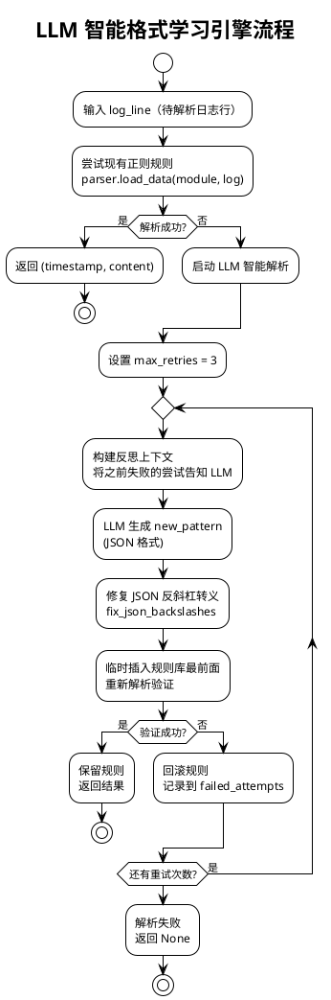

#### 4.4.2 反思机制

```python
# LogAutoParsingEngine.py:84-91
def _generate_pattern_with_reflection(self, log_line, failed_patterns):
    reflection_context = ""
    if failed_patterns:
        reflection_context = "\n【注意：以下是你之前的错误尝试，请不要重复使用，并分析其匹配失败的原因】:\n"
        for i, p in enumerate(failed_patterns):
            reflection_context += f"{i + 1}. {p}\n"
    prompt = build_prompt(log_line, reflection_context)
```

每次失败后，将错误尝试告知 LLM，避免重复犯错，实现反思式学习。

### 4.5 复杂度分析

| 算法 | 检索复杂度 | 空间复杂度 | 备注 |
|------|-----------|-----------|------|
| Drain3 | O(d+k) 平均, O(n) 最坏 | O(n·d) | d=树深度, k=候选簇数 |
| PIPLUP | O(\|C\|+k) 平均 | O(n·br_thresh) | C=常量词数, br_thresh=分支阈值 |
| PIPLUP + CRC32缓存 | O(1) 缓存命中 | O(m) | m=缓存条目数, 重复日志场景 |

### 4.6 端到端解析示例

**输入日志（DME osd 模块）**：
```
[2026-02-04 11:39:58][12345][ERR][osd.123][dsware][plog][osd][run][blk-12345] receive data from 192.168.1.100:8080 failed, error code 0x80010001, pid:53912,tid:53969
```

**解析过程**：
1. `LogFormatParser.load_data("osd", log)` 匹配 `format_chaos.json` 中 osd 的多组备选正则，提取 `timestamp=2026-02-04 11:39:58`, `content=receive data from ...`
2. `preprocess(content)` 按剪枝后的活跃规则集执行替换（`use_keys=False` 时替换为 `<*>`）：
   - `192.168.1.100:8080` → `<*>`
   - `0x80010001` → `<*>`
   - `pid:53912,tid:53969` → `<*>`
   - `blk-12345` → `<*>`
3. `PIPLUP.treeSearch()` 在 storage_tree 中查找，未命中 → 新建聚类簇
4. `postprocessing.correct_single_template()` 规范化模板
5. **输出模板**：`receive data from <*> failed, error code <*>`

---

## 5. 关键技术点二：模板无关自适应参数异常检测

### 5.1 技术定位与对外契约

该能力由 `TIG-2026/dme_platform/` 实现，当前定位是**参数异常检测验证平台**，不是已经完成生产化的告警服务。它不要求调用方预先提供固定模板 ID，而是从正常日志学习模板、参数角色和行为基线；同时保留外部专家规则作为最高优先级的确定性通道。

**模块输入示例**：

```json
{
  "ts": 1725963825,
  "source": "node-01",
  "module": "xnet",
  "object": "lwp-8",
  "log_text": "Xnet send msg(0x25e...(mid:437) -- 0x247...(mid:297), time use=15280(us), SNO=2283111033000000001, reqSNO=0, msg type=1, plane=1, xnetRet=0."
}
```

**模块输出示例**：

```json
{
  "status": "normal",
  "score": 0.08,
  "strategies": {
    "statistical": 0.04,
    "sequence": 0.00,
    "context": 0.08,
    "vae": 0.03
  },
  "evidence": [],
  "dq_issues": [],
  "param_predictions": []
}
```

**具体职责**：先用专家规则处理已知高确定性模式；规则未覆盖时，再完成模板无关解析、参数语义与行为建模、多策略检测、校准融合和参数区间定位。输出使用 `normal / anomaly / data_quality / parse_variant` 四态契约，避免把解析失败误报成业务异常。

上一模块的解析与仓储能力负责形成通用日志结构；本模块直接消费原始日志和流身份，在内部建立更细粒度的参数角色。其结果随后参与第 8 章的跨类型异常合并与故障诊断。

### 5.2 总体架构与正确检测逻辑

#### 5.2.1 模块化架构

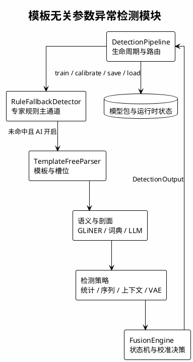

场景知识不写入通用检测核心，而由 `PluginSpec` 注入分隔符、masking 顺序、单位、哨兵、语义词典、操作名、参数角色和对象键。当前提供 DME 与 `generic_kv` 两个插件，用于验证核心逻辑能否跨场景复用。

#### 5.2.2 检测流水线与逻辑校正

原检测图存在四个问题：缺少规则优先分流；把动态阈值调整画成每条日志融合后的串行步骤；没有表达解析/值质量状态的优先级；也没有体现 AI 关闭时的安全拒判。正确流程如下。

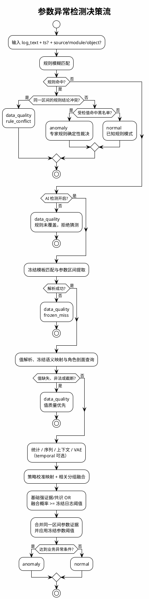

这里的“动态阈值”不是单条推理链路中的即时步骤。阈值有两种更新方式：

- 决策校准阶段使用带外部真值的独立数据，选择日志级和参数级阈值，随后冻结进入模型包；
- 运行反馈控制器只接受外部确认的 TP/FP/FN，并带调整上限与恶化回滚保护。

因此，当前日志的检测结果不能反过来充当自身标签并修改当前阈值，否则会形成自证循环和数据泄漏。

### 5.3 专家规则主通道

**模块输入示例**：

```text
Get ns async failed ret ( -99999 ) .
```

**模块输出示例**：

```json
{
  "status": "anomaly",
  "score": 0.95,
  "evidence": ["black_list:-99999"],
  "param_predictions": [
    {"role": "ret", "span": [26, 32], "raw_value": "-99999", "alert": true}
  ]
}
```

**具体职责**：对外部专家规则库中的已知模式作确定性裁决。规则命中后不再进入 AI，确保明确业务知识不被统计或模型分数稀释；未命中才把日志交给后续模板无关管道。

#### 5.3.1 模糊匹配

“模糊”只针对占位符值，而不是任意文本相似度：

1. 模板和日志按空白分词，token 数必须一致；
2. 固定 token 严格相等；
3. `<NUM>`、`<HEX0x>`、`<MAC-HEX>`、`<*>` 按值形态匹配；
4. 支持 `<NUM>.` 或 `prefix<HEX0x>` 等粘着前后缀，并同步收缩参数字符区间。

`param_pos` 使用 0-based token 下标。配置偏差 1 位时只在 ±1 存在唯一占位符候选时容错；无候选或有歧义均拒绝加载。规则文件只支持已经实现的 `black_list` 模式，未知模式 fail-closed，避免“看似加载成功、实际不检测”。

#### 5.3.2 裁决语义

- 黑名单比较：数值按数值等值，十六进制忽略大小写，其他字符串精确比较；
- 任一受检参数命中黑名单即异常；
- 多规则对同一字符区间给出冲突结论时返回 `data_quality`，不依赖规则文件顺序；
- 规则命中且值未命中黑名单时返回正常，这是规则库本身的已知模式语义。

规则未命中时，控制权回到 `DetectionPipeline`，由它判断进入 AI 分支还是安全拒判。

### 5.4 模板无关解析与统一参数表示

**模块输入示例**：

```text
Xnet send msg(... time use=15280(us), SNO=2283111033000000001, reqSNO=0, ...).
```

**模块输出示例**：

```json
{
  "matched": true,
  "operation": "xnet_send",
  "slot_values": [
    {
      "role": "time_use@tpl_pos",
      "raw_value": "15280",
      "unit": "us",
      "source_span": [71, 76],
      "value_state": "ok"
    }
  ]
}
```

**具体职责**：训练态从正常日志学习模板和槽位，推理态只做冻结匹配；把每个参数转换为可追溯的 `ParameterObservation`。输出直接供语义、剖面和策略层消费。

#### 5.4.1 训练态学习与推理态冻结

`TemplateFreeParser` 使用 Drain3 聚类，但不要求调用方提供固定模板。masking 管线由场景插件提供。训练结束后解析器冻结，推理时不创建新簇：

- 精确冻结匹配成功：输出参数值、模板位置和原文字符区间；
- 精确匹配失败：尝试占位符形态软匹配，以识别 `<NUM>` 到 `<BIGNUM>` 等格式漂移；
- 仍未匹配：返回 `frozen_miss`，由状态机路由为 `data_quality`。

这种设计避免异常日志在推理期被学习成“新的正常模板”。

#### 5.4.2 参数身份、值状态与位置

参数稳定身份为 `operation|role`，其中 role 由参数名和模板 token 位置共同构成；同名参数可根据上下文区分为 `src.mid`、`dst.mid`。每个参数保留：

- `raw_value` 与半开字符区间 `source_span=[start,end)`；
- 已知单位下的归一化值；未知单位不强制换算；
- `ok / zero / missing / invalid / sentinel` 五种值状态；
- 语义类型、语义来源与置信度；
- 流身份 `source × object`，用于隔离动态窗口。

缺失和非法值绝不静默转成 0。解析结果接下来进入语义映射与正常剖面查询。

### 5.5 语义映射与正常剖面

**模块输入示例**：

```json
{
  "operation": "xnet_send",
  "role": "time_use@12",
  "raw_value": "15280",
  "unit": "us",
  "left_context": "time use"
}
```

**模块输出示例**：

```json
{
  "semantic_type": "duration",
  "source": "gliner",
  "confidence": 0.86,
  "profile_key": "xnet_send|time_use@12"
}
```

**具体职责**：为结构化槽位补充“它是什么”和“正常情况下如何变化”两类信息。语义用于选择正确的特征与豁免逻辑，剖面为统计、序列、上下文和 VAE 提供正常基线。

#### 5.5.1 三层语义路径

语义提取按保守优先级执行：

```text
GLiNER（原文位置绑定 + 置信门槛）
  → 拒绝或低置信时使用插件词典
  → 仍未知时可选 LLM 补充
  → 无可靠证据则保留 other
```

GLiNER 是特征服务，不是独立异常检测策略。模型输出必须能绑定到当前日志的目标字符区间，并通过原文一致性与单位冲突检查；LLM 仅补充未知或低置信角色，结果受类型白名单约束。未知参数不会因为语义未识别而被丢弃。

训练期形成的 `(operation|role) → SemanticInference` 会冻结进模型包，推理期直接查表，不重复推断，以保证训练与推理表示一致。

#### 5.5.2 剖面与行为证据

`SlotProfileStore` 以 `operation|role` 累积数值范围、中位数、MAD、分位数和值频率。查找时优先使用样本充足的操作级剖面，冷启动才回退到语义类别先验。

`BehaviorProfile` 独立判断枚举、高基数、序列、计数器等行为。identifier 只有在“高基数 + 非枚举 + 非序列”的行为证据成立时才豁免幅值检测，不能仅凭语义标签跳过检测。完成剖面查询后，各策略基于同一参数身份并行产出标准化证据。

### 5.6 多策略参数检测

**模块输入示例**：

```json
{
  "operation": "xnet_send",
  "observations": [{"role": "SNO@18", "raw_value": "2283111032999999000"}],
  "stream": "node-01|lwp-8",
  "enabled_strategies": ["statistical", "sequence", "context", "vae"]
}
```

**模块输出示例**：

```json
[
  {
    "strategy": "sequence",
    "score": 0.94,
    "confidence": 0.90,
    "evidence": ["sequence_regression"],
    "param_predictions": [
      {"role": "SNO@18", "span": [82, 101], "anomaly_score": 0.94}
    ]
  }
]
```

**具体职责**：让不同证据源各自评分，但统一返回 `StrategyResult`；可定位策略必须附带 role、字符区间、原值和参数分数，供融合与参数级评估使用。

| 策略 | 关键原理 | 输出粒度 | 默认行为 |
|---|---|---|---|
| statistical | 中位数/MAD 稳健偏差、分位数、哨兵丢失、负值、新枚举、常量与形态漂移 | 参数级 | 启用 |
| sequence | 连续性回退/跳变、持续非零、积压、训练期学习的引用关系断裂 | 参数级 | 启用 |
| context | 同一流近期窗口的条件基线，当前聚焦 duration | 参数级 | 启用，但不能单独裁决 |
| vae | 全模板共享 DeepSets VAE 的重构误差 | 参数级 | 依赖 PyTorch、训练和误差校准 |
| temporal | 事件时间窗口、乱序拒绝、CUSUM 变点 | 日志级 | 显式开启 |

#### 5.6.1 稳健统计与序列规则

统计策略优先使用中位数和 MAD，降低极端样本对基线的污染；对跨数量级参数在合适的数值域评分。序列策略保存流内状态，检测计数器回退、异常跳变、持续异常值以及引用关系断裂。重建豁免必须由插件显式提供对象级重启依据，普通 ID 变化不能自动获得豁免。

#### 5.6.2 共享 VAE

共享 VAE 不是“一模板一模型”，而是所有模板共用一套权重。编码器接收上下文特征和值特征，解码器只接收潜变量和上下文嵌入，不携带真实值旁路，确保重构任务有效。值特征覆盖：

- 数值幅值、零值、哨兵和长度；
- 稳定哈希投影与字符构成，使同长度字符串仍可区分；
- 参数身份引用，使误差可映射回 role、原文区间和原值。

正常误差基准按“角色 → 值类别 → 全局共享”逐级回退。VAE 不允许以单一高分直接裁决业务异常，用于控制其已知误报风险。

各策略结果随后交给融合层；策略分数不是天然可比较的概率，必须经过校准或使用明确的基础规则。

### 5.7 融合、状态机与参数定位

**模块输入示例**：

```json
{
  "parse": {"matched": true, "has_value_dq": false},
  "strategy_results": [
    {"strategy": "statistical", "score": 0.92},
    {"strategy": "sequence", "score": 0.88},
    {"strategy": "context", "score": 0.30}
  ]
}
```

**模块输出示例**：

```json
{
  "status": "anomaly",
  "score": 0.91,
  "evidence": ["strong_statistical", "strategy_consensus"],
  "param_predictions": [
    {"role": "SNO@18", "span": [82, 101], "alert": true}
  ]
}
```

**具体职责**：按不可覆盖的状态优先级处理数据质量，再把策略分数转成最终业务结论，并把多策略证据合并到准确的原文参数区间。

#### 5.7.1 四态与优先级

| 状态 | 含义 | 典型触发 |
|---|---|---|
| `anomaly` | 业务参数异常 | 强单证据、策略共识或校准概率过阈值 |
| `data_quality` | 无法可靠作业务判断 | 解析失败、未见非法值、参数缺失或截断 |
| `parse_variant` | 在线接纳到新模板 | 仅显式在线学习路径产生 |
| `normal` | 未发现异常 | 其余情况 |

优先级固定为：**解析失败 > 值级数据质量 > 新模板事件 > 业务异常 > 正常**。校准概率不能把 DQ 或新模板事件覆盖成业务异常。

#### 5.7.2 校准融合

AI 基础判定由强单证据和策略共识构成；决策校准在此基础上增加概率路径：

```text
每策略原始分数
  → 每策略校准映射
  → 相关策略组内 max
  → 组间 noisy-OR
  → 融合概率与冻结日志阈值比较
```

最终业务判定为“基础判定成立”或“融合概率达到冻结阈值”。若校准条件不足，系统显式回退基础规则，不把未校准分数冒充概率。

参数预测以原文字符区间对齐。同一区间的多策略证据先合并，再分别与对应策略的冻结参数阈值比较，任一有效证据过阈值即报警。这样既避免同一参数重复计数，也不会用日志级报警冒充参数命中。

### 5.8 训练、校准与模型生命周期

**模块输入示例**：

```python
pipe.train(train_fit)
pipe.calibrate_error(train_error_cal)
pipe.calibrate_fusion(train_decision_cal)
pipe.save(model_dir)
result = pipe.detect(log_text, ts=ts, source=source, object=object_id)
```

**模块输出示例**：

```json
{
  "format_version": 5,
  "feature_version": 2,
  "plugin_id": "dme",
  "n_train_logs": 160000,
  "error_calibrated": true,
  "decision_calibrated": true
}
```

**具体职责**：明确分离“学正常模式”“估计正常误差”“选择最终决策阈值”和“冻结推理”四个阶段，防止训练数据、校准标签和测试数据互相泄漏。

#### 5.8.1 三段训练生命周期

| 阶段 | 数据 | 更新内容 | VAE 权重 |
|---|---|---|---|
| 正常拟合 `train` | 仅正常日志 | 模板、槽位剖面、序列/行为关系、VAE | 更新 |
| 误差校准 `calibrate_error` | 独立正常日志 | 日志级与参数级正常重构误差基准 | 冻结 |
| 决策校准 `calibrate_fusion` | 独立且带可信正常/异常标签的数据 | 策略映射、日志阈值、参数阈值 | 冻结 |
| 固定测试 | 未参与设计的数据 | 只计算指标 | 冻结且不可调参 |

规则命中的日志按真实路由直接裁决，不进入 AI 决策校准，也不推进回放窗口。校准与解释使用隔离副本，不能污染活跃运行时。

#### 5.8.2 模型包与运行时隔离

模型包格式为 v5，保存解析器、剖面、序列关系、行为证据、冻结语义、VAE 权重与误差基准、决策阈值、校准映射和反馈控制器。加载时校验格式版本、插件身份、配置签名、特征版本及必需文件摘要；任一不匹配即拒绝加载。

动态状态按 `source × object × operation × role` 的语义隔离。开始新的独立日志流时必须调用 `reset_runtime()`；连续流不能逐条重置。需要连续恢复时必须同时保存运行时检查点。

生命周期完成后，`DetectionOutput` 可稳定交给上层异常融合；模型重训、候选回放、切换和回滚通过插件路由器管理。

### 5.9 模块交互关系

| 上游模块 | 交互数据 | 下游模块 | 关键约束 |
|---|---|---|---|
| 调用方 / 日志接入 | `log_text, ts, source, module, object` | `DetectionPipeline` | 严格身份模式下 source、object 不得缺失 |
| `DetectionPipeline` | 原始日志 | `RuleFallbackDetector` | 命中即终止 AI 路由 |
| 规则通道 | 未命中 | `TemplateFreeParser` | AI 关闭时改为 DQ |
| 解析器 | `ParseResult + slot_values` | 语义与剖面层 | 必须保留原文字符区间 |
| 语义与剖面层 | `ParameterObservation` | 各检测策略 | 未知语义仍保留 |
| 各检测策略 | `StrategyResult` | `FusionEngine` | 策略分数不是天然概率 |
| 融合引擎 | `DetectionOutput` | 上层结果融合 / 参数对齐评估 | 状态优先级不可被校准覆盖 |
| 模型生命周期 | 模型包与运行时检查点 | 新管道实例 / PluginRouter | 不兼容模型 fail-closed |

### 5.10 复杂度、验证口径与已知边界

| 环节 | 主要开销 | 说明 |
|---|---|---|
| 规则匹配 | O(R·T) | R 为规则数，T 为 token 数；命中后短路 |
| 冻结模板匹配 | 近似 O(d+k) | d 为解析树深度，k 为候选簇 |
| 统计/序列/上下文 | O(P) | P 为单条日志参数数，窗口状态增量更新 |
| VAE | O(P·E) | E 为一次共享网络前向开销 |
| 融合与区间合并 | O(S+Q log Q) | S 为策略数，Q 为参数预测数 |

当前结果来自受控仿真与回归测试，只能证明接口、状态机、生命周期和评估链路按设计工作，不能等同于真实 DME 日志上的生产准确率。上线前仍需：

- 用脱敏真实日志按时间、来源、对象和故障事件隔离训练/校准/测试；
- 核验单位、码表、重建信号、正常范围和对象键；
- 评估参数级精确率/召回率、每千条误报、事件级召回、首检延迟及 P95/P99 延迟；
- 对高熵模板、合法边界值、未知枚举和结构漂移单独设验收集；
- 先以只读旁路方式运行，再决定是否进入正式告警链路。

### 5.11 端到端检测示例

下面分别展示规则命中和规则未命中两条路径。

#### 5.11.1 专家规则命中

**输入**：

```text
Get ns async failed ret ( -99999 ) .
```

**交互过程**：

1. `DetectionPipeline` 先调用规则检测器；
2. 固定 token 与占位符形态匹配，提取 `ret=-99999` 及其原文区间；
3. 数值等值命中黑名单；
4. 直接输出 `anomaly`，不调用解析器、GLiNER、VAE 或融合校准。

**输出**：

```json
{
  "status": "anomaly",
  "score": 0.95,
  "strategies": {"rule_fallback": 0.95},
  "evidence": ["template_id=10305", "ret in black_list"],
  "param_predictions": [
    {
      "role": "ret",
      "raw_value": "-99999",
      "span": [26, 32],
      "source": "rule_fallback",
      "alert": true
    }
  ]
}
```

#### 5.11.2 AI 模板无关路径

**输入**：

```text
Xnet send msg(... time use=15280(us), SNO=2283111032999999000, reqSNO=0, msg type=1, plane=1, xnetRet=0.
```

**交互过程**：

1. 专家规则未命中，且 `use_ai_detection=true`；
2. 冻结解析器匹配到 `xnet_send`，提取 `time_use`、`SNO`、`reqSNO` 等参数及字符区间；
3. 冻结语义将 `time_use` 映射为 duration，行为剖面将 `SNO` 识别为序列；
4. 统计策略判断耗时是否偏离正常剖面，序列策略检测 SNO 回退，其他策略提供补充证据；
5. 融合器先检查 DQ，再应用强证据/共识与冻结阈值；
6. 参数证据按 SNO 的原文区间合并，输出日志级异常和参数级定位。

**示意输出**：

```json
{
  "status": "anomaly",
  "score": 0.94,
  "strategies": {
    "statistical": 0.22,
    "sequence": 0.94,
    "context": 0.12,
    "vae": 0.31
  },
  "evidence": ["sequence_regression"],
  "dq_issues": [],
  "param_predictions": [
    {
      "role": "SNO@18",
      "raw_value": "2283111032999999000",
      "span": [82, 101],
      "source": "sequence",
      "anomaly_score": 0.94,
      "alert": true
    }
  ]
}
```

该输出继续进入第 8 章的跨类型结果融合；若解析失败或值缺失，则在本模块内以 `data_quality` 结束，不进入业务异常合并。

---


## 6. 关键技术点三：分词增强语义异常检测

### 6.1 技术概述

语义异常检测的目标是识别日志内容本身的异常（如出现不应出现的错误信息、异常组合等）。LogNet3.0 通过**领域专用分词器训练** + **多粒度滑动窗口嵌入** + **异常基线相似度匹配**三层机制实现"分词增强"的语义异常检测。

### 6.2 领域分词器训练流水线

`pre_train/LogTokenizerTraining/` 实现了 6 步分词器训练流水线：

**模块输入示例**：包含 `TP_IPC_SERVER_MAGIC_FAIL`、错误码和驼峰标识符的脱敏日志语料。

**模块输出示例**：领域词表、SentencePiece 模型、扩展后的 BERT tokenizer 及 MLM 继续预训练权重。

**具体职责**：从日志语料中发现需要整体保留的领域词，扩展通用词表并让模型适应日志文本分布。训练产物交给 LogNetMini/Big 加载。

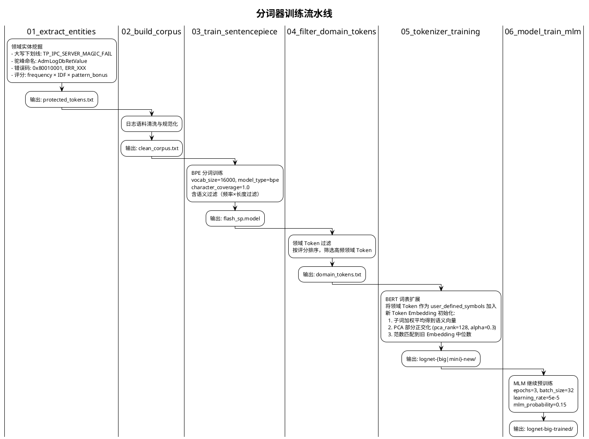

### 6.3 双模型架构

**模块输入示例**：`input_ids + attention_mask`，内容由领域分词器编码。

**模块输出示例**：token 级静态嵌入；NPU 版本可同时输出句子级嵌入和分类 logits。

**具体职责**：为语义异常检测提供统一的向量表示；Mini 面向 CPU 低资源场景，Big 面向 NPU 吞吐和多头判定场景。

#### 6.3.1 LogNetMini（CPU 场景）

| 参数 | 值 | 说明 |
|------|---|------|
| D_MODEL | 64 | 隐藏维度 |
| N_LAYERS | 1 | Transformer 层数 |
| N_HEADS | 1 | 注意力头数 |
| max_len | 512 | 最大序列长度 |
| 模型文件 | `lognet-mini/model.pth` | 本地权重 |

**特点**：轻量级 BERT，仅提取 token 级静态嵌入，适合 CPU 推理。

#### 6.3.2 LogNetBig（NPU 场景）

| 参数 | 值 | 说明 |
|------|---|------|
| hidden_size | 768 | 隐藏维度 |
| num_hidden_layers | 12 | Transformer 层数 |
| vocab_size | 31582 | 词表大小 |
| max_position_embeddings | 514 | 最大位置编码长度 |
| 基础模型 | MPNet | 预训练骨干网络 |
| 模型文件 | `lognet-big/` | 含 `LogNetUnified`（统一模型） |

**特点**：基于 MPNet 的 12 层大模型，同时输出 static（token 级）和 contextual（sentence 级）嵌入 + 分类 logits。

### 6.4 语义异常检测核心流程

**模块输入示例**：`["metadata corruption found in <*> node"]`，输入前已由上游过滤白名单。

**模块输出示例**：`{"templateId": 42, "anomalyType": ["semantic"], "summary": ["日志内容异常请检查"]}`。

**具体职责**：对模板文本编码，构造多粒度短语嵌入，并与异常基线比较。输出的语义异常证据交给第 8 章融合，不直接生成故障结论。

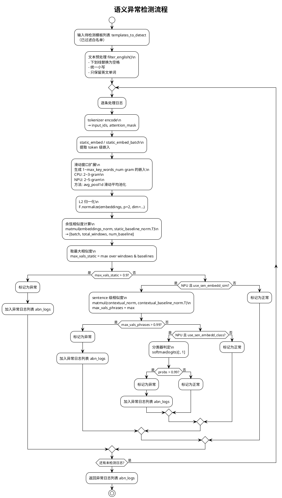

### 6.5 关键算法详解

#### 6.5.1 滑动窗口多粒度嵌入

```python
# semantic_anomaly.py:419-427 (CPU 版本)
def static_embed(self, static_inputs):
    static_embeddings = self.static_embedding(static_inputs).squeeze(0).detach()[1:]
    max_key_words_num = 5 if self.device.upper()=='NPU' else 3
    extend_embeddings = []
    for l in range(2, max_key_words_num+1):
        extend_embeddings.extend(
            [torch.mean(static_embeddings[i:i+l], dim=0) 
             for i in range(len(static_embeddings)-l+1)]
        )
    if len(extend_embeddings):
        static_embeddings = torch.cat((static_embeddings, torch.stack(extend_embeddings, dim=0)), dim=0)
    return static_embeddings
```

**原理**：
- 单 token 嵌入只能捕获词级异常
- 2~5-gram 滑动窗口平均池化生成多粒度短语嵌入
- 将原始 token 嵌入与所有 n-gram 嵌入拼接，形成丰富的特征表示
- **分词增强的体现**：领域专用分词器确保关键术语不被切碎，滑动窗口在完整语义单元上生成嵌入

#### 6.5.2 批量推理优化（NPU）

```python
# semantic_anomaly.py:429-482 (NPU 批量版本)
def static_embed_batch(self, static_embeddings, mask):
    static_embeddings = static_embeddings[:, 1:, :]  # 去掉 CLS
    mask = mask[:, 1:]
    batch, seq_len, emb_dim = static_embeddings.shape
    max_key_words_num = 5
    extend_embeddings = [static_embeddings]
    extend_masks = [mask]
    
    emb_t = static_embeddings.transpose(1, 2)  # [batch, emb, seq]
    mask_t = mask.unsqueeze(1)  # [batch, 1, seq]
    
    for l in range(2, max_key_words_num + 1):
        if seq_len < l:  # 短序列保护：序列长度不足时跳过当前窗口
            continue
        sum_pool = F.avg_pool1d(emb_t * mask_t, kernel_size=l, stride=1) * l
        counts = F.avg_pool1d(mask_t, kernel_size=l, stride=1) * l
        counts = counts.clamp(min=1e-6)
        window_avg = (sum_pool / counts).transpose(1, 2)
        window_mask = (counts.squeeze(1) > 0).float()
        extend_embeddings.append(window_avg)
        extend_masks.append(window_mask)
    
    return torch.cat(extend_embeddings, dim=1), torch.cat(extend_masks, dim=1)
```

**优化点**：使用 `F.avg_pool1d` 替代 Python 循环，在 GPU/NPU 上实现高效的批量滑动窗口池化。

#### 6.5.3 三层 OR 判定机制（NPU）

```python
# semantic_anomaly.py:384-390
final_mask = torch.zeros(len(logs), dtype=torch.bool, device=support_device)
final_mask |= (max_vals_static > self.static_threshold)          # 静态 token 级
if self.use_sen_embedd_sim:
    final_mask |= (max_vals_phrases > self.contextual_threshold_sim)  # 上下文相似度
if self.use_sen_embedd_class:
    final_mask |= (probs > self.contextual_threshold_class)           # 分类器
abnormal_indices = final_mask.nonzero().flatten().cpu().tolist()
```

| 层级 | 阈值 | 检测能力 |
|------|------|---------|
| 静态 token 级 | 0.9 | 关键词异常、错误码异常 |
| 上下文相似度 | 0.99 | 短语组合异常、语义偏移 |
| 分类器 | 0.99 | 端到端学习的异常模式 |

三层判定采用 OR 逻辑，任一层级触发即判定为异常，实现互补检测。

#### 6.5.4 异常基线

异常基线 `abn_baseline_{case}_{device}.json` 是预计算的异常日志嵌入向量库：

```json
{
  "static_baseline_norm": [[...768维向量...], ...],
  "contextual_baseline_norm": [[...768维向量...], ...]
}
```

检测时计算输入日志嵌入与基线的最大余弦相似度，超过阈值即判异常。基线由历史标注的异常日志通过模型编码并 L2 归一化后生成。

> **部署注意**：`abn_baseline_DME_NPU.json` 存在于 `pre_train/LogTokenizerTraining/configurations/` 目录，运行时需手动复制到 `src/anomaly_detection/semantic_anomaly/configurations/` 目录下，否则 DME NPU 场景语义检测将因基线文件缺失而无法加载。

#### 6.5.5 动态分桶

```python
# semantic_anomaly.py:295-322
def bucketize_logs(self, logs, max_bucket_diff=20):
    tokens = self.static_tokenizer(logs, padding=False)
    lengths = [len(x) for x in tokens['input_ids']]
    sorted_idx = sorted(range(len(logs)), key=lambda i: lengths[i])
    buckets = []
    current_bucket = []
    last_len = None
    for idx in sorted_idx:
        l = lengths[idx]
        if last_len is None or l - last_len <= max_bucket_diff:
            current_bucket.append(idx)
        else:
            buckets.append(current_bucket)
            current_bucket = [idx]
        last_len = l
    if current_bucket:
        buckets.append(current_bucket)
    return buckets
```

按 token 长度分桶，同桶内 padding 到相同长度，减少 padding 浪费，提升推理效率。

### 6.6 分词增强的完整链路

```plantuml
@startuml Tokenizer_Enhancement
!theme plain
title 分词增强语义理解链路

|训练阶段|
:1. 领域实体挖掘
TP_IPC_SERVER_MAGIC_FAIL → 保护为完整 Token;
:2. BPE 训练
在日志语料上学习子词单元;
:3. 词表扩展
将领域 Token 作为 user_defined_symbols
加入 BERT 词表;
:4. Embedding 初始化
新 Token = 子词加权平均 + PCA正交化 + 范数匹配;
:5. MLM 预训练
在日志语料上继续训练，适应日志文本分布;

|推理阶段|
:6. 领域分词器 tokenize
TP_IPC_SERVER_MAGIC_FAIL → [TP_IPC_SERVER_MAGIC_FAIL]
(而非 [TP, _IP, C, _SERVER, ...]);
:7. 滑动窗口多粒度嵌入
1~5-gram 嵌入捕获不同粒度的异常模式;
:8. 异常基线相似度匹配
与历史异常嵌入计算余弦相似度;
:9. 三层 OR 判定
静态 + 上下文 + 分类器互补;

@enduml
```

### 6.7 端到端检测示例

**场景**：DME 存储集群 NPU 节点语义异常检测

**异常基线**（`abn_baseline_DME_NPU.json`）包含历史异常日志的嵌入：
- "disk sector read error unrecoverable"
- "cache data loss detected in volume"
- "metadata corruption found in btree node"

**输入模板**：
```
metadata corruption found in <*> node
```

**检测过程**：
1. `filter_english()`: `metadata corruption found in node`（去除 `<*>` 和标点）
2. `tokenizer encode`: `[CLS] metadata corruption found in node [SEP]` → 7 tokens
3. `static_embed_batch()`: 生成 7（1-gram）+ 6（2-gram）+ 5（3-gram）+ 4（4-gram）+ 3（5-gram）= 25 个窗口嵌入
4. L2 归一化后与基线计算相似度矩阵 `[1, 25, num_baseline]`
5. `max_vals_static = 0.94`（与基线 "metadata corruption found in btree node" 的 4-gram 嵌入高度相似）
6. `0.94 > 0.9` → **静态层判定异常**
7. 输出：`{anomalyType: ["semantic"], summary: ["日志内容异常请检查"]}`

---

## 7. 数量异常检测

### 7.1 算法原理

数量异常检测器（`quantitive_detector.py`）基于两种策略：

**模块输入示例**：某模板在连续时间窗中的计数 `[12, 11, 13, 12, 95]`，以及白名单和时间窗大小。

**模块输出示例**：`{"templateId": 42, "timestamp": 1725963825, "log_count": 95, "score": 47}`。

**具体职责**：从模板仓库按时间窗汇总出现次数，检测新模板和频次突变。结果与语义、参数检测使用同一日志身份交给融合模块。

#### 7.1.1 新增模板检测

```python
# quantitive_detector.py:171-191
def find_new_templates_based_on_seq(previous_data, current_data, previous_time_interval, white_list={}):
    prev_data_seq = previous_data['event'] if previous_data else []
    cur_data_seq = current_data['event']
    if sum(prev_data_seq) == 0 and cur_data_seq and str(id) not in white_list:
        for i in range(len(cur_data_seq)):
            if cur_data_seq[i] > 0:
                all_id_results.append(id)
                all_times.append(current_data['time'][i])
                all_counts.append(cur_data_seq[i])
                return ...
```

白名单外且历史无出现的模板 → 标记为新增异常。

#### 7.1.2 k-sigma 突变检测（留一法）

```python
# quantitive_detector.py:198-230
def find_change_templates_based_on_sigma(current_data, time_interval, k_sigma=3):
    arr = np.array(cur_data_seq)
    sum_all = np.sum(arr)
    sum_of_squares_all = np.sum(arr ** 2)
    n = len(cur_data_seq)
    for i in range(n):
        # 留一法：去除当前点后计算均值和标准差
        sum_without_x = sum_all - cur_data_seq[i]
        mean = sum_without_x / (n - 1)
        variance = (sum_of_squares_all - cur_data_seq[i]**2 - sum_without_x**2/(n-1)) / (n-1)
        std = math.sqrt(variance)
        # 判定：偏离 k_sigma 倍标准差且绝对差值 > 10
        if abs(cur_data_seq[i] - mean) > k_sigma * std and abs(cur_data_seq[i] - mean) > 10:
            # 记录突变
```

**留一法**：计算去除当前窗口后的均值/标准差，避免异常点自身影响统计量。函数默认 `k_sigma=3`，生产配置中调用方传入 `k_sigma=6`，同时要求绝对差值 > 10 防止低频日志的误报。

#### 7.1.3 评分机制

```python
# quantitive_detector.py:137-168
@staticmethod
def assign_scores(result_dict, order_key, max_score, min_score):
    # 正态分布 CDF 映射分数
    ranks = np.arange(1, num_templates + 1)
    group_scores = norm.ppf((ranks - 0.5) / num_templates) * std_dev + mean_score
    group_scores = np.clip(group_scores, min_score, max_score).round().astype(int).tolist()
```

使用正态分布的百分位点（`scipy.stats.norm.ppf`）将异常程度映射为分数区间，新增模板 [50, 99]，突变模板 [1, 49]。

---

## 8. 异常检测结果融合与故障诊断

### 8.1 三路检测结果融合

`anomaly_detection.py:279-374` 的 `merge_results` 方法实现三路检测结果融合：

**模块输入示例**：语义、参数、数量三路检测器输出的列表，元素均带 `template_id`、`log_id`、`timestamp`。

**模块输出示例**：`{"logId": "L-7", "templateId": 42, "anomalyType": ["parametric", "semantic"]}`及对应时间窗事件。

**具体职责**：按稳定日志身份去重、保留同一日志的多种异常类型，再按时间窗聚合成事件。DME 事件继续交给指纹库诊断。

```python
@staticmethod
def merge_results(semantic_data, parametric_data, quantitative_data):
    # 按 (template_id, log_id, timestamp) 三元组去重合并
    anomaly_data_dict = defaultdict(dict)
    for data in semantic_data:
        anomaly_data_dict[(template_id, log_id, timestamp)]["semantic"] = metadata
    for data in parametric_data:
        anomaly_data_dict[(template_id, log_id, timestamp)]["parametric"] = metadata
    for data in quantitative_data:
        anomaly_data_dict[(template_id, log_id, timestamp)]["quantitative"] = metadata
    
    # 生成 anomalyType 列表（可同时命中多种异常）
    for data in anomaly_data:
        one_data = {"logId": ..., "timestamp": ..., "templateId": ...}
        if "parametric" in data["metadata"]:
            one_data["anomalyType"] = ["parametric"]
            one_data["summary"] = [f"日志参数异常,异常参数为 {parameter}"]
        if "quantitative" in data["metadata"]:
            times = data["metadata"]["quantitative"]["log_count"]
            if "anomalyType" in one_data:
                one_data["anomalyType"].append("quantitative")
            else:
                one_data["anomalyType"] = ["changeRecord"]
            one_data["summary"].append(f"日志频率异常,当前时间窗内出现{times}次")
        if "semantic" in data["metadata"]:
            one_data["anomalyType"].append("semantic")
            one_data["summary"].append("日志内容异常请检查")
```

**融合逻辑**：
- 同一条日志可能同时被多种检测器标记为异常
- 按 `(template_id, log_id, timestamp)` 三元组去重
- `anomalyType` 为列表，可包含 `parametric`、`quantitative`（或仅数量异常时为 `changeRecord`）、`semantic` 的任意组合
- 按时间戳聚合为 10 分钟时间窗的 `anomaly_event`

### 8.2 指纹库故障诊断（DME 专用）

**模块输入示例**：一个时间窗内去重后的异常模板集合，以及指纹库中的线索模板、权重和案例阈值。

**模块输出示例**：`{"caseID": "CASE_JH_023", "case_name": "控制器内部 CDR 芯片异常", "case_score": 1.12}`。

**具体职责**：将异常事件中的模板与已知故障线索模糊匹配，累加权重并在达到案例阈值时生成诊断候选。该模块消费融合事件，输出仅是候选故障，不改写原始检测证据。

```python
# anomaly_detection.py:91-115
for event in anomaly_event:
    for case_name, case_data in finger_print.items():
        case_score = 0
        for template in templates_unique:
            for finger_print in case_data["clues"]:
                for s, weight in finger_print.items():
                    if same_template(s, template):  # 模糊匹配
                        case_score += weight
        if case_score > thresh:  # thresh=0.95
            reports.append({"case_name": ..., "case_score": ..., ...})
```

**指纹库结构**（`finger_print_lib.json`）：
```json
{
  "case1": {
    "caseName": "控制器内部CDR芯片异常",
    "caseID": "CASE_JH_023",
    "clues": [{"模板字符串": 权重}, ...],
    "threshold": 0.95
  }
}
```

**匹配逻辑**：
1. 对每个异常事件中的模板，与指纹库线索模板做 `same_template` 模糊匹配
2. `same_template` 要求 token 数一致、至少 2 个 token 精确匹配、通配符位置兼容
3. 累加匹配到的线索权重，超过阈值则生成故障诊断报告

> **阈值来源差异**：`anomaly_detection` 方法（单案例检测）中阈值硬编码为 `thresh = 0.95`；`all_detect` 方法（全量检测）中阈值从指纹库配置 `case_data["threshold"]` 动态读取，各案例可配置不同阈值。

---

## 9. 接口规格定义

### 9.1 日志解析接口

```
POST /lognet_parse
Content-Type: application/json
```

**请求体**：
```json
{
    "logInfo": [
        {
            "rawLog": "[2026-02-04 11:39:58][ERR][osd] receive data from 192.168.1.100 failed",
            "module": "osd",
            "source": "node-01",
            "logId": "log_001"
        }
    ]
}
```

**响应体**：
```json
{
    "parsed_result": []
}
```

**处理逻辑**：日志经 PIPLUP 解析后存入内存仓库 `LogTemplateRepository`，稳态学习期间自动更新白名单。接口本身返回空的 `parsed_result` 列表（解析结果存入内存仓库供后续异常检测使用，不直接返回）。

### 9.2 异常检测接口

```
POST /abnormal-check
Content-Type: application/json
```

**请求体**：
```json
{
    "startTime": 1738646400000,
    "endTime": 1738648200000,
    "windowSize": 180000,
    "module": "osd",
    "source": "node-01"
}
```

**响应体**：
```json
{
    "code": 200,
    "message": "OK",
    "data": [
        {
            "logId": "log_001",
            "timestamp": 1738646400000,
            "templateId": 1234567890,
            "template": "receive data from <*> failed",
            "anomalyType": ["semantic", "parametric"],
            "summary": ["日志内容异常请检查", "日志参数异常,异常参数为 0x0B1C"]
        }
    ],
    "event": [
        {
            "timestamp": 1738646400,
            "template_id": [1234567890],
            "log_id": ["log_001"],
            "template": ["receive data from <*> failed"],
            "summary": "2026-02-04 11:40:00-2026-02-04 11:50:00 语义异常检出1个 参数异常检出1个"
        }
    ]
}
```

### 9.3 全量检测接口

```
POST /anomaly-check-all
Content-Type: application/json
```

**请求体**：
```json
{
    "startTime": 1738646400000,
    "endTime": 1738648200000,
    "windowSize": 180000
}
```

### 9.4 参数检测管道接口

当上层服务集成第 5 章的新参数检测能力时，应以 `DetectionPipeline.detect` 作为单条日志入口，而不再直接调用旧的 `ParamAnomalyDetector`。

```python
result = pipe.detect(
    log_text,
    ts=timestamp,
    source="node-01",
    module="xnet",
    object="lwp-8",
)
```

`module` 是元数据，`source × object` 用于隔离动态流状态。返回值至少包含 `status`、`score`、`strategies`、`evidence`、`dq_issues`、`strategy_details` 和 `param_predictions`。上层只将 `status=anomaly` 合并进业务异常；`data_quality` 和 `parse_variant` 应保留为独立状态。

**响应体**：
```json
{
    "code": 200,
    "message": "OK",
    "data": [
        {
            "module": "osd",
            "source": "node-01",
            "detectLine": [...],
            "detectEvent": [...],
            "reports": [...]  // 仅 DME 场景返回故障诊断报告，MAE 场景不返回此字段
        }
    ]
}
```

---

## 10. 配置体系

### 10.1 配置文件总览

| 配置文件 | 位置 | 用途 |
|---------|------|------|
| `config.json` | `config/` | 服务端口、稳态学习开关、持久化间隔 |
| `format_chaos.json` | `config/` | DME 60+模块日志格式定义 |
| `format_mae.json` | `config/` | MAE 网络日志格式定义 |
| `time_format.json` | `config/` | 60+模块时间戳格式映射 |
| `white_list_a4.json` | `config/` | 稳态白名单（按模块组织 template_id 列表） |
| `config_build_dme.json` | `src/.../configuration/` | 旧参数检测器的 DME 配置，仅供存量链路兼容 |
| `config_build_mae.json` | `src/.../configuration/` | 旧参数检测器的 MAE 配置，仅供存量链路兼容 |
| `rule_fallback.json` | `TIG-2026/dme_platform/config/` | 新参数检测的外部专家黑名单规则 |
| `services.example.json` | `TIG-2026/dme_platform/config/` | GLiNER / LLM 服务配置示例，不包含密钥 |
| 模型包 v5 | `TIG-2026/dme_platform/data/model_packages/` | 解析器、剖面、共享 VAE、校准阈值与完整性元数据 |
| `abn_baseline_*.json` | `src/.../configurations/` | 语义异常基线向量 |
| `finger_print_lib.json` | `src/.../configurations/` | DME 故障模式指纹库 |

### 10.2 核心配置参数

#### 10.2.1 服务配置（`config.json`）

| 参数 | 默认值 | 说明 |
|------|--------|------|
| `host` | 127.0.0.1 | 服务监听地址 |
| `port` | 5001 | 服务监听端口 |
| `persistence_time_minutes` | 5 | 持久化间隔（分钟） |
| `learning_switch` | off | 稳态学习开关 |
| `learning_mode` | new | 学习模式（new/goon） |
| `learning_time_hours` | 24 | 学习时长（小时） |
| `persistence_duration` | 86400000 | 内存数据保留时长（ms，=24小时） |
| `print_invalid_log` | false | 是否打印无效日志信息 |

#### 10.2.2 PIPLUP 参数

| 参数 | 默认值 | 说明 |
|------|--------|------|
| `br_thresh` | 5 | 分支路径合并阈值 |
| `update_population` | 385 | 触发常量词发现的命中次数 |
| `sim_thresh` | 'default' | 自适应阈值字典 |
| `use_cache` | False | 是否启用 pickle 持久化 |
| `use_template_cache` | True | 是否启用 CRC32 模板缓存 |

#### 10.2.3 语义检测参数

| 参数 | CPU 值 | NPU 值 | 说明 |
|------|--------|--------|------|
| `static_threshold` | 0.9 | 0.9 | 静态相似度阈值 |
| `contextual_threshold_sim` | - | 0.99 | 上下文相似度阈值 |
| `contextual_threshold_class` | - | 0.99 | 分类置信度阈值 |
| `max_key_words_num` | 3 | 5 | 最大 n-gram 长度 |
| `D_MODEL` | 64 | 768 | 模型隐藏维度 |
| `N_LAYERS` | 1 | 12 | Transformer 层数 |

#### 10.2.4 参数检测参数

| 参数 | 作用 | 约束 |
|------|------|------|
| `use_ai_detection` | 规则未命中时是否进入 AI 管道 | 关闭时未覆盖日志返回 `data_quality` |
| `enabled_strategies` | 选择 statistical / sequence / context / vae / temporal | temporal 显式开启；VAE 需依赖、训练和校准 |
| `strict_identity` | 要求输入显式提供 source 与 object | 开启后缺失身份直接拒绝 |
| `rule_fallback_path` | 指定外部专家规则库 | 规则内容摘要纳入实验与路由身份 |
| `gliner_config` / `llm_config` | 配置可选语义服务 | 缺失或不可用时必须显式降级 |
| 日志/参数决策阈值 | 将策略证据转成最终告警 | 由独立决策校准数据选择并冻结，不在单条推理中自更新 |

`k_sigma` 仍属于第 7 章数量异常检测参数，不与新参数检测管道的决策阈值混用。

---

## 11. 部署与运行

### 11.1 部署架构

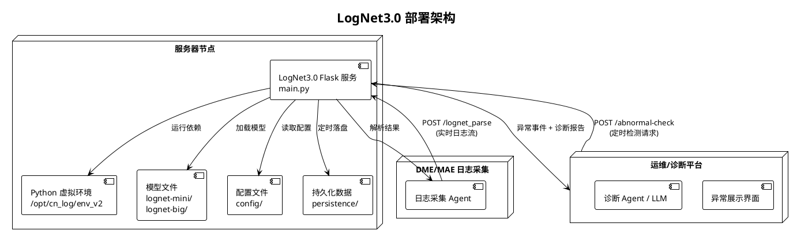

### 11.2 启动方式

```bash
# 在线服务
bin/start.sh
# 或直接运行
python main.py

# 离线检测（DME）
python src/data_process/offline_data_plugin/offline_detection_tool_with_piplup.py

# 离线检测（MAE）
python src/data_process/offline_data_plugin/offline_mae_detection_tool.py

# 参数异常检测验证平台（在 TIG-2026 仓库根目录）
python -m dme_platform.run

# 训练/校准/固定测试的共享模型评估
python -m dme_platform.detection.evaluate_shared_model --profile smoke
```

### 11.3 持久化机制

| 数据类型 | 存储路径 | 触发条件 |
|---------|---------|---------|
| Drain 树状态 | `config/persistence/{module}_extractor_state.bin` | 每 `persistence_time_minutes` 分钟 |
| PIPLUP 缓存 | `config/persistence/{module}_piplup_cache.pkl` | 每 `persistence_time_minutes` 分钟 |
| 白名单 | `config/white_list_a4.json` | 稳态学习期间，每 `persistence_time_minutes` 分钟 |
| 模型权重 | `src/.../lognet-mini/model.pth` | 离线训练生成 |
| 参数检测模型包 | `dme_platform/data/model_packages/` | 完成正常拟合、误差校准和决策校准后显式保存 |
| 参数检测运行时检查点 | 模型包关联的 runtime snapshot | 仅连续流恢复时保存/加载 |

### 11.4 稳态学习生命周期

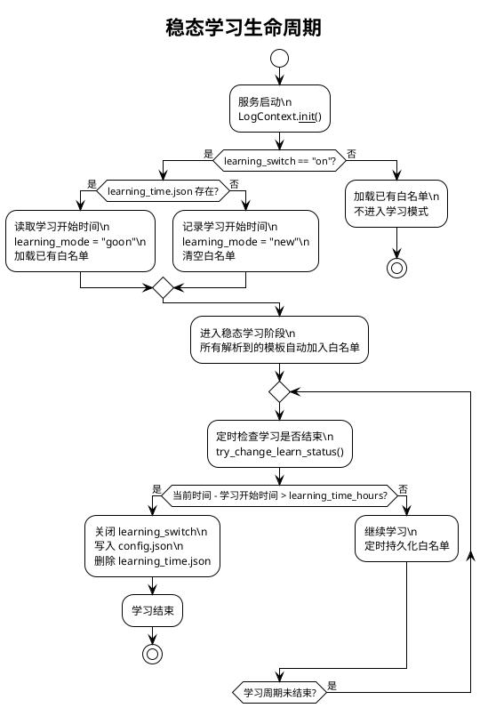

---

## 12. 评估指标体系

### 12.1 模板解析评估指标

| 指标 | 含义 | 计算方式 |
|------|------|---------|
| **GA** (Grouping Accuracy) | 聚类准确率 | 正确分组的行数 / 总行数 |
| **PA** (Parsing Accuracy) | 解析准确率 | 模板完全匹配的行数 / 总行数 |
| **FGA** (F1 of Grouping) | 聚类 F1 | 簇划分的 P/R/F1 |
| **FTA** (F1 of Template) | 模板 F1 | 模板集合的 P/R/F1 |

### 12.2 异常检测评估指标

| 指标 | 含义 | 计算方式 |
|------|------|---------|
| **Precision** | 精准率 | TP / (TP + FP) |
| **Recall** | 召回率 | TP / (TP + FN) |
| **F1** | 精确率与召回率的调和平均 | 2PR / (P + R) |
| **Accuracy** | 总体判定正确率 | (TP + TN) / 全部样本 |
| **CompressionRate** | 压缩率 | 评测集日志总数 / 上报异常日志总数 |

**三级统计粒度**：
- **Event level**：以时间窗为单位统计 TP/FP/TN/FN
- **Template level**：以模板为单位统计
- **Log level**：以日志行为单位统计
- **Parameter level**：以原文字符区间对齐具体参数，独立统计 TP/FP/FN

参数检测还需单独报告正常误报率、解析成功率、参数对齐率、DQ 路由率、对齐冲突数和时序事件首检延迟。日志级告警不得代替参数级定位命中；`data_quality` 类案例应以 DQ 通道捕获率评估，不应强行计入业务异常召回。

**Trade-off 策略**：
- 供运维人员分析：优先保障 Precision
- 供诊断 Agent/LLM 分析：优先保障 Recall，不断提升压缩率

---

## 13. 端到端示例

### 13.1 完整流程示例：DME 存储集群异常检测

**场景**：DME 存储集群 osd 模块发生磁盘扇区读取错误

**Step 1：日志采集与解析**

输入日志：
```
[2026-02-04 11:39:58][12345][ERR][osd.123][dsware][plog][osd][run][blk-12345] disk sector read error unrecoverable, sector 0x1A2B, retry count 5, pid:53912,tid:53969
```

解析过程：
1. `LogFormatParser.load_data("osd", log)` → `timestamp=2026-02-04 11:39:58`, `content=disk sector read error unrecoverable, sector 0x1A2B, retry count 5, pid:53912,tid:53969`
2. `preprocess(content)` → `disk sector read error unrecoverable, sector NUM_TAG, retry count NUM_TAG, pid:NUM_TAG,tid:NUM_TAG`
3. PIPLUP `treeSearch` → 新建聚类簇
4. `postprocessing` → 模板：`disk sector read error unrecoverable, sector <*>, retry count <*>, <*>`
5. `generate_template_id` → `CRC32(template) = 3829104765`
6. 存入 `LogTemplateRepository`

**Step 2：异常检测（三路并行）**

**语义检测**：
- `filter_english()`: `disk sector read error unrecoverable sector retry count`
- LogNetBig 编码 → 25 个窗口嵌入（1~5-gram）
- 与异常基线计算相似度 → `max_vals_static = 0.95`
- `0.95 > 0.9` → **语义异常**

**参数检测**：
- 管道先调用外部专家规则库。本示例假设规则库已纳入该日志形态，并把 `sector` 的 `0x1A2B` 列为黑名单值。
- 固定 token 与占位符形态匹配成功，参数提取同时记录 `0x1A2B` 在原日志中的字符区间。
- 十六进制等值比较命中黑名单，直接输出 **参数异常**，不再进入 AI 分支。
- 若规则未覆盖该日志，则由冻结解析器、剖面和多策略检测处理；解析失败必须返回 `data_quality`，不能沿用旧的模板 ID 相似度猜测。

**数量检测**：
- 该模板在 11:30-11:40 时间窗出现 15 次
- 历史均值 2 次/窗，标准差 1.5
- `|15 - 1.75| > 6 × 1.71` 且 `|15 - 1.75| > 10` → **数量异常**

**Step 3：结果融合**

```json
{
    "logId": "log_001",
    "timestamp": 1738646400000,
    "templateId": 3829104765,
    "template": "disk sector read error unrecoverable, sector <*>, retry count <*>, <*>",
    "anomalyType": ["semantic", "parametric", "changeRecord"],
    "summary": [
        "日志内容异常请检查",
        "日志参数异常,异常参数为 0x1A2B",
        "日志频率异常,当前时间窗内出现15次"
    ]
}
```

**Step 4：指纹库故障诊断（DME 专用）**

- 异常模板 `disk sector read error unrecoverable, sector <*>, ...` 与指纹库线索 `disk sector read error <*> sector <*>` 匹配，权重 0.5
- 异常模板与线索 `retry count <*>` 匹配，权重 0.6
- `case_score = 1.1 > threshold 0.95` → 生成诊断报告：

```json
{
    "format_time": "2026-02-04 11:40:00",
    "case_name": "磁盘扇区不可恢复读错误",
    "case_score": 1.1,
    "fault_mode_clue": [
        "disk sector read error unrecoverable, sector <*>, retry count <*>, <*>"
    ],
    "module": "osd",
    "source": "node-01"
}
```

### 13.2 性能数据

基于已有评估数据（CN 数据集，20250917 批次）：

| 指标 | 值 |
|------|---|
| 整体召回率 | 83% |
| 整体精准率 | 79% |
| 压缩比 | < 0.001 |

PIPLUP 解析覆盖率较 Drain3 提升显著（尤其在格式不规则的日志模块上），CRC32 双层缓存在重复日志高占比场景下可将大部分解析降为 O(1) 查表。

> 上述指标仅对应标明的 CN 数据批次，不代表第 5 章 `dme_platform` 的真实 DME 生产效果。参数检测当前以受控仿真和回归测试验证系统行为，上线结论需由独立脱敏真实数据评估给出。

---

## 附录

### A. 依赖环境

| 依赖 | 版本 | 用途 |
|------|------|------|
| Flask | 3.1.1 | Web 服务 |
| torch | - | 深度学习框架 |
| transformers | - | BERT 模型 |
| openai | 1.97.0 | LLM 客户端 |
| pydantic | 2.11.7 | 数据模型 |
| scikit-learn | - | IsolationForest |
| scipy | 1.16.0 | 统计计算 |
| regex | 2024.11.6 | 正则匹配 |

### B. 关键文件索引

| 功能 | 文件路径 |
|------|---------|
| 服务入口 | `main.py` |
| 上下文管理 | `src/data_process/log_context.py` |
| PIPLUP 算法 | `src/data_process/template_extractor/parsing_algorithm/PIPLUP.py` |
| Drain3 算法 | `src/data_process/template_extractor/parsing_algorithm/template_miner.py` |
| 预处理 | `src/data_process/template_extractor/parsing_algorithm/preprocessing.py` |
| 后处理 | `src/data_process/template_extractor/parsing_algorithm/postprocessing.py` |
| LLM 格式学习 | `src/data_process/template_extractor/parsing_algorithm/LogAutoParsingEngine.py` |
| PIPLUP 适配器 | `src/data_process/template_extractor/log_template_parsing_process_piplup.py` |
| 日志格式解析 | `src/data_process/template_extractor/log_formatter_parse.py` |
| 日志仓库 | `src/data_process/template_extractor/log_template_repository.py` |
| 语义异常检测 | `src/anomaly_detection/semantic_anomaly/semantic_anomaly.py` |
| LogNetMini 模型 | `src/anomaly_detection/semantic_anomaly/bert_model/LogNetMini.py` |
| LogNetBig 模型 | `src/anomaly_detection/semantic_anomaly/bert_model/LogNetBig.py` |
| 参数异常检测编排 | `TIG-2026/dme_platform/detection/pipeline.py` |
| 专家规则主通道 | `TIG-2026/dme_platform/detection/rule_fallback.py` |
| 参数解析与表示 | `TIG-2026/dme_platform/detection/log_parser.py`, `value_parser.py`, `core/parameter.py` |
| 参数剖面与策略 | `TIG-2026/dme_platform/detection/slot_profile.py`, `behavior_profile.py`, `detectors.py`, `shared_vae.py` |
| 参数检测融合 | `TIG-2026/dme_platform/detection/fusion.py` |
| 参数检测模型包 | `TIG-2026/dme_platform/detection/model_io.py` |
| 数量异常检测 | `src/anomaly_detection/quantitive_anomaly/quantitive_detector.py` |
| 检测编排器 | `src/anomaly_detection/anomaly_detection.py` |
| 评估指标 | `src/evaluation/ParserMetrics.py`, `src/evaluation/metrics.py`, `src/evaluation/LogAnalysis.py` |
| 分词器训练 | `pre_train/LogTokenizerTraining/` |
