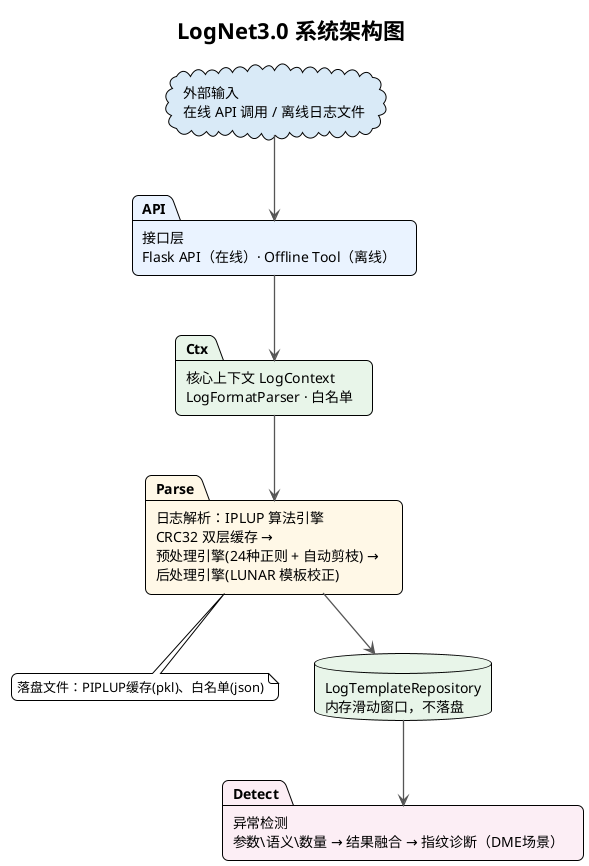
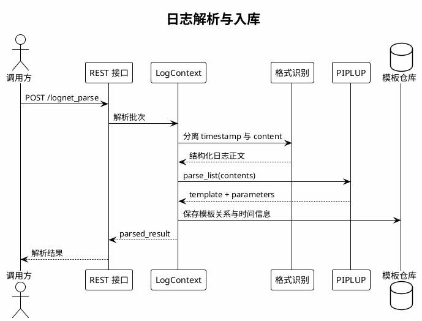
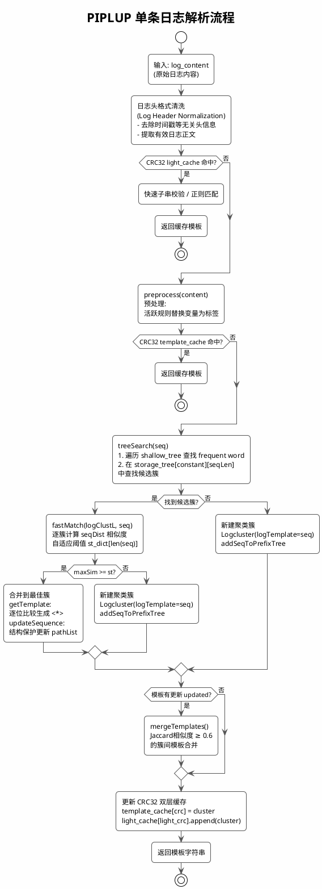
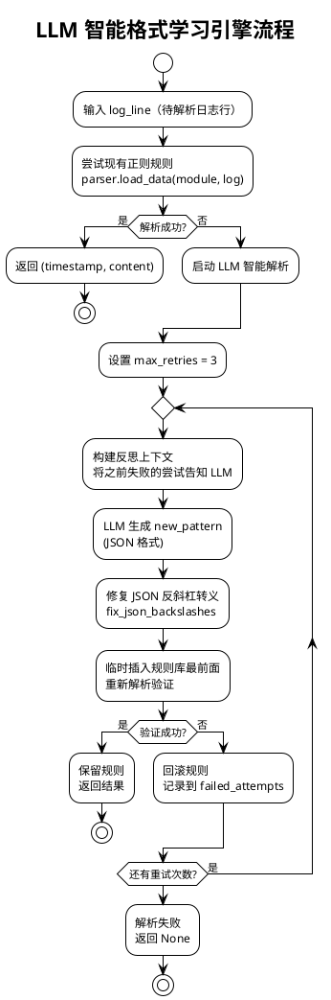
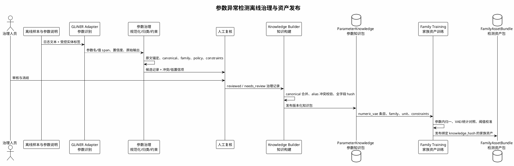
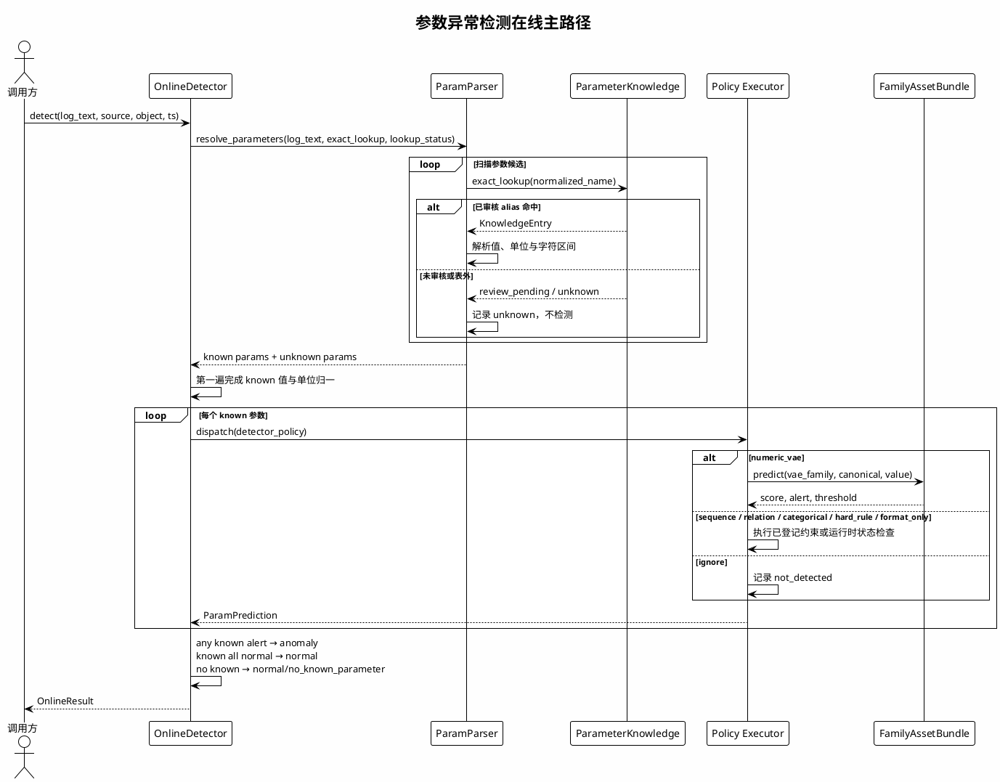
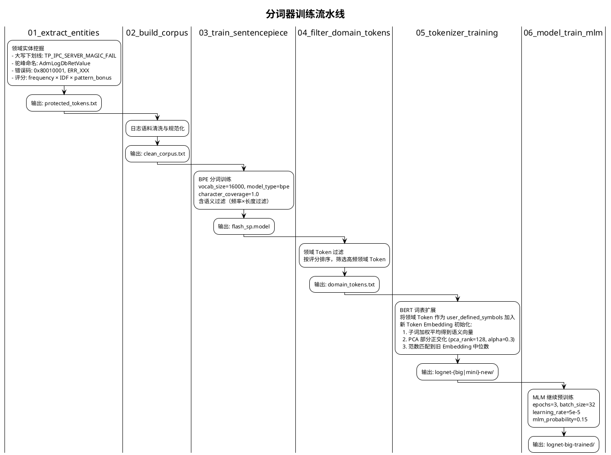
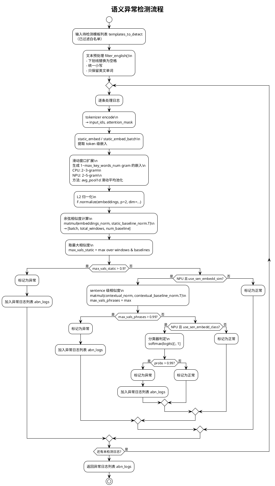
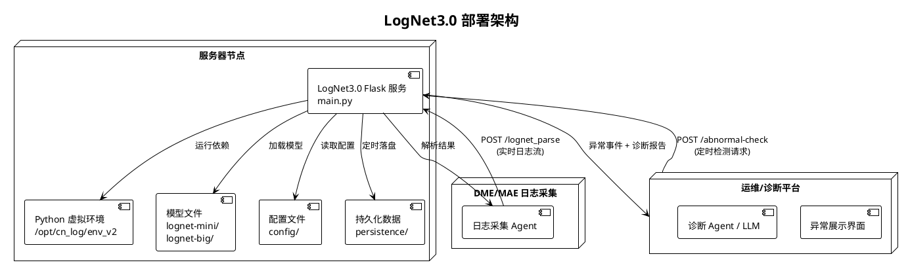
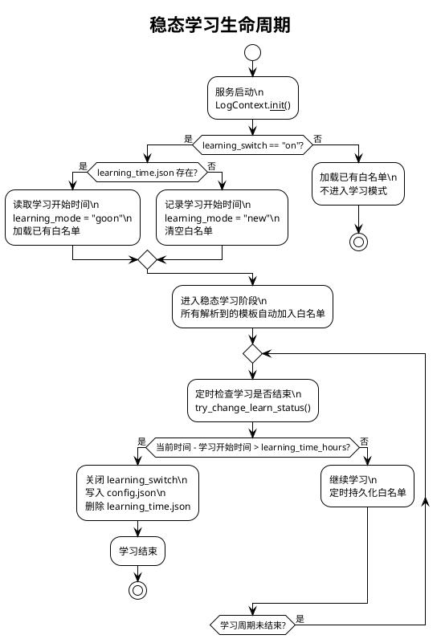

# LogNet3.0 方案设计与实现文档（V5）

| 项目 | 内容 |
|------|------|
| 文档名称 | LogNet3.0 方案设计与实现文档 |
| 版本 | V5.0 |
| 适用产品 | DME（分布式存储）/ MAE（网络） |
| 日期 | 2026-09-15 |
| 关键技术点 | 免人工配置异构日志解析、模板无关自适应参数异常检测、分词增强语义异常检测 |

---

## 目录

1. [概述](#1-概述)
2. [系统架构设计](#2-系统架构设计)
3. [模块交互与时序设计](#3-模块交互与时序设计)
4. [关键技术点一：免人工配置异构日志解析](#4-关键技术点一免人工配置异构日志解析)
5. [关键技术点二：模板无关自适应参数异常检测](#5-关键技术点二模板无关自适应参数异常检测)
6. [关键技术点三：分词增强语义异常检测](#6-关键技术点三分词增强语义异常检测)
7. [数量异常检测](#7-数量异常检测)
8. [异常检测结果融合与故障诊断](#8-异常检测结果融合与故障诊断)
9. [接口规格定义](#9-接口规格定义)
10. [配置体系](#10-配置体系)
11. [部署与运行](#11-部署与运行)
12. [评估指标体系](#12-评估指标体系)
13. [端到端示例](#13-端到端示例)

---

## 概述

### 背景与目标

LogNet3.0 是旨在实现对海量异构日志的**免人工配置解析**与**精准异常检测**的日志智能感知系统。系统通过三大核心技术点实现端到端的高性能日志分析能力：

- **免人工配置异构日志解析**：基于自研 PIPLUP（Prefix-tree Indexed Parsing with LLM-assisted Universal Processing）算法，结合 LLM 智能格式学习引擎，实现对不同模块、不同格式日志的自动解析，无需人工逐模块配置正则规则。
- **模板无关自适应参数异常检测**：以外部专家规则作为高确定性主通道，规则未覆盖时由可开关的模板无关 AI 管道完成参数解析、正常剖面学习、多策略检测和校准融合，并将异常精确定位到原文字符区间。
- **分词增强语义异常检测**：通过领域专用 BERT 分词器训练 + 滑动窗口多粒度嵌入 + 异常基线相似度匹配，实现日志内容的语义级异常检测。

### 代码仓库结构

```
TIG_LogAnalysis/
├── main.py                          # Flask 服务入口，提供 /lognet_parse 和 /abnormal-check 接口
├── config/                          # 配置文件（格式定义、白名单、参数检测配置等）
├── src/
│   ├── common/                      # 公共组件
│   │   ├── llm_client.py            # LLM 客户端
│   │   ├── constant.py              # 常量定义
│   │   ├── atomic_op.py             # 原子操作
│   │   ├── global_config.py         # 全局配置
│   │   └── distributed_lock.py      # 分布式锁
│   ├── data_process/
│   │   ├── log_context.py           # 日志上下文管理（Drain 树、白名单、PIPLUP 实例）
│   │   ├── data_basic_structs/      # 基础数据结构（LRUCache）
│   │   ├── template_extractor/      # 模板提取核心模块
│   │   │   ├── log_formatter_parse.py        # 日志格式解析器
│   │   │   ├── log_template_parsing_process.py         # Drain 解析流程
│   │   │   ├── log_template_parsing_process_piplup.py  # PIPLUP 解析适配器
│   │   │   ├── log_template_repository.py    # 日志模板仓库（内存存储）
│   │   │   ├── parsing_algorithm/
│   │   │   │   ├── PIPLUP.py                 # PIPLUP 核心算法
│   │   │   │   ├── template_miner.py         # Drain3 算法
│   │   │   │   ├── template_miner_config.py  # Drain3 配置
│   │   │   │   ├── preprocessing.py          # 预处理（24种活跃正则）
│   │   │   │   ├── postprocessing.py         # 后处理（LUNAR 模板校正）
│   │   │   │   ├── LogAutoParsingEngine.py   # LLM 智能格式学习引擎
│   │   │   │   ├── extractor.py              # 格式提取器
│   │   │   │   ├── masking.py                # 掩码工具
│   │   │   │   ├── file_persistence.py       # 文件持久化
│   │   │   │   ├── persistence_handler.py    # 持久化处理器
│   │   │   │   ├── simple_profiler.py        # 性能分析器
│   │   │   │   ├── template_config.py        # 模板配置
│   │   │   │   ├── tools/llm_client_all.py   # LLM 客户端集合
│   │   │   │   └── prompts/                  # LLM Prompt 模板
│   │   │   └── multi_process.py
│   │   └── offline_data_plugin/    # 离线数据处理工具（DME/MAE 离线检测、参数配置生成等）
│   ├── anomaly_detection/
│   │   ├── anomaly_detection.py     # 异常检测编排器（三路检测融合）
│   │   ├── semantic_anomaly/        # 语义异常检测
│   │   │   ├── semantic_anomaly.py
│   │   │   ├── data_models.py       # 语义数据模型
│   │   │   ├── utils.py             # 语义工具函数
│   │   │   ├── semantic_detectors/  # 语义检测器基类
│   │   │   ├── bert_model/
│   │   │   │   ├── LogNetMini.py    # CPU 轻量 BERT 模型
│   │   │   │   └── LogNetBig.py     # NPU MPNet 模型
│   │   │   └── configurations/      # 异常基线、指纹库
│   │   ├── parameter_anomaly/       # 参数异常检测
│   │   │   ├── param_detector.py
│   │   │   └── configuration/       # 参数检测配置
│   │   │       ├── load_param_config.py  # 配置加载器
│   │   │       └── param_config.py       # 参数配置定义
│   │   ├── quantitive_anomaly/      # 数量异常检测
│   │   │   └── quantitive_detector.py
│   │   └── anomaly_base/            # 数据模型基类
│   └── evaluation/                  # 评估指标
│       ├── ParserMetrics.py         # 解析质量评估（GA/PA/FGA/FTA）
│       ├── metrics.py               # 检测指标评估
│       └── LogAnalysis.py           # 三级评估器
├── pre_train/                       # 预训练分词器与模型
│   └── LogTokenizerTraining/        # 6步分词器训练流水线
├── agent/                           # 现网案例复核与故障注入评估
├── test/                            # 测试用例
├── bin/start.sh                     # 部署启动脚本
└── design_doc/                      # 已有设计文档
```

---

## 2. 系统架构设计

### 架构总览图



### 2.2 核心模块说明

| 模块 | 代码位置 | 职责 |
|------|---------|------|
| **接口层** | `main.py` | Flask Web 服务，提供日志解析和异常检测 REST 接口 |
| **上下文管理** | `src/data_process/log_context.py` | 管理全局状态：Drain 树映射、PIPLUP 实例、白名单、稳态学习、日志仓库 |
| **日志解析** | `src/data_process/template_extractor/` | PIPLUP / Drain 双引擎日志模板提取，含预处理、后处理、LLM 智能格式学习 |
| **语义异常检测** | `src/anomaly_detection/semantic_anomaly/` | 基于 BERT 嵌入 + 异常基线相似度匹配的日志内容异常检测 |
| **参数异常检测** | `src/anomaly_detection/parameter_anomaly/` | 规则模糊匹配优先；未命中时进入可开关的模板无关 AI 管道，输出日志级状态和可定位的参数证据 |
| **数量异常检测** | `src/anomaly_detection/quantitive_anomaly/` | 基于 k-sigma 留一法的日志频率突变检测 |
| **结果融合** | `src/anomaly_detection/anomaly_detection.py` | 三路检测结果按三元组去重合并，生成异常事件与诊断报告 |
| **模型层** | `src/anomaly_detection/semantic_anomaly/bert_model/` | LogNetMini（CPU）和 LogNetBig（NPU）双模型 |
| **预训练** | `pre_train/LogTokenizerTraining/` | 6步分词器训练流水线 + MLM 预训练 |

---

## 3. 模块交互与时序设计

### 核心交互时序

#### 解析入库



#### 检测与融合


### 模块间交互接口

| 源模块 | 目标模块 | 接口方法 | 输入参数 | 返回值 |
|--------|---------|---------|---------|--------|
| main.py | LogContext | `parse_logs_piplup_adapter(log_info, context)` | `log_info: List[dict]`, `context: LogContext` | `List[dict]` (parse_results) |
| main.py | AnomalyDetection | `get_detector(mode, product).anomaly_detection(...)` | `source, module, start_time, end_time, window_size, repository, template_cache, white_list` | `(anomaly_data, anomaly_event[, reports])` |
| LogContext | LogFormatParser | `load_data(module, log)` | `module: str`, `log: str` | `(timestamp, content)` |
| LogContext | PIPLUP | `parser_piplup.parse_list(contents)` | `contents: List[str]` | `List[str]` (templates) |
| LogContext | LogTemplateRepository | `log_repository.add(LogTemplateRelation)` | `LogTemplateRelation(source, time, log_id, template_id, module, param_list)` | void |
| AnomalyDetection | SemanticAnomalyDetector | `detect(source, module, k_sigma, window_map, template_cache, white_list_dict)` | 6参数 | `(data, event)` |
| AnomalyDetection | QuantityAnomalyDetector | `detect(source, module, window_map, template_cache, white_list, k_sigma)` | 6参数 | `(data, event)` |
| AnomalyDetection | ParamAnomalyDetector | `detect(log_entries, window_size, output_path)` | 3参数 | `(outliers, events, count)` |
| AnomalyDetection | merge_results | `merge_results(semantic_data, parametric_data, quantitative_data)` | 3路结果列表 | `(combined_data, anomaly_event)` |
| SemanticAnomalyDetector | LogNetMini/Big | `model(input_ids, attention_mask)` | Tensor | `embeddings / logits` |
| ParamAnomalyDetector | config_build_*.json | `template_config_dict.get((module, template_id))` | `(module, template_id)` | 配置项 dict |

---

## 关键技术点一：免人工配置异构日志解析

### 技术概述

传统日志解析方案（如 Drain3）需要为每种日志格式预配置正则表达式，且对参数变量的识别依赖固定规则。LogNet3.0 通过 **PIPLUP 算法** + **LLM 智能格式学习引擎** + **自动预处理剪枝** 三层机制，实现真正的"免人工配置"。

### PIPLUP 算法核心设计

PIPLUP（Prefix-tree Indexed Parsing with LLM-assisted Universal Processing）是自研的日志模板解析算法，核心代码位于 `src/data_process/template_extractor/parsing_algorithm/PIPLUP.py`。

**模块输入示例**：`receive data from 192.168.1.100 failed, error code 0x80010001`

**模块输出示例**：`receive data from <*> failed, error code <*>`，并关联对应模板簇。

**具体职责**：消费格式识别模块分离出的日志正文，通过预处理、索引检索、相似度匹配和模板演化生成稳定模板。模板结果交给仓库及后续异常检测模块使用。

#### 数据结构

PIPLUP 采用**双层前缀树**结构：

```
shallow_tree (浅层索引)          storage_tree (深层存储)
┌──────────────────────┐       ┌─────────────────────────────────┐
│ "None": [cluster1,   │       │ "None": {                       │
│         cluster2,...]│       │   7: [cluster1, cluster3],      │
│ "recv": [cluster3,   │       │   5: [cluster2]                 │
│         cluster4,...]│       │ },                              │
│ "start": [cluster5]  │       │ "recv": {                       │
└──────────────────────┘       │   8: [cluster3, cluster4],      │
                                │   6: [cluster5]                 │
  按 frequent word 分组          │ }                               │
  (常量词作为一级索引)            └─────────────────────────────────┘
                                  按 frequent word + 序列长度 二级索引
```

- **shallow_tree**：`dict[str, List[Logcluster]]`，以常量词（frequent word）为键，快速缩小搜索范围
- **storage_tree**：`dict[str, dict[int, List[Logcluster]]]`，在常量词基础上再按序列长度分组
- **Logcluster**：每个聚类簇维护 `logTemplate`（当前模板）、`pathList`（分支路径列表，最多 `br_thresh` 条）、`templateList`（后处理后的候选模板集合）、`hit_time`（命中次数）

#### 解析流程



#### 自适应相似度阈值

PIPLUP 不使用固定相似度阈值，而是按日志序列长度自适应选择（`PIPLUP.py:146-158`）：

```python
self.st_dict = {
    1: 1,           # 1个token：必须完全匹配
    2: (2-1)/2,     # 2个token：允许0.5差异
    3: (3-1)/3,     # 3个token：允许0.33差异
    4: (4-1)/4,
    5: (5-2)/5,     # 5个token：允许0.6差异
    6: (6-2)/6,
    7: (7-3)/7,
    8: (8-3)/8,
    9: (9-3)/9,
    'others': 0.5   # 超过9个token：固定0.5
}
```

**设计原理**：短日志对参数变化更敏感，需要更严格的阈值；长日志包含更多常量词，可以容忍更多参数位置差异。

#### CRC32 双层缓存

为加速重复日志的解析，PIPLUP 实现了两级 CRC32 缓存：

| 缓存层级 | 位置 | 键 | 计算方式 | 命中效果 |
|---------|------|---|---------|---------|
| **light_cache** | 预处理前 | `CRC32(数字替换为0后的日志)` | `_light_digit_re.sub('0', content)` → CRC32 | 跳过预处理，通过快速子串校验或正则匹配返回缓存模板 |
| **template_cache** | 预处理后 | `CRC32(预处理后日志)` | `' '.join(logmessageL)` → CRC32 | 跳过树搜索步骤 |

在重复日志高占比的生产场景下，大部分解析降为 O(1) 查表操作。

#### 常量词自动发现（模板演化）

当模板发生变化（`oldTemplate != newTemplate`）或命中次数达到 `update_population`（默认385次），且当前仍在 `'None'` 分组（`first_constant == 'None'`）时，自动提取分组依据（`PIPLUP.py:512-545`）：

1. 遍历当前模板中的 token，找到第一个不含 `<*>` 的常量词
2. 将该常量词作为 frequent word 加入 `shallow_tree` 和 `storage_tree`
3. 从 `'None'` 分组中迁移所有包含该常量词的簇到新分组
4. 后续日志优先按 frequent word 检索，大幅缩小候选集


#### 后处理：LUNAR 模板校正

`postprocessing.py` 实现模板规范化，主要规则包括：

- **输入示例**：`path = "<*>.<*>"  status = <*>`
- **输出示例**：`path = <*> status = <*>`
- **职责**：消除聚类结果中由标点、连续占位符和赋值形式引入的伪差异，将规范化模板返回 PIPLUP 更新缓存和模板仓库。

- 连续变量折叠：`<*>.<*>` → `<*>`，`<*>,<*>` → `<*>`
- 赋值泛化：`= value` → `= <*>`
- 标点包裹简化：`"<*>"` → `<*>`
- 多空格压缩为单空格

### 预处理引擎与自动剪枝

**模块输入示例**：`pid:53912,tid:53969 connect 192.168.1.1:8080`

**模块输出示例**：pid:`<*>,tid:<*> connect <*>`，同时返回本条日志命中的模式类型。

**具体职责**：在 PIPLUP 检索前将高变参数替换为统一占位符，并从样本中自动筛选有效规则。处理后的 token 序列直接进入 PIPLUP 索引和相似度匹配。

#### 活跃规则集与执行顺序

`preprocessing.py` 当前的 DME `sequence` 含 24 种活跃规则。文档不展开每条正则的底层写法，只保留对算法结果有影响的分类和顺序原则：

| 规则组 | 典型模式 | 目的 |
|---|---|---|
| 日志头与时间 | `datetime_full`、`kernel_uptime`、`epoch_ms_13d`、`log_level` | 先消除与业务模板无关的日志头差异 |
| 运行时身份 | `pid_tid_pair`、`serial_num`、`device_serial` | 屏蔽进程、线程和设备实例波动 |
| 结构化复合值 | `brace_hex_value_pair`、`hex_dump`、`embedded_hex`、`xnet_ctx_id` | 先匹配特化结构，避免被通用数字规则切碎 |
| 地址与路径 | `url`、`IPv4_port`、`IPv6`、`Mac_address`、`path` | 统一网络与文件定位参数 |
| 通用值 | `duration`、`size`、`numerical`、`weekday_months` | 作为后置通用兜底 |

执行顺序遵循“复杂、特化模式优先，通用数字模式最后”。

#### 正则模式自动剪枝

```python
# PIPLUP.py:454-466
if idx < 2000:
    logmessageL, sequence, matched = preprocess(content, estimation_stage=True)
    matched_types.extend(matched)
    use_sequence = sequence
else:
    if idx == 2000:
        matched_types = set(matched_types)
        use_sequence = [i for i in use_sequence if i in matched_types]
    logmessageL = preprocess(content, estimation_stage=False, use_sequence=use_sequence)
```

**机制**：前 2000 行日志进入估算阶段，记录哪些正则实际命中；第 2001 行起只保留命中的正则，减少无效替换开销。

### LLM 智能格式学习引擎

`LogAutoParsingEngine.py` 实现了当预置正则无法匹配日志格式时，自动调用 LLM 生成新的正则规则。

**模块输入示例**：一条现有格式规则无法分离时间戳和正文的原始日志。

**模块输出示例**：`{"timestamp": "2026-09-15 10:00:00", "content": "disk read failed"}`，以及通过本地验证的候选格式规则。

**具体职责**：只在本地格式规则未命中时生成候选规则，经回放验证成功后才供格式解析器使用。它解决日志头格式的冷启动问题，不参与模板聚类或异常判定。

#### 4.4.1 核心流程



#### 反思机制

```python
# LogAutoParsingEngine.py:84-91
def _generate_pattern_with_reflection(self, log_line, failed_patterns):
    reflection_context = ""
    if failed_patterns:
        reflection_context = "\n【注意：以下是你之前的错误尝试，请不要重复使用，并分析其匹配失败的原因】:\n"
        for i, p in enumerate(failed_patterns):
            reflection_context += f"{i + 1}. {p}\n"
    prompt = build_prompt(log_line, reflection_context)
```

每次失败后，将错误尝试告知 LLM，避免重复犯错，实现反思式学习。

### 复杂度分析

| 算法 | 检索复杂度 | 空间复杂度 | 备注 |
|------|-----------|-----------|------|
| Drain3 | O(d+k) 平均, O(n) 最坏 | O(n·d) | d=树深度, k=候选簇数 |
| PIPLUP | O(\|C\|+k) 平均 | O(n·br_thresh) | C=常量词数, br_thresh=分支阈值 |
| PIPLUP + CRC32缓存 | O(1) 缓存命中 | O(m) | m=缓存条目数, 重复日志场景 |

### 端到端解析示例

**输入日志（DME osd 模块）**：

```
[2026-02-04 11:39:58][12345][ERR][osd.123][dsware][plog][osd][run][blk-12345] receive data from 192.168.1.100:8080 failed, error code 0x80010001, pid:53912,tid:53969
```

**解析过程**：

1. `LogFormatParser.load_data("osd", log)` 匹配 `format_chaos.json` 中 osd 的多组备选正则，提取 `timestamp=2026-02-04 11:39:58`, `content=receive data from ...`
2. `preprocess(content)` 按剪枝后的活跃规则集执行替换（`use_keys=False` 时替换为 `<*>`）：
   - `192.168.1.100:8080` → `<*>`
   - `0x80010001` → `<*>`
   - `pid:53912,tid:53969` → `<*>`
   - `blk-12345` → `<*>`
3. `PIPLUP.treeSearch()` 在 storage_tree 中查找，未命中 → 新建聚类簇
4. `postprocessing.correct_single_template()` 规范化模板
5. **输出模板**：`receive data from <*> failed, error code <*>`

---

## 关键技术点二：模板无关自适应参数异常检测

### 技术概述

参数异常检测采用“**离线治理、在线直检**”的知识驱动架构。模板仅作为离线分析参数语义和检测要求的上下文，不作为在线检测入口；在线侧不按 `template_id` 选择规则，也不加载语义模型。离线侧将参数识别结果治理为可审核、可版本化的参数知识表，并训练与知识表绑定的家族检测资产；在线侧只负责确定性解析、精确查询、策略执行和结果汇总。

```text
离线态
日志样本与参数说明
  → GLiNER 参数识别
  → 参数规范化、归类与约束整理
  → 一致性校验与人工复核
  → 参数知识表发布
  → 数值家族资产训练、校准与发布

在线态
原始日志
  → 确定性参数解析
  → 已审核参数知识表精确查询
      ├─ hit：值归一化并按 detector_policy 检测
      └─ miss：记录 unknown，不检测
  → 参数级结果汇总
  → 日志级结论与可观测信息
```

该架构的模板无关性体现在：只要日志中出现参数知识表已经登记的参数名称，无论日志常量文本、字段顺序或所属模板如何变化，该参数都可以进入相同的检测流程。反之，表外参数不会因名称中包含 `time`、`id`、`count` 等片段而被在线推断为已知参数。

核心模块及职责如下：

| 模块 | 主要输入 | 主要输出 | 职责 | 对应实现 |
|------|----------|----------|------|----------|
| 离线参数识别与治理 | 日志样本、参数说明、目标实体标签 | 参数候选与治理记录 | 使用 GLiNER 识别参数证据，完成规范化、归类和复核 | `offline/model_adapters.py`、`corpus/parameter_gold.py` |
| 参数知识构建 | 审核后的治理记录 | 版本化知识包 | 合并 canonical、建立 alias 索引、校验冲突并计算哈希 | `corpus/parameter_knowledge_builder.py`、`detection/parameter_knowledge.py` |
| 家族资产训练 | 参数知识、正常及异常样本 | 家族检测资产包 | 按数值行为家族训练、校准并选择 VAE 或统计方法 | `offline/family_training.py`、`detection/family_assets.py` |
| 在线参数解析 | 原始日志、知识表查询函数 | known 参数与 unknown 参数 | 确定性扫描参数表达式，不依赖模板或模型 | `detection/param_parser.py` |
| 在线检测执行 | known 参数、知识条目、家族资产 | 参数级检测结果 | 按 `detector_policy` 执行约束、序列、关系或数值检测 | `detection/online.py` |
| 结果汇总 | 参数级结果与版本信息 | 日志级结果 | 汇总状态、原因码、证据、未知率和阶段耗时 | `detection/online.py` |

下文按照数据从离线生产到在线消费的顺序介绍各模块，并在每个模块的开头给出输入输出示例，在结尾说明其与下游模块的衔接关系。

### 离线参数识别与治理

**模块职责**：从日志及参数说明中提取参数名、参数值和原文位置，形成参数治理候选；随后补充规范名、行为家族、值类型、单位、检测策略和约束。模型输出只作为候选证据，不能直接成为线上真值。

**输入输出示例**：

```text
输入日志：
Xnet send ..., time use=10772(us), SNO=100, plane=1, xnetRet=0.

输入标签：
["parameter name", "parameter value"]

GLiNER 候选输出：
parameter name  → "time use"
parameter value → "10772"
parameter name  → "SNO"
parameter value → "100"

治理输出：
surface="time use"
canonical="time_use"
family="duration"
value_kind=["integer"]
canonical_unit="ms"
detector_policy="numeric_vae"
vae_family="duration"
```

该模块接收上游离线样本和参数说明，输出尚未发布的治理记录；治理记录经过校验和人工审核后，才交给参数知识构建模块。

#### GLiNER 参数识别

GLiNER 在离线阶段承担参数实体识别职责。模型接收完整日志文本和受控实体标签，输出参数名、参数值、字符起止位置及置信度。统一接入协议将模型结果转换为相同的 span 结构：

```python
{
    "surface": "time use",
    "entity_type": "parameter name",
    "start": 15,
    "end": 23,
    "confidence": 0.91
}
```

模型结果进入后续流程前必须完成原文锚定校验：字符区间采用半开区间 `[start, end)`，且 `log_text[start:end]` 必须与模型返回的表面文本一致。越界、空白、实体类型非法或无法回查原文的结果均标记为无效，不进入自动发布链路。

GLiNER 不负责直接判断异常，也不参与在线推理。它的作用是为离线治理提供参数名和参数值候选，降低人工定位参数的成本。模型版本、阈值、设备、依赖和原始输出需要随候选结果保留，以便复现和审计。

#### 参数规范化与行为归类

有效 span 与参数说明合并后，形成统一治理记录。核心字段包括：

| 字段 | 作用 |
|------|------|
| `surface` | 日志或说明中出现的原始参数名 |
| `canonical` | 稳定的规范参数名，同时作为参数身份基础 |
| `aliases` | 允许在线精确命中的已审核表面名集合 |
| `family` | 参数的业务或行为类别 |
| `value_kind` | integer、float、hex、enum、string 等值形态 |
| `canonical_unit` | 在线归一后的统一单位 |
| `detector_policy` | 在线主检测策略 |
| `constraints` | 范围、固定值、合法集合等确定性约束 |
| `vae_family` | 数值类参数对应的家族资产；不适用时为空 |
| `relation` | 参数之间的比较、差值或引用关系 |

`family` 与 `detector_policy` 分工不同：`family` 描述参数是什么，`detector_policy` 决定线上怎样检测。例如，时延参数可归入 `duration` 家族并路由到 `numeric_vae`；返回码可归入 `return_code` 家族并路由到 `hard_rule`。

规范化过程不以“数值能否转换”为唯一依据。ID、地址、哈希、枚举、状态和返回码即使使用整数表示，也不能因此进入连续数值家族。该约束保证后续训练模块不会把无连续数值意义的参数送入 VAE 或统计分布检测。

#### 约束与关系整理

确定性检测要求在离线阶段结构化。知识记录支持以下主要形式：

- `min`、`max`、`fixed`：上下界或固定值；
- `domain`、`success_values`：允许集合或成功码集合；
- `monotonic`、`monotonic_increasing`：序列单调性；
- `max_ref`：当前参数不得超过同日志中的参考参数；
- `relation`：`>=`、`in_or_ref`、`diff_close_zero`、`max_ref` 等参数间关系；
- `allow_empty`、`valid_unix_timestamp`：格式或有效性要求。

约束必须具有参数说明或人工确认依据。无法唯一确定的枚举集合、成功码或参数关系不能由模型臆造；这类记录保留为待复核状态。

#### 校验与人工复核

治理结果发布前至少检查以下内容：

1. 参数名和值是否可以回查原文；
2. canonical、类型、单位、family 与检测策略是否一致；
3. 同一 canonical 在不同来源中的检测字段是否冲突；
4. alias 是否同时指向多个 parameter_id；
5. `numeric_vae` 是否仅绑定允许的数值家族；
6. 约束和关系是否有明确来源。

存在冲突或不确定字段的条目标记为 `needs_review`。模型置信度不能替代人工审核，模型输出也不能直接修改线上知识。只有审核通过的记录才允许被在线查询命中。

完成审核后，治理记录交给参数知识构建模块；后者负责合并条目、生成索引并发布不可变知识包。

### 参数知识构建与运行时加载

**模块职责**：把审核后的治理记录合并为参数知识条目，检查 alias 唯一性和策略合法性，生成逐条哈希与知识包哈希；在线侧只加载发布产物，不读取离线语料，也不临时重建知识。

**输入输出示例**：

```text
输入：
同一 canonical 下的多条审核记录及 aliases

输出知识条目：
{
  "parameter_id": "time_use",
  "canonical": "time_use",
  "aliases": ["time use"],
  "family": "duration",
  "value_kind": ["integer"],
  "canonical_unit": "ms",
  "detector_policy": "numeric_vae",
  "constraints": {"min": 0, "max": 100000, "unit": "us"},
  "vae_family": "duration",
  "review_status": "reviewed",
  "content_hash": "..."
}
```

该模块位于离线治理和在线运行之间：上游提供审核记录，下游的家族训练模块与在线检测模块共同消费同一个知识版本。

#### 知识条目合并

知识构建器按 `canonical` 聚合治理记录，合并 aliases、值类型、来源和约束。family、检测策略、规范单位、VAE 家族和参数关系等影响检测行为的字段必须保持一致；出现冲突时拒绝发布，先进行人工消歧。

同一 alias 只能属于一个 parameter_id。如果 alias 同时映射到多个参数，构建过程直接失败，不能把歧义带入在线查询。上下文只允许处理离线已经登记的歧义关系，不能用来创造表外参数。

待复核条目可以保留在知识包中用于追踪，但不能在线命中。构建器将其检测策略置为 `ignore`、清除数值家族绑定，并标记 `review_pending`；运行时查询会把它作为未知治理项返回。

#### 精确 alias 索引

运行时知识表建立 `normalized alias → KnowledgeEntry` 的哈希索引。查询键只执行小写化和首尾空白清理；查询不执行 substring、编辑距离、模糊匹配、family 推断或模型预测。

```python
entry = knowledge.exact_lookup(normalized_name)

if entry is None:
    # 未登记或尚未审核
    record_unknown()
else:
    # 已审核精确命中
    dispatch(entry.detector_policy)
```

精确查询保证了线上行为确定、可解释和可回放。名称中带有语义提示但未登记的参数仍然 miss，不会因规则推断而获得检测权限。

#### 版本与完整性校验

知识包包含 Schema 版本、知识版本、来源信息、逐条 `content_hash` 和整体 `bundle_hash`。条目哈希覆盖 parameter_id、canonical、aliases、family、值类型、单位、检测策略、约束、关系、VAE 家族、来源、审核状态和 Schema 版本等检测相关字段。

运行时按以下顺序加载：

1. 检查资产文件是否存在且 JSON 可解析；
2. 检查 Schema 版本是否兼容；
3. 重算并核对每个条目的 `content_hash`；
4. 重算并核对知识包 `bundle_hash`；
5. 校验检测策略和 VAE 家族是否在允许集合中；
6. 检查 parameter_id 和 alias 是否重复或冲突。

任一步失败均抛出加载错误并停止启动。在线侧不得降级为从语料重建知识、临时推断或自动写回。

知识包发布后产生两个下游：家族资产训练模块使用其数值家族定义生成检测资产；在线参数解析模块使用其精确索引判断 known 与 unknown。

### 家族检测资产训练

**模块职责**：读取知识表中被标记为 `numeric_vae` 且绑定 `vae_family` 的参数，按参数自身尺度完成稳健归一化，再在行为家族内训练和比较 VAE 与统计检测器，最终发布与知识表哈希绑定的家族资产。

**输入输出示例**：

```text
输入：
parameter_id = "time_use"
vae_family = "duration"
canonical_unit = "ms"
normal_values = [8.2, 9.5, 10.7, 12.0, ...]

输出：
family = "duration"
kind = "statistical" 或 "vae"
canonical_stats["time_use"] = {median, mad, n}
threshold = 冻结报警阈值
knowledge_hash = 对应参数知识版本
```

该模块上游是参数知识表和离线样本，下游是在线检测执行模块。在线只加载已经选定、校准并封装好的家族资产，不参与训练和调参。

#### 数值家族准入

只有具有连续数值意义并显式绑定 `vae_family` 的参数进入本模块。主要家族包括时延、非负计数、容量大小和经过归一化的位置增量。以下参数不进入数值家族资产：

- ID、地址、哈希和 CRC；
- 枚举、flag、状态和返回码；
- 需要比较前后关系的序列值；
- 需要同日志多个字段联合判断的关系参数；
- 仅做格式校验或明确忽略的参数。

准入由知识表决定，训练模块不得根据值看起来像整数就自行改变检测策略。

#### 参数内去尺度与家族聚合

同一行为家族中的不同参数可能具有完全不同的绝对量级，因此不能直接混合原始值。当前设计先把值转换为规范单位，再对每个 canonical 分别计算训练期统计量：

```text
y = log1p(max(x_in_canonical_unit, 0))
z = (y - median_canonical) /
    (1.4826 × MAD_canonical + ε)
```

`median_canonical` 和 `MAD_canonical` 仅从该参数的正常训练数据估计。完成参数内去尺度后，才把同家族的 `z` 特征汇聚起来学习共同分布形状。运行时若资产中缺少某个 canonical 的统计量，必须失败，不能借用同家族其他参数的尺度。

#### 五段数据生命周期

训练流程将数据用途固定为五段：

| 数据段 | 用途 |
|--------|------|
| `train_fit_normal` | 拟合参数统计量和家族模型 |
| `validation_normal` | 选择训练轮次并恢复最佳 checkpoint |
| `error_cal_normal` | 建立正常重构误差分布 |
| `decision_cal_labeled` | 选择并冻结报警阈值 |
| `test_sealed` | 在模型、归一化和阈值全部冻结后进行最终评估 |

同一参数的近重复值不能跨用途泄漏。归一化统计只能从 `train_fit_normal` 计算，阈值只能在决策校准集选择，封存测试集不能用于继续调参。

#### VAE 与统计基线选择

每个 family 独立训练轻量 VAE，并至少使用多个固定种子记录稳定性。训练采用 AdamW、KL warm-up、梯度裁剪、验证集早停和最佳 checkpoint 恢复。与此同时，以 `|z|` 为异常分数建立稳健统计基线。

两种方法使用相同的数据分区，在同一决策校准集上冻结阈值，再在相同封存测试集上做配对比较。只有 VAE 相对统计方法具有稳定、可重复的独立增益时，资产的 `kind` 才选择 `vae`；否则选择 `statistical`。因此知识表中的 `numeric_vae` 表示进入数值家族资产路由，并不强制每个家族最终都使用 VAE。

#### 家族资产包

每个家族资产记录：

- `family` 与最终选择的 `kind`；
- 冻结阈值和规范单位；
- 各 canonical 的 median、MAD 与训练样本计数；
- VAE 配置和权重（选择 VAE 时）；
- 数据指纹、随机种子、评估指标和版本；
- 资产内容哈希。

家族资产包还保存 `knowledge_hash`。在线加载时，资产包必须与当前知识表完全匹配；缺少知识表声明的家族、单参数归一化统计缺失、资产哈希损坏或知识哈希不一致时均 fail closed。

家族资产和知识包共同构成在线检测的只读输入。下一模块介绍在线如何从任意日志结构中找到这些知识能够识别的参数。

### 在线确定性参数解析

**模块职责**：扫描原始日志中的显式参数表达式，解析参数名、值、单位和字符区间；通过注入的精确查询函数优先解析已知参数，再记录未命中的可解析候选。该模块不依赖 Drain 模板，也不调用 GLiNER、Qwen 或其他语义模型。

**输入输出示例**：

```text
输入：
new layout :: time use=2000000(us), plane=1, extraFlag(9)

输出 known：
time use → raw_value="2000000", unit="us",
           name_span=[14,22), value_span=[23,30)
plane    → raw_value="1"

输出 unknown：
extraFlag → raw_value="9", review_hint="unknown"
```

该模块的上游是原始日志和已加载知识表；输出分为 known 与 unknown。known 交给值归一化和策略执行，unknown 仅进入结果记录和离线治理回流。

#### 支持的参数表达式

解析器采用模板无关词法扫描，支持：

- `name=value`；
- `name:value`；
- `name(value)`，包括嵌套括号；
- `name value` 的裸数值形式；
- 最多三个 token 的多词参数名；
- 数值、负数、浮点数和十六进制值；
- 引号值及转义字符；
- 紧邻数值的时间和容量单位；
- 重复参数名；
- 封闭连接词 `to`、`is`、`of` 连接的名称和值。

参数名和值均保留半开字符区间 `[start, end)`，便于结果定位和原文复核。为减少普通文本误捕，`=` 和 `:` 后只接受数值、十六进制或引号字符串；裸值形式只接受数值或十六进制。

#### 候选生成与两遍消解

解析器先定位标识符锚点，在每个锚点生成最长优先的候选名。候选解析分两遍完成：

1. **已知命中优先**：从左到右尝试候选，首个能够解析值且被 `exact_lookup` 命中的候选立即接纳；
2. **未知记录**：在剩余未占用区域中，把最长可解析候选记录为 unknown，一个区域只保留一条。

两遍设计避免日志中的普通前缀吞掉内部已登记参数，也避免 unknown 候选阻塞 known 参数。解析器只负责生成候选和读取值，“是不是已知参数”完全由知识表决定。

#### known、review_pending 与 unknown

查询结果分为三种状态：

| 状态 | 含义 | 在线行为 |
|------|------|----------|
| `hit` | alias 已登记且审核通过 | 进入检测 |
| `review_pending` | alias 已登记但尚未审核 | 按 unknown 返回，不检测 |
| `unknown` | alias 未登记 | 按 unknown 返回，不检测 |

任何 miss 都不能触发名称片段推断、模糊 family 匹配或在线模型补判。未知参数可以采样进入下一轮离线治理，但本次在线请求继续按照已知参数形成结论。

解析完成后，在线检测模块先对全部 known 参数做值和单位归一化，再按照知识表中的策略执行检测。

### 在线值归一化与策略执行

**模块职责**：将 known 参数的原值转换为知识表声明的规范值，按 `detector_policy` 调用对应执行器，并生成包含分数、阈值和证据的参数级结果。

**输入输出示例**：

```text
输入：
surface="time use"
raw_value="2000000"
unit="us"
canonical_unit="ms"
detector_policy="numeric_vae"
vae_family="duration"

归一化：
2000000 us → 2000 ms

输出：
canonical="time_use"
normalized_value=2000.0
score=...
threshold=...
alert=true/false
evidence=["unit_convert:us->ms", "family_z=..."]
```

该模块接收参数解析模块输出的 known 参数、对应知识条目和家族资产，输出参数级 `ParamPrediction`；所有参数结果完成后，再交给日志级汇总模块。

#### 值与单位归一化

在线值解析支持整数、浮点数和带符号十六进制。知识条目声明规范单位后，时间值统一换算为毫秒，容量值统一换算为字节；每次换算同时写入 evidence。无法解析为数值的值保留原文，由对应策略决定是否只做格式检查或不评分。

约束可能使用来源文档单位，因此在执行 `min`、`max` 或 `fixed` 比较前，也要把约束转换到 canonical unit，保证约束值和参数值处于同一量纲。

#### 检测策略调度

当前在线主路径只接受知识表白名单中的七类策略：

| `detector_policy` | 执行逻辑 |
|-------------------|----------|
| `numeric_vae` | 先检查数值硬约束，再调用对应 `vae_family` 资产计算家族分数 |
| `sequence` | 按 `(source, object, parameter_id)` 隔离状态，检测严格递增或非递减约束 |
| `relation` | 在同一日志的 known 参数中查找引用参数，执行大小、差值或集合关系 |
| `categorical` | 检查固定值或有限 `domain`；未登记集合时如实标记未裁决 |
| `hard_rule` | 执行固定值、成功码、数值范围、时间戳有效性等确定性规则 |
| `format_only` | 检查空值、整数、十六进制、文本等格式约束 |
| `ignore` | 记录为已知策略，但不执行异常检测 |

策略由离线知识决定，在线不根据参数值重新选择策略。遇到未知策略时直接报错，不静默回退。

#### 数值家族检测

`numeric_vae` 参数先执行知识条目中的硬约束，再从家族资产中读取本 canonical 的归一化统计和冻结阈值。运行时统一返回家族分数与报警结果：

```text
z = robust_normalize(value, canonical_stats)
model_alert = abs(z) >= frozen_threshold
parameter_alert = constraint_alert OR model_alert
```

若离线最终选择统计资产，分数直接使用稳健 `|z|`；若选择 VAE，资产包同时携带相应模型配置和权重。无论采用哪一种，线上都只消费已经冻结的资产，不在线重新估计统计量或阈值。

#### 序列和关系检测

序列检测状态按 `source + object + parameter_id` 隔离，避免不同日志流互相污染。首个观测只建立基线，后续观测根据知识约束检查严格递增或非递减；独立日志流开始时可以显式清空运行时序列状态。

关系检测先完成同一日志全部 known 参数的值归一化，再执行第二遍策略计算，以保证被引用参数已经可用。引用参数缺失时记录 `not_judged`，不臆造参考值。当前支持的关系操作包括：

- 当前值大于等于参考参数；
- 当前值属于允许集合，否则必须满足参考参数关系；
- 与参考参数的差值接近零；
- 当前值不得超过参考参数。

#### 参数级裁决

参数级裁决采用“硬约束 OR 主检测器”的直接逻辑：

```text
constraint_alert = 任一已登记硬约束违反
model_alert      = 主检测器分数达到冻结阈值
parameter_alert  = constraint_alert OR model_alert
```

该路径不存在“是否进入 AI”的二次判断，也不进行跨参数类型的全局加权、投票或动态阈值调整。每个参数的 evidence 明确记录触发规则、家族分数、阈值、单位换算或无法裁决原因。

所有参数级结果随后交给日志级汇总模块，形成稳定的外部状态和原因码。

### 日志级汇总与可观测性

**模块职责**：根据 known 参数的检测结果生成日志级状态，保留 unknown 参数、知识和模型版本、阶段耗时及参数级证据，为线上监控和离线治理回流提供统一输出。

**输入输出示例**：

```text
输入：
known_hits = [
  {canonical: "time_use", alert: true, score: 6.2},
  {canonical: "plane", alert: false, score: 0.0}
]
unknown_params = [
  {surface: "extraFlag", review_hint: "unknown"}
]

输出：
status="anomaly"
reason_code="known_parameter_anomaly"
score=6.2
knowledge_version="..."
knowledge_hash="..."
family_model_versions={...}
unknown_parameter_rate=...
timings_ms={parse, lookup, detect, total}
```

该模块是在线链路的出口。结果交给上层异常检测编排器或接口层；其中的 unknown 样本可以异步进入下一轮离线治理，但不会改变本次已知参数的检测结论。

#### 日志级状态机

日志级判断只有三种业务路径：

```python
if known_hits and any(p.alert for p in known_hits):
    status = "anomaly"
    reason_code = "known_parameter_anomaly"
elif known_hits:
    status = "normal"
    reason_code = "known_parameters_normal"
else:
    status = "normal"
    reason_code = "no_known_parameter"
```

已知与未知参数同时出现时，只检测已知参数。未知参数不能把已知异常覆盖成通过，也不会触发额外语义分析。`no_known_parameter` 表示当前知识范围内没有可检测对象，不表示系统已经证明日志内容正常。

#### 输出结构

参数级输出保留：

- parameter_id、canonical、surface 和规范化名称；
- 原值、规范值、原单位和规范单位；
- 参数名和值的字符区间；
- detector_policy 与 vae_family；
- alert、score、threshold 和 evidence。

日志级输出保留：

- `status`、`reason_code` 和汇总分数；
- `known_hits` 与 `unknown_params`；
- 知识版本、知识哈希和家族模型版本；
- 参数解析路径；
- parse、lookup、detect 和 total 阶段耗时；
- unknown parameter rate。

汇总分数取已触发异常参数中的最大分数；确定性硬规则即使没有连续模型分数，也通过 alert 和 evidence 完整表达异常原因。

#### 关键监控指标

方案重点监控以下指标：

| 层级 | 指标 |
|------|------|
| 参数解析 | 候选数、解析成功率、span 可回查率 |
| 知识覆盖 | known 数、unknown 数、review_pending 数、lookup coverage、unknown parameter rate |
| 参数检测 | 各 policy 和 family 的 Precision、Recall、F1、正常误报率 |
| 日志检测 | 日志级 Precision、Recall、F1 和混淆矩阵 |
| 工程性能 | parse、lookup、detect、total 的 p50/p95、吞吐和内存 |
| 资产治理 | 知识版本、资产版本、哈希校验失败次数、加载失败原因 |

unknown 样本回流到离线治理后，重新经过 GLiNER 候选识别、规则校验和人工审核；只有发布新知识版本后，新的 alias 才能在后续在线请求中命中，从而形成受控闭环。

### 模块交互与时序

#### 离线发布时序

离线链路由参数识别、知识发布和家族资产训练三个模块依次完成。GLiNER 提供候选而不直接发布；知识构建器只消费审核结果；家族训练使用发布后的知识定义，而不是重新推断参数类别。



#### 在线检测时序

在线链路仅加载知识包和检测资产。参数解析器通过知识表查询函数完成两遍消解，检测器在全部 known 参数归一化后执行策略，最后生成日志级结果。



#### 模块接口关系

| 源模块 | 目标模块 | 主要调用或数据 | 交互约束 |
|--------|----------|----------------|----------|
| GLiNER Adapter | 参数治理 | 统一 span 结构 | 输出必须回查原文，模型结果不是知识真值 |
| 参数治理 | Knowledge Builder | 审核记录 | 冲突项不得自动发布 |
| Knowledge Builder | ParameterKnowledge | 版本化 JSON bundle | 逐条哈希与 bundle hash 完整 |
| ParameterKnowledge | Family Training | reviewed 数值家族条目 | 训练策略由知识字段决定 |
| Family Training | FamilyAssetBundle | 家族资产 JSON | 必须绑定 knowledge_hash |
| OnlineDetector | ParamParser | 日志、exact lookup、lookup status | 解析器不自行推断 family |
| ParamParser | ParameterKnowledge | `exact_lookup(name)` | 只允许审核 alias 精确命中 |
| OnlineDetector | Policy Executor | known 参数与 KnowledgeEntry | 先全部归一，再执行关系检测 |
| Policy Executor | FamilyAssetBundle | family、canonical、规范值 | 缺资产或统计量时 fail closed |
| OnlineDetector | 上层编排器 | OnlineResult | known/unknown、证据、版本和耗时完整返回 |

### 复杂度、性能与运行边界

#### 复杂度分析

设日志长度为 `L`，解析得到的候选数为 `C`，已知命中参数数为 `K`：

| 阶段 | 主要复杂度 | 说明 |
|------|------------|------|
| 词法扫描与候选解析 | 近似 O(L) | 标识符扫描，每个锚点最多生成有限个多词候选 |
| 参数知识查询 | 平均 O(C) | 每个候选执行哈希表精确查询，单次平均 O(1) |
| 值与单位归一化 | O(K) | 只处理已知参数 |
| 确定性策略执行 | O(K) | 枚举、范围、格式和序列检查均为常数级 |
| 关系检测 | O(K²) 最坏 | 当前实现按同日志 known 参数查找引用；通常 K 较小 |
| 日志级汇总 | O(K) | 扫描参数告警与最大分数 |

在线模块不加载 GLiNER、Qwen、NuNER、NuExtract、LLM 或 Transformers 语义栈。离线模型的体积和推理时延不会进入在线请求路径。

#### Fail-closed 边界

以下情况拒绝加载或执行，不能静默降级：

- 参数知识资产缺失、JSON 损坏或 Schema 不兼容；
- 条目哈希或知识包哈希不一致；
- alias 冲突或检测策略不在白名单；
- 知识表声明的数值家族资产缺失；
- 家族资产与知识表哈希不匹配；
- 家族资产或 bundle 哈希损坏；
- family 中缺少当前 canonical 的归一化统计；
- 运行时遇到未知检测策略。

未知参数本身不属于系统故障：它按照产品契约记录为 unknown 并通过。Fail closed 针对的是已发布资产不完整或不可信，避免系统在错误资产上给出貌似正常的结果。

#### 已知设计边界

- 在线只检测知识表已覆盖并审核的参数，表外参数会漏检；该取舍通过 unknown rate 和离线回流显式管理。
- 纯位置参数如果没有显式名称，只有在知识包已经发布确定性提取方式时才能识别，否则按 unknown 处理。
- 未登记枚举集合、成功码或缺少引用参数的关系不能在线臆断，结果记录为 `not_judged`。
- 序列检测依赖正确的 source 和 object 隔离；调用方需要为不同日志流提供稳定身份。
- 模板无关指不依赖模板 ID 路由，不表示系统可以在没有参数知识的情况下理解任意新参数。

### 端到端检测示例

以下示例展示一个已知参数出现在新文本结构中时，离线知识如何驱动在线检测。

#### 离线治理与发布

离线样本包含：

```text
Xnet send ..., time use=10772(us), plane=1, xnetRet=0.
```

GLiNER 输出 `time use` 和 `10772` 的 span 候选。经过原文校验、参数说明解析和人工复核后，发布如下知识：

```json
{
  "parameter_id": "time_use",
  "canonical": "time_use",
  "aliases": ["time use"],
  "family": "duration",
  "value_kind": ["integer"],
  "canonical_unit": "ms",
  "detector_policy": "numeric_vae",
  "constraints": {"min": 0, "max": 100000, "unit": "us"},
  "vae_family": "duration",
  "review_status": "reviewed"
}
```

家族训练模块读取该条目，把 `time_use` 的正常样本统一到毫秒并在 `log1p` 空间计算 median/MAD；随后与同一 duration 家族的规范化特征共同参与 VAE 和统计方法对照，最终发布冻结阈值及资产版本。

#### 新模板中的已知参数

在线收到从未出现过的文本结构：

```text
new component summary :: plane=1 ; time use=2000000(us) ; extraFlag(9)
```

处理过程如下：

1. ParamParser 识别 `plane=1`、`time use=2000000(us)` 和 `extraFlag(9)`；
2. `plane` 和 `time use` 精确命中已审核知识，`extraFlag` 未命中并记录为 unknown；
3. `time use` 从 `2000000 us` 归一化为 `2000 ms`；
4. categorical 执行器检查 `plane` 的合法集合；
5. numeric family 执行器检查 `time_use` 的硬范围并计算 duration 家族分数；
6. 若 `time_use` 达到冻结阈值，则该参数 alert；
7. 日志结果为 `anomaly / known_parameter_anomaly`，同时返回 `extraFlag` 的 unknown 记录。

该过程没有查询模板 ID，也没有调用在线语义模型，因此日志结构变化不会阻断已知参数检测。

#### 只有未知参数

若输入为：

```text
new component summary :: extraFlag(9) ; customCount=12
```

两个参数都无法精确命中已审核知识表，系统不会根据名称中的 `Flag` 或 `Count` 在线推断其 family。最终返回：

```json
{
  "status": "normal",
  "reason_code": "no_known_parameter",
  "known_hits": [],
  "unknown_params": ["extraFlag", "customCount"]
}
```

该结果表示“当前参数知识范围内没有检测对象”，未知样本随后进入离线治理队列。完成识别、审核和新版本发布前，线上行为保持不变。

## 关键技术点三：分词增强语义异常检测

### 技术概述

语义异常检测的目标是识别日志内容本身的异常（如出现不应出现的错误信息、异常组合等）。LogNet3.0 通过**领域专用分词器训练** + **多粒度滑动窗口嵌入** + **异常基线相似度匹配**三层机制实现"分词增强"的语义异常检测。

### 领域分词器训练流水线

`pre_train/LogTokenizerTraining/` 实现了 6 步分词器训练流水线：

**模块输入示例**：包含 `TP_IPC_SERVER_MAGIC_FAIL`、错误码和驼峰标识符的脱敏日志语料。

**模块输出示例**：领域词表、SentencePiece 模型、扩展后的 BERT tokenizer 及 MLM 继续预训练权重。

**具体职责**：从日志语料中发现需要整体保留的领域词，扩展通用词表并让模型适应日志文本分布。训练产物交给 LogNetMini/Big 加载。



### 双模型架构

**模块输入示例**：`input_ids + attention_mask`，内容由领域分词器编码。

**模块输出示例**：token 级静态嵌入；NPU 版本可同时输出句子级嵌入和分类 logits。

**具体职责**：为语义异常检测提供统一的向量表示；Mini 面向 CPU 低资源场景，Big 面向 NPU 吞吐和多头判定场景。

#### LogNetMini（CPU 场景）

| 参数 | 值 | 说明 |
|------|---|------|
| D_MODEL | 64 | 隐藏维度 |
| N_LAYERS | 1 | Transformer 层数 |
| N_HEADS | 1 | 注意力头数 |
| max_len | 512 | 最大序列长度 |
| 模型文件 | `lognet-mini/model.pth` | 本地权重 |

**特点**：轻量级 BERT，仅提取 token 级静态嵌入，适合 CPU 推理。

#### LogNetBig（NPU 场景）

| 参数 | 值 | 说明 |
|------|---|------|
| hidden_size | 768 | 隐藏维度 |
| num_hidden_layers | 12 | Transformer 层数 |
| vocab_size | 31582 | 词表大小 |
| max_position_embeddings | 514 | 最大位置编码长度 |
| 基础模型 | MPNet | 预训练骨干网络 |
| 模型文件 | `lognet-big/` | 含 `LogNetUnified`（统一模型） |

**特点**：基于 MPNet 的 12 层大模型，同时输出 static（token 级）和 contextual（sentence 级）嵌入 + 分类 logits。

### 语义异常检测核心流程

**模块输入示例**：`["metadata corruption found in <*> node"]`，输入前已由上游过滤白名单。

**模块输出示例**：`{"templateId": 42, "anomalyType": ["semantic"], "summary": ["日志内容异常请检查"]}`。

**具体职责**：对模板文本编码，构造多粒度短语嵌入，并与异常基线比较。输出的语义异常证据交给第 8 章融合，不直接生成故障结论。



### 关键算法详解

#### 滑动窗口多粒度嵌入

```python
# semantic_anomaly.py:419-427 (CPU 版本)
def static_embed(self, static_inputs):
    static_embeddings = self.static_embedding(static_inputs).squeeze(0).detach()[1:]
    max_key_words_num = 5 if self.device.upper()=='NPU' else 3
    extend_embeddings = []
    for l in range(2, max_key_words_num+1):
        extend_embeddings.extend(
            [torch.mean(static_embeddings[i:i+l], dim=0) 
             for i in range(len(static_embeddings)-l+1)]
        )
    if len(extend_embeddings):
        static_embeddings = torch.cat((static_embeddings, torch.stack(extend_embeddings, dim=0)), dim=0)
    return static_embeddings
```

**原理**：

- 单 token 嵌入只能捕获词级异常
- 2~5-gram 滑动窗口平均池化生成多粒度短语嵌入
- 将原始 token 嵌入与所有 n-gram 嵌入拼接，形成丰富的特征表示
- **分词增强的体现**：领域专用分词器确保关键术语不被切碎，滑动窗口在完整语义单元上生成嵌入

#### 批量推理优化（NPU）

```python
# semantic_anomaly.py:429-482 (NPU 批量版本)
def static_embed_batch(self, static_embeddings, mask):
    static_embeddings = static_embeddings[:, 1:, :]  # 去掉 CLS
    mask = mask[:, 1:]
    batch, seq_len, emb_dim = static_embeddings.shape
    max_key_words_num = 5
    extend_embeddings = [static_embeddings]
    extend_masks = [mask]
    
    emb_t = static_embeddings.transpose(1, 2)  # [batch, emb, seq]
    mask_t = mask.unsqueeze(1)  # [batch, 1, seq]
    
    for l in range(2, max_key_words_num + 1):
        if seq_len < l:  # 短序列保护：序列长度不足时跳过当前窗口
            continue
        sum_pool = F.avg_pool1d(emb_t * mask_t, kernel_size=l, stride=1) * l
        counts = F.avg_pool1d(mask_t, kernel_size=l, stride=1) * l
        counts = counts.clamp(min=1e-6)
        window_avg = (sum_pool / counts).transpose(1, 2)
        window_mask = (counts.squeeze(1) > 0).float()
        extend_embeddings.append(window_avg)
        extend_masks.append(window_mask)
    
    return torch.cat(extend_embeddings, dim=1), torch.cat(extend_masks, dim=1)
```

**优化点**：使用 `F.avg_pool1d` 替代 Python 循环，在 GPU/NPU 上实现高效的批量滑动窗口池化。

#### 三层 OR 判定机制（NPU）

```python
# semantic_anomaly.py:384-390
final_mask = torch.zeros(len(logs), dtype=torch.bool, device=support_device)
final_mask |= (max_vals_static > self.static_threshold)          # 静态 token 级
if self.use_sen_embedd_sim:
    final_mask |= (max_vals_phrases > self.contextual_threshold_sim)  # 上下文相似度
if self.use_sen_embedd_class:
    final_mask |= (probs > self.contextual_threshold_class)           # 分类器
abnormal_indices = final_mask.nonzero().flatten().cpu().tolist()
```

| 层级 | 阈值 | 检测能力 |
|------|------|---------|
| 静态 token 级 | 0.9 | 关键词异常、错误码异常 |
| 上下文相似度 | 0.99 | 短语组合异常、语义偏移 |
| 分类器 | 0.99 | 端到端学习的异常模式 |

三层判定采用 OR 逻辑，任一层级触发即判定为异常，实现互补检测。

#### 异常基线

异常基线 `abn_baseline_{case}_{device}.json` 是预计算的异常日志嵌入向量库：

```json
{
  "static_baseline_norm": [[...768维向量...], ...],
  "contextual_baseline_norm": [[...768维向量...], ...]
}
```

检测时计算输入日志嵌入与基线的最大余弦相似度，超过阈值即判异常。基线由历史标注的异常日志通过模型编码并 L2 归一化后生成。

> **部署注意**：`abn_baseline_DME_NPU.json` 存在于 `pre_train/LogTokenizerTraining/configurations/` 目录，运行时需手动复制到 `src/anomaly_detection/semantic_anomaly/configurations/` 目录下，否则 DME NPU 场景语义检测将因基线文件缺失而无法加载。

#### 动态分桶

```python
# semantic_anomaly.py:295-322
def bucketize_logs(self, logs, max_bucket_diff=20):
    tokens = self.static_tokenizer(logs, padding=False)
    lengths = [len(x) for x in tokens['input_ids']]
    sorted_idx = sorted(range(len(logs)), key=lambda i: lengths[i])
    buckets = []
    current_bucket = []
    last_len = None
    for idx in sorted_idx:
        l = lengths[idx]
        if last_len is None or l - last_len <= max_bucket_diff:
            current_bucket.append(idx)
        else:
            buckets.append(current_bucket)
            current_bucket = [idx]
        last_len = l
    if current_bucket:
        buckets.append(current_bucket)
    return buckets
```

按 token 长度分桶，同桶内 padding 到相同长度，减少 padding 浪费，提升推理效率。

### 分词增强的完整链路

```plantuml
@startuml Tokenizer_Enhancement
!theme plain
title 分词增强语义理解链路

|训练阶段|
:1. 领域实体挖掘
TP_IPC_SERVER_MAGIC_FAIL → 保护为完整 Token;
:2. BPE 训练
在日志语料上学习子词单元;
:3. 词表扩展
将领域 Token 作为 user_defined_symbols
加入 BERT 词表;
:4. Embedding 初始化
新 Token = 子词加权平均 + PCA正交化 + 范数匹配;
:5. MLM 预训练
在日志语料上继续训练，适应日志文本分布;

|推理阶段|
:6. 领域分词器 tokenize
TP_IPC_SERVER_MAGIC_FAIL → [TP_IPC_SERVER_MAGIC_FAIL]
(而非 [TP, _IP, C, _SERVER, ...]);
:7. 滑动窗口多粒度嵌入
1~5-gram 嵌入捕获不同粒度的异常模式;
:8. 异常基线相似度匹配
与历史异常嵌入计算余弦相似度;
:9. 三层 OR 判定
静态 + 上下文 + 分类器互补;

@enduml
```

### 端到端检测示例

**场景**：DME 存储集群 NPU 节点语义异常检测

**异常基线**（`abn_baseline_DME_NPU.json`）包含历史异常日志的嵌入：

- "disk sector read error unrecoverable"
- "cache data loss detected in volume"
- "metadata corruption found in btree node"

**输入模板**：

```
metadata corruption found in <*> node
```

**检测过程**：

1. `filter_english()`: `metadata corruption found in node`（去除 `<*>` 和标点）
2. `tokenizer encode`: `[CLS] metadata corruption found in node [SEP]` → 7 tokens
3. `static_embed_batch()`: 生成 7（1-gram）+ 6（2-gram）+ 5（3-gram）+ 4（4-gram）+ 3（5-gram）= 25 个窗口嵌入
4. L2 归一化后与基线计算相似度矩阵 `[1, 25, num_baseline]`
5. `max_vals_static = 0.94`（与基线 "metadata corruption found in btree node" 的 4-gram 嵌入高度相似）
6. `0.94 > 0.9` → **静态层判定异常**
7. 输出：`{anomalyType: ["semantic"], summary: ["日志内容异常请检查"]}`

---

## 数量异常检测

### 算法原理

数量异常检测器（`quantitive_detector.py`）基于两种策略：

**模块输入示例**：某模板在连续时间窗中的计数 `[12, 11, 13, 12, 95]`，以及白名单和时间窗大小。

**模块输出示例**：`{"templateId": 42, "timestamp": 1725963825, "log_count": 95, "score": 47}`。

**具体职责**：从模板仓库按时间窗汇总出现次数，检测新模板和频次突变。结果与语义、参数检测使用同一日志身份交给融合模块。

#### 新增模板检测

```python
# quantitive_detector.py:171-191
def find_new_templates_based_on_seq(previous_data, current_data, previous_time_interval, white_list={}):
    prev_data_seq = previous_data['event'] if previous_data else []
    cur_data_seq = current_data['event']
    if sum(prev_data_seq) == 0 and cur_data_seq and str(id) not in white_list:
        for i in range(len(cur_data_seq)):
            if cur_data_seq[i] > 0:
                all_id_results.append(id)
                all_times.append(current_data['time'][i])
                all_counts.append(cur_data_seq[i])
                return ...
```

白名单外且历史无出现的模板 → 标记为新增异常。

#### k-sigma 突变检测（留一法）

```python
# quantitive_detector.py:198-230
def find_change_templates_based_on_sigma(current_data, time_interval, k_sigma=3):
    arr = np.array(cur_data_seq)
    sum_all = np.sum(arr)
    sum_of_squares_all = np.sum(arr ** 2)
    n = len(cur_data_seq)
    for i in range(n):
        # 留一法：去除当前点后计算均值和标准差
        sum_without_x = sum_all - cur_data_seq[i]
        mean = sum_without_x / (n - 1)
        variance = (sum_of_squares_all - cur_data_seq[i]**2 - sum_without_x**2/(n-1)) / (n-1)
        std = math.sqrt(variance)
        # 判定：偏离 k_sigma 倍标准差且绝对差值 > 10
        if abs(cur_data_seq[i] - mean) > k_sigma * std and abs(cur_data_seq[i] - mean) > 10:
            # 记录突变
```

**留一法**：计算去除当前窗口后的均值/标准差，避免异常点自身影响统计量。函数默认 `k_sigma=3`，生产配置中调用方传入 `k_sigma=6`，同时要求绝对差值 > 10 防止低频日志的误报。

#### 评分机制

```python
# quantitive_detector.py:137-168
@staticmethod
def assign_scores(result_dict, order_key, max_score, min_score):
    # 正态分布 CDF 映射分数
    ranks = np.arange(1, num_templates + 1)
    group_scores = norm.ppf((ranks - 0.5) / num_templates) * std_dev + mean_score
    group_scores = np.clip(group_scores, min_score, max_score).round().astype(int).tolist()
```

使用正态分布的百分位点（`scipy.stats.norm.ppf`）将异常程度映射为分数区间，新增模板 [50, 99]，突变模板 [1, 49]。

---

## 异常检测结果融合与故障诊断

### 三路检测结果融合

`anomaly_detection.py:279-374` 的 `merge_results` 方法实现三路检测结果融合：

**模块输入示例**：语义、参数、数量三路检测器输出的列表，元素均带 `template_id`、`log_id`、`timestamp`。

**模块输出示例**：`{"logId": "L-7", "templateId": 42, "anomalyType": ["parametric", "semantic"]}`及对应时间窗事件。

**具体职责**：按稳定日志身份去重、保留同一日志的多种异常类型，再按时间窗聚合成事件。DME 事件继续交给指纹库诊断。

```python
@staticmethod
def merge_results(semantic_data, parametric_data, quantitative_data):
    # 按 (template_id, log_id, timestamp) 三元组去重合并
    anomaly_data_dict = defaultdict(dict)
    for data in semantic_data:
        anomaly_data_dict[(template_id, log_id, timestamp)]["semantic"] = metadata
    for data in parametric_data:
        anomaly_data_dict[(template_id, log_id, timestamp)]["parametric"] = metadata
    for data in quantitative_data:
        anomaly_data_dict[(template_id, log_id, timestamp)]["quantitative"] = metadata
    
    # 生成 anomalyType 列表（可同时命中多种异常）
    for data in anomaly_data:
        one_data = {"logId": ..., "timestamp": ..., "templateId": ...}
        if "parametric" in data["metadata"]:
            one_data["anomalyType"] = ["parametric"]
            one_data["summary"] = [f"日志参数异常,异常参数为 {parameter}"]
        if "quantitative" in data["metadata"]:
            times = data["metadata"]["quantitative"]["log_count"]
            if "anomalyType" in one_data:
                one_data["anomalyType"].append("quantitative")
            else:
                one_data["anomalyType"] = ["changeRecord"]
            one_data["summary"].append(f"日志频率异常,当前时间窗内出现{times}次")
        if "semantic" in data["metadata"]:
            one_data["anomalyType"].append("semantic")
            one_data["summary"].append("日志内容异常请检查")
```

**融合逻辑**：

- 同一条日志可能同时被多种检测器标记为异常
- 按 `(template_id, log_id, timestamp)` 三元组去重
- `anomalyType` 为列表，可包含 `parametric`、`quantitative`（或仅数量异常时为 `changeRecord`）、`semantic` 的任意组合
- 按时间戳聚合为 10 分钟时间窗的 `anomaly_event`

### 指纹库故障诊断（DME 专用）

**模块输入示例**：一个时间窗内去重后的异常模板集合，以及指纹库中的线索模板、权重和案例阈值。

**模块输出示例**：`{"caseID": "CASE_JH_023", "case_name": "控制器内部 CDR 芯片异常", "case_score": 1.12}`。

**具体职责**：将异常事件中的模板与已知故障线索模糊匹配，累加权重并在达到案例阈值时生成诊断候选。该模块消费融合事件，输出仅是候选故障，不改写原始检测证据。

```python
# anomaly_detection.py:91-115
for event in anomaly_event:
    for case_name, case_data in finger_print.items():
        case_score = 0
        for template in templates_unique:
            for finger_print in case_data["clues"]:
                for s, weight in finger_print.items():
                    if same_template(s, template):  # 模糊匹配
                        case_score += weight
        if case_score > thresh:  # thresh=0.95
            reports.append({"case_name": ..., "case_score": ..., ...})
```

**指纹库结构**（`finger_print_lib.json`）：

```json
{
  "case1": {
    "caseName": "控制器内部CDR芯片异常",
    "caseID": "CASE_JH_023",
    "clues": [{"模板字符串": 权重}, ...],
    "threshold": 0.95
  }
}
```

**匹配逻辑**：

1. 对每个异常事件中的模板，与指纹库线索模板做 `same_template` 模糊匹配
2. `same_template` 要求 token 数一致、至少 2 个 token 精确匹配、通配符位置兼容
3. 累加匹配到的线索权重，超过阈值则生成故障诊断报告

> **阈值来源差异**：`anomaly_detection` 方法（单案例检测）中阈值硬编码为 `thresh = 0.95`；`all_detect` 方法（全量检测）中阈值从指纹库配置 `case_data["threshold"]` 动态读取，各案例可配置不同阈值。

---

## 接口规格定义

### 日志解析接口

```
POST /lognet_parse
Content-Type: application/json
```

**请求体**：

```json
{
    "logInfo": [
        {
            "rawLog": "[2026-02-04 11:39:58][ERR][osd] receive data from 192.168.1.100 failed",
            "module": "osd",
            "source": "node-01",
            "logId": "log_001"
        }
    ]
}
```

**响应体**：

```json
{
    "parsed_result": []
}
```

**处理逻辑**：日志经 PIPLUP 解析后存入内存仓库 `LogTemplateRepository`，稳态学习期间自动更新白名单。接口本身返回空的 `parsed_result` 列表（解析结果存入内存仓库供后续异常检测使用，不直接返回）。

### 异常检测接口

```
POST /abnormal-check
Content-Type: application/json
```

**请求体**：

```json
{
    "startTime": 1738646400000,
    "endTime": 1738648200000,
    "windowSize": 180000,
    "module": "osd",
    "source": "node-01"
}
```

**响应体**：

```json
{
    "code": 200,
    "message": "OK",
    "data": [
        {
            "logId": "log_001",
            "timestamp": 1738646400000,
            "templateId": 1234567890,
            "template": "receive data from <*> failed",
            "anomalyType": ["semantic", "parametric"],
            "summary": ["日志内容异常请检查", "日志参数异常,异常参数为 0x0B1C"]
        }
    ],
    "event": [
        {
            "timestamp": 1738646400,
            "template_id": [1234567890],
            "log_id": ["log_001"],
            "template": ["receive data from <*> failed"],
            "summary": "2026-02-04 11:40:00-2026-02-04 11:50:00 语义异常检出1个 参数异常检出1个"
        }
    ]
}
```

### 全量检测接口

```
POST /anomaly-check-all
Content-Type: application/json
```

**请求体**：

```json
{
    "startTime": 1738646400000,
    "endTime": 1738648200000,
    "windowSize": 180000
}
```

### 参数检测管道接口

当上层服务集成第 5 章的新参数检测能力时，应以 `DetectionPipeline.detect` 作为单条日志入口，而不再直接调用旧的 `ParamAnomalyDetector`。

```python
result = pipe.detect(
    log_text,
    ts=timestamp,
    source="node-01",
    module="xnet",
    object="lwp-8",
)
```

`module` 是元数据，`source × object` 用于隔离动态流状态。返回值至少包含 `status`、`score`、`strategies`、`evidence`、`dq_issues`、`strategy_details` 和 `param_predictions`。上层只将 `status=anomaly` 合并进业务异常；`data_quality` 和 `parse_variant` 应保留为独立状态。

**响应体**：

```json
{
    "code": 200,
    "message": "OK",
    "data": [
        {
            "module": "osd",
            "source": "node-01",
            "detectLine": [...],
            "detectEvent": [...],
            "reports": [...]  // 仅 DME 场景返回故障诊断报告，MAE 场景不返回此字段
        }
    ]
}
```

---

## 配置体系

### 配置文件总览

| 配置文件 | 位置 | 用途 |
|---------|------|------|
| `config.json` | `config/` | 服务端口、稳态学习开关、持久化间隔 |
| `format_chaos.json` | `config/` | DME 60+模块日志格式定义 |
| `format_mae.json` | `config/` | MAE 网络日志格式定义 |
| `time_format.json` | `config/` | 60+模块时间戳格式映射 |
| `white_list_a4.json` | `config/` | 稳态白名单（按模块组织 template_id 列表） |
| `config_build_dme.json` | `src/.../configuration/` | 旧参数检测器的 DME 配置，仅供存量链路兼容 |
| `config_build_mae.json` | `src/.../configuration/` | 旧参数检测器的 MAE 配置，仅供存量链路兼容 |
| `rule_fallback.json` | `TIG-2026/dme_platform/config/` | 新参数检测的外部专家黑名单规则 |
| `services.example.json` | `TIG-2026/dme_platform/config/` | GLiNER / LLM 服务配置示例，不包含密钥 |
| 模型包 v5 | `TIG-2026/dme_platform/data/model_packages/` | 解析器、剖面、共享 VAE、校准阈值与完整性元数据 |
| `abn_baseline_*.json` | `src/.../configurations/` | 语义异常基线向量 |
| `finger_print_lib.json` | `src/.../configurations/` | DME 故障模式指纹库 |

### 核心配置参数

#### 服务配置（`config.json`）

| 参数 | 默认值 | 说明 |
|------|--------|------|
| `host` | 127.0.0.1 | 服务监听地址 |
| `port` | 5001 | 服务监听端口 |
| `persistence_time_minutes` | 5 | 持久化间隔（分钟） |
| `learning_switch` | off | 稳态学习开关 |
| `learning_mode` | new | 学习模式（new/goon） |
| `learning_time_hours` | 24 | 学习时长（小时） |
| `persistence_duration` | 86400000 | 内存数据保留时长（ms，=24小时） |
| `print_invalid_log` | false | 是否打印无效日志信息 |

#### PIPLUP 参数

| 参数 | 默认值 | 说明 |
|------|--------|------|
| `br_thresh` | 5 | 分支路径合并阈值 |
| `update_population` | 385 | 触发常量词发现的命中次数 |
| `sim_thresh` | 'default' | 自适应阈值字典 |
| `use_cache` | False | 是否启用 pickle 持久化 |
| `use_template_cache` | True | 是否启用 CRC32 模板缓存 |

#### 语义检测参数

| 参数 | CPU 值 | NPU 值 | 说明 |
|------|--------|--------|------|
| `static_threshold` | 0.9 | 0.9 | 静态相似度阈值 |
| `contextual_threshold_sim` | - | 0.99 | 上下文相似度阈值 |
| `contextual_threshold_class` | - | 0.99 | 分类置信度阈值 |
| `max_key_words_num` | 3 | 5 | 最大 n-gram 长度 |
| `D_MODEL` | 64 | 768 | 模型隐藏维度 |
| `N_LAYERS` | 1 | 12 | Transformer 层数 |

#### 参数检测参数

| 参数 | 作用 | 约束 |
|------|------|------|
| `use_ai_detection` | 规则未命中时是否进入 AI 管道 | 关闭时未覆盖日志返回 `data_quality` |
| `enabled_strategies` | 选择 statistical / sequence / context / vae / temporal | temporal 显式开启；VAE 需依赖、训练和校准 |
| `strict_identity` | 要求输入显式提供 source 与 object | 开启后缺失身份直接拒绝 |
| `rule_fallback_path` | 指定外部专家规则库 | 规则内容摘要纳入实验与路由身份 |
| `gliner_config` / `llm_config` | 配置可选语义服务 | 缺失或不可用时必须显式降级 |
| 日志/参数决策阈值 | 将策略证据转成最终告警 | 由独立决策校准数据选择并冻结，不在单条推理中自更新 |

`k_sigma` 仍属于第 7 章数量异常检测参数，不与新参数检测管道的决策阈值混用。

---

## 部署与运行

### 部署架构



### 启动方式

```bash
# 在线服务
bin/start.sh
# 或直接运行
python main.py

# 离线检测（DME）
python src/data_process/offline_data_plugin/offline_detection_tool_with_piplup.py

# 离线检测（MAE）
python src/data_process/offline_data_plugin/offline_mae_detection_tool.py

# 参数异常检测验证平台（在 TIG-2026 仓库根目录）
python -m dme_platform.run

# 训练/校准/固定测试的共享模型评估
python -m dme_platform.detection.evaluate_shared_model --profile smoke
```

### 稳态学习生命周期



---

## 评估指标体系

### 模板解析评估指标

| 指标 | 含义 | 计算方式 |
|------|------|---------|
| **GA** (Grouping Accuracy) | 聚类准确率 | 正确分组的行数 / 总行数 |
| **PA** (Parsing Accuracy) | 解析准确率 | 模板完全匹配的行数 / 总行数 |
| **FGA** (F1 of Grouping) | 聚类 F1 | 簇划分的 P/R/F1 |
| **FTA** (F1 of Template) | 模板 F1 | 模板集合的 P/R/F1 |

### 异常检测评估指标

| 指标 | 含义 | 计算方式 |
|------|------|---------|
| **Precision** | 精准率 | TP / (TP + FP) |
| **Recall** | 召回率 | TP / (TP + FN) |
| **F1** | 精确率与召回率的调和平均 | 2PR / (P + R) |
| **Accuracy** | 总体判定正确率 | (TP + TN) / 全部样本 |
| **CompressionRate** | 压缩率 | 评测集日志总数 / 上报异常日志总数 |

**三级统计粒度**：

- **Event level**：以时间窗为单位统计 TP/FP/TN/FN
- **Template level**：以模板为单位统计
- **Log level**：以日志行为单位统计
- **Parameter level**：以原文字符区间对齐具体参数，独立统计 TP/FP/FN

参数检测还需单独报告正常误报率、解析成功率、参数对齐率、DQ 路由率、对齐冲突数和时序事件首检延迟。日志级告警不得代替参数级定位命中；`data_quality` 类案例应以 DQ 通道捕获率评估，不应强行计入业务异常召回。

**Trade-off 策略**：

- 供运维人员分析：优先保障 Precision
- 供诊断 Agent/LLM 分析：优先保障 Recall，不断提升压缩率

---

## 端到端示例

### 完整流程示例：DME 存储集群异常检测

**场景**：DME 存储集群 osd 模块发生磁盘扇区读取错误

**Step 1：日志采集与解析**

输入日志：

```
[2026-02-04 11:39:58][12345][ERR][osd.123][dsware][plog][osd][run][blk-12345] disk sector read error unrecoverable, sector 0x1A2B, retry count 5, pid:53912,tid:53969
```

解析过程：

1. `LogFormatParser.load_data("osd", log)` → `timestamp=2026-02-04 11:39:58`, `content=disk sector read error unrecoverable, sector 0x1A2B, retry count 5, pid:53912,tid:53969`
2. `preprocess(content)` → `disk sector read error unrecoverable, sector NUM_TAG, retry count NUM_TAG, pid:NUM_TAG,tid:NUM_TAG`
3. PIPLUP `treeSearch` → 新建聚类簇
4. `postprocessing` → 模板：`disk sector read error unrecoverable, sector <*>, retry count <*>, <*>`
5. `generate_template_id` → `CRC32(template) = 3829104765`
6. 存入 `LogTemplateRepository`

**Step 2：异常检测（三路并行）**

**语义检测**：

- `filter_english()`: `disk sector read error unrecoverable sector retry count`
- LogNetBig 编码 → 25 个窗口嵌入（1~5-gram）
- 与异常基线计算相似度 → `max_vals_static = 0.95`
- `0.95 > 0.9` → **语义异常**

**参数检测**：

- 管道先调用外部专家规则库。本示例假设规则库已纳入该日志形态，并把 `sector` 的 `0x1A2B` 列为黑名单值。
- 固定 token 与占位符形态匹配成功，参数提取同时记录 `0x1A2B` 在原日志中的字符区间。
- 十六进制等值比较命中黑名单，直接输出 **参数异常**，不再进入 AI 分支。
- 若规则未覆盖该日志，则由冻结解析器、剖面和多策略检测处理；解析失败必须返回 `data_quality`，不能沿用旧的模板 ID 相似度猜测。

**数量检测**：

- 该模板在 11:30-11:40 时间窗出现 15 次
- 历史均值 2 次/窗，标准差 1.5
- `|15 - 1.75| > 6 × 1.71` 且 `|15 - 1.75| > 10` → **数量异常**

**Step 3：结果融合**

```json
{
    "logId": "log_001",
    "timestamp": 1738646400000,
    "templateId": 3829104765,
    "template": "disk sector read error unrecoverable, sector <*>, retry count <*>, <*>",
    "anomalyType": ["semantic", "parametric", "changeRecord"],
    "summary": [
        "日志内容异常请检查",
        "日志参数异常,异常参数为 0x1A2B",
        "日志频率异常,当前时间窗内出现15次"
    ]
}
```

**Step 4：指纹库故障诊断（DME 专用）**

- 异常模板 `disk sector read error unrecoverable, sector <*>, ...` 与指纹库线索 `disk sector read error <*> sector <*>` 匹配，权重 0.5
- 异常模板与线索 `retry count <*>` 匹配，权重 0.6
- `case_score = 1.1 > threshold 0.95` → 生成诊断报告：

```json
{
    "format_time": "2026-02-04 11:40:00",
    "case_name": "磁盘扇区不可恢复读错误",
    "case_score": 1.1,
    "fault_mode_clue": [
        "disk sector read error unrecoverable, sector <*>, retry count <*>, <*>"
    ],
    "module": "osd",
    "source": "node-01"
}
```
