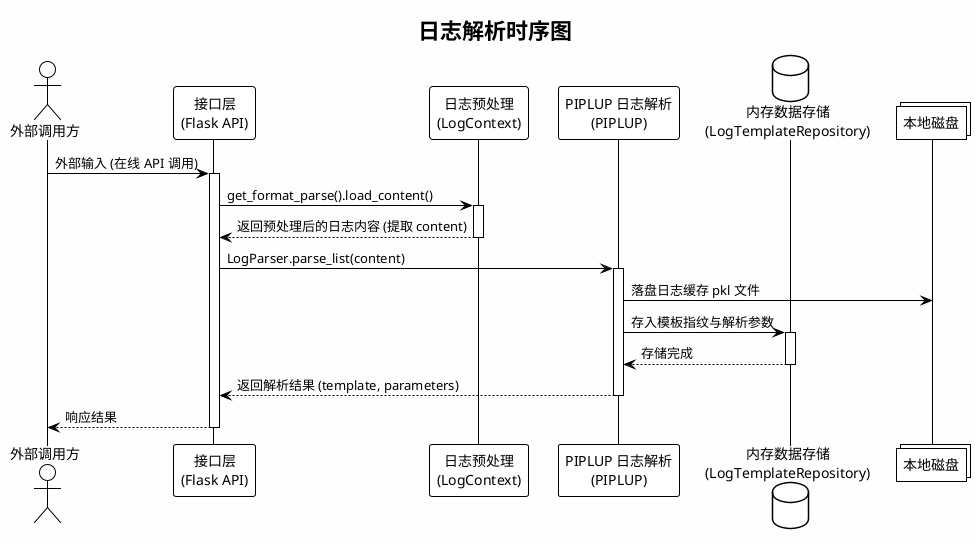
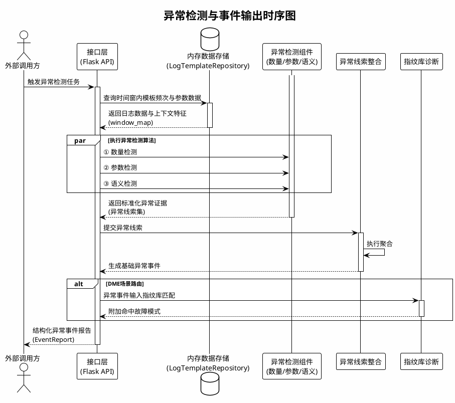
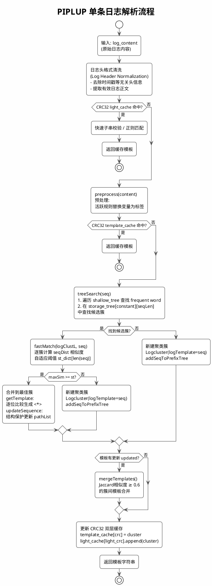
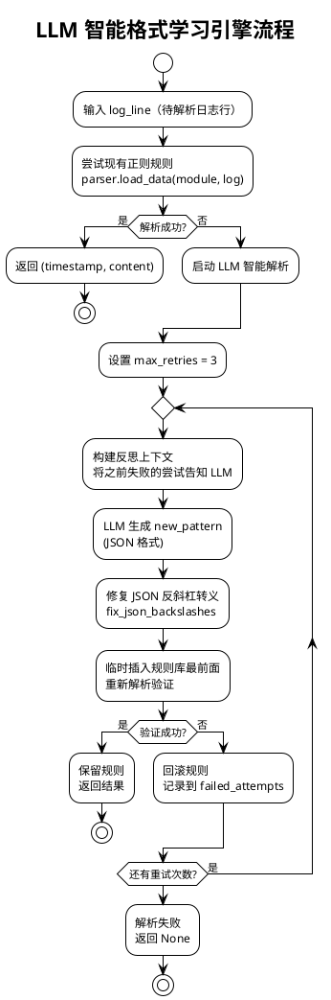
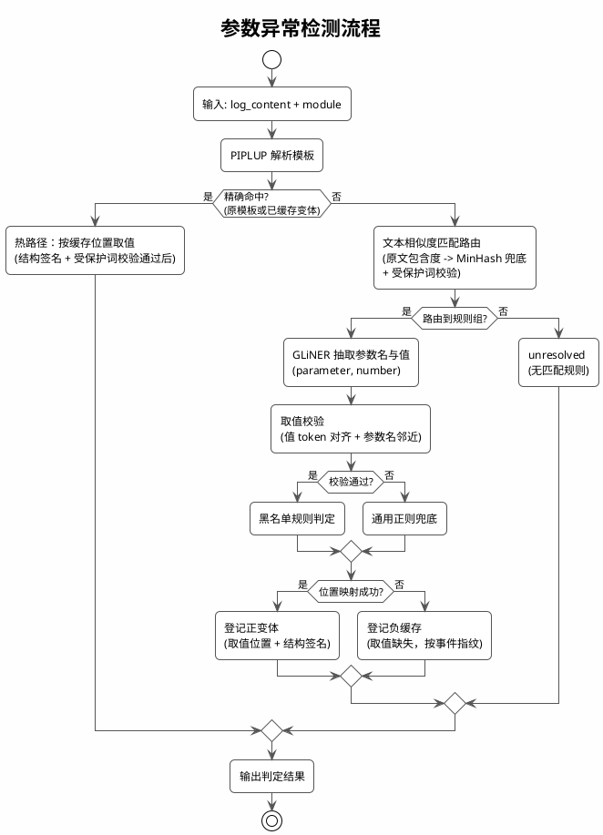
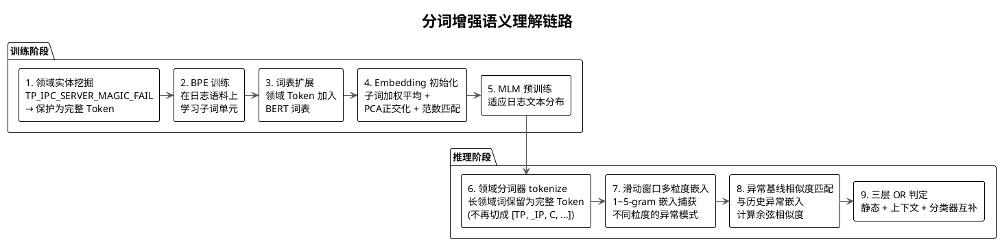
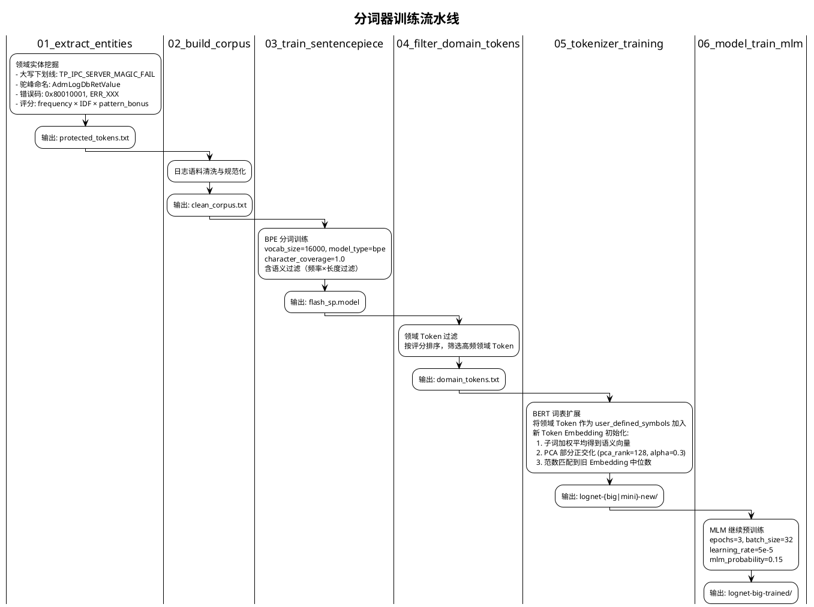
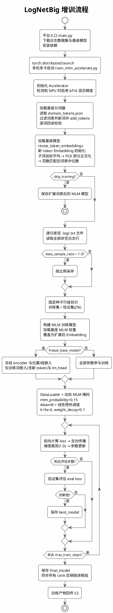
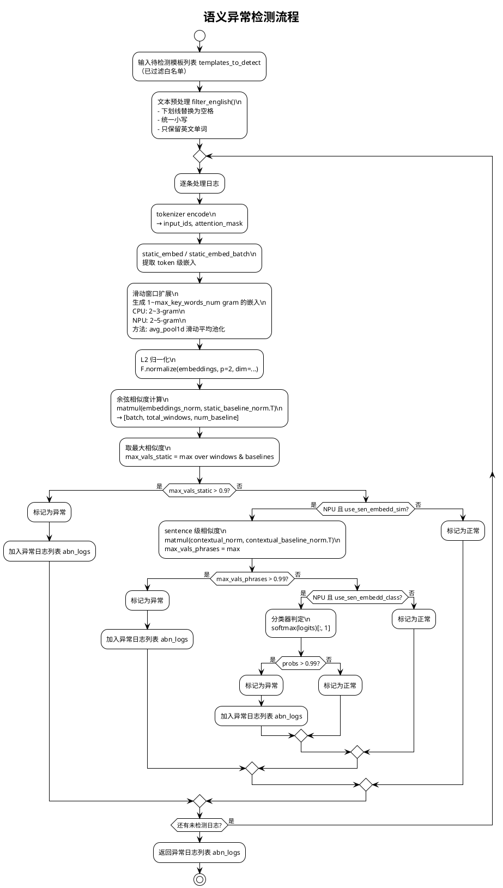

# LogNet3.0 方案设计与实现文档（V6）

| 项目 | 内容 |
|------|------|
| 文档名称 | LogNet3.0 方案设计与实现文档 |
| 版本 | V7.0 |
| 日期 | 2026-10-08 |
| 关键技术点 | 免人工配置异构日志解析、模板无关的参数异常检测、分词增强语义异常检测 |

---

## 目录

1. [概述](#1-概述)
2. [系统架构设计](#2-系统架构设计)
3. [模块交互与时序设计](#3-模块交互与时序设计)
4. [关键技术点一：免人工配置异构日志解析](#4-关键技术点一免人工配置异构日志解析)
5. [关键技术点二：模板无关的参数异常检测](#5-关键技术点二模板无关的参数异常检测)
6. [关键技术点三：分词增强语义异常检测](#6-关键技术点三分词增强语义异常检测)
7. [数量异常检测](#7-数量异常检测)
8. [异常检测结果融合与故障诊断](#8-异常检测结果融合与故障诊断)
9. [评估指标体系](#12-评估指标体系)
13. [端到端示例](#13-端到端示例)

---

## 1. 概述

LogNet3.0 面向海量异构日志，目标是解析与异常检测全程免人工配置。系统有三个核心技术点：

- **免人工配置异构日志解析**：基于自研 PIPLUP（Prefix-tree Indexed Parsing with LLM-assisted Universal Processing）算法，结合 LLM 智能格式学习引擎，自动解析不同模块、不同格式的日志，无需人工逐模块配置正则规则。
- **模板无关的参数异常检测**：检测配置只有参数名和黑名单，不含任何模板解析规则；参数抽取由 GLiNER 通用完成，日志路由靠词面相似度自动归属，首见结构在线学习，同结构日志再走缓存直检。
- **分词增强语义异常检测**：训练领域专用 BERT 分词器，做滑动窗口多粒度嵌入，再与异常基线做相似度匹配，检测日志内容本身的语义异常。

---

## 2. 系统架构设计


---

## 3. 系统时序设计

### 3.1 日志解析



### 3.2 异常检测



## 4. 关键技术点一：免人工配置异构日志解析

### 4.1 技术概述

传统日志解析方案（如 Drain3）要为每种日志格式预配置正则表达式，参数变量的识别也依赖固定规则。LogNet3.0 靠三层机制做到免人工配置：PIPLUP 算法、LLM 智能格式学习引擎、自动预处理剪枝。

### 4.2 PIPLUP 算法核心设计

**模块输入示例**：`receive data from 192.168.1.100 failed, error code 0x80010001`

**模块输出示例**：`receive data from <*> failed, error code <*>`，并关联对应模板簇。

**具体职责**：消费格式识别模块分离出的日志正文，通过预处理、索引检索、相似度匹配和模板演化生成稳定模板。模板结果交给仓库及后续异常检测模块使用。

#### 4.2.1 数据结构

PIPLUP 采用**双层前缀树**结构：

```
shallow_tree (浅层索引)          storage_tree (深层存储)
┌──────────────────────┐       ┌─────────────────────────────────┐
│ "None": [cluster1,   │       │ "None": {                       │
│         cluster2,...]│       │   7: [cluster1, cluster3],      │
│ "recv": [cluster3,   │       │   5: [cluster2]                 │
│         cluster4,...]│       │ },                              │
│ "start": [cluster5]  │       │ "recv": {                       │
└──────────────────────┘       │   8: [cluster3, cluster4],      │
                                │   6: [cluster5]                 │
  按 frequent word 分组          │ }                               │
  (常量词作为一级索引)            └─────────────────────────────────┘
                                  按 frequent word + 序列长度 二级索引
```

- **shallow_tree**：`dict[str, List[Logcluster]]`，以常量词（frequent word）为键，快速缩小搜索范围
- **storage_tree**：`dict[str, dict[int, List[Logcluster]]]`，在常量词基础上再按序列长度分组
- **Logcluster**：每个聚类簇维护 `logTemplate`（当前模板）、`pathList`（分支路径列表，最多 `br_thresh` 条）、`templateList`（后处理后的候选模板集合）、`hit_time`（命中次数）

#### 4.2.2 解析流程



#### 4.2.3 自适应相似度阈值

PIPLUP 不使用固定相似度阈值，而是按日志序列长度自适应选择：

```python
self.st_dict = {
    1: 1,           # 1个token：必须完全匹配
    2: (2-1)/2,     # 2个token：允许0.5差异
    3: (3-1)/3,     # 3个token：允许0.33差异
    4: (4-1)/4,
    5: (5-2)/5,     # 5个token：允许0.6差异
    6: (6-2)/6,
    7: (7-3)/7,
    8: (8-3)/8,
    9: (9-3)/9,
    'others': 0.5   # 超过9个token：固定0.5
}
```

**设计原理**：短日志对参数变化更敏感，需要更严格的阈值；长日志包含更多常量词，可以容忍更多参数位置差异。

#### 4.2.4 CRC32 双层缓存

为加速重复日志的解析，PIPLUP 实现了两级 CRC32 缓存：

| 缓存层级 | 位置 | 键 | 计算方式 | 命中效果 |
|---------|------|---|---------|---------|
| **light_cache** | 预处理前 | `CRC32(数字替换为0后的日志)` | `_light_digit_re.sub('0', content)` → CRC32 | 跳过预处理，通过快速子串校验或正则匹配返回缓存模板 |
| **template_cache** | 预处理后 | `CRC32(预处理后日志)` | `' '.join(logmessageL)` → CRC32 | 跳过树搜索步骤 |

在重复日志高占比的生产场景下，大部分解析降为 O(1) 查表操作。

#### 4.2.5 常量词自动发现（模板演化）

当模板发生变化（`oldTemplate != newTemplate`）或命中次数达到 `update_population`（默认385次），且当前仍在 `'None'` 分组（`first_constant == 'None'`）时，自动提取分组依据：

1. 遍历当前模板中的 token，找到第一个不含 `<*>` 的常量词
2. 将该常量词作为 frequent word 加入 `shallow_tree` 和 `storage_tree`
3. 从 `'None'` 分组中迁移所有包含该常量词的簇到新分组
4. 后续日志优先按 frequent word 检索，候选集随之缩小


#### 4.2.6 后处理：LUNAR 模板校正

`postprocessing.py` 实现模板规范化，主要规则包括：

- **输入示例**：`path = "<*>.<*>"  status = <*>`
- **输出示例**：`path = <*> status = <*>`
- **职责**：消除聚类结果中由标点、连续占位符和赋值形式引入的伪差异，将规范化模板返回 PIPLUP 更新缓存和模板仓库。

- 连续变量折叠：`<*>.<*>` → `<*>`，`<*>,<*>` → `<*>`
- 赋值泛化：`= value` → `= <*>`
- 标点包裹简化：`"<*>"` → `<*>`
- 多空格压缩为单空格

### 4.3 预处理掩码

**模块输入示例**：`pid:53912,tid:53969 connect 192.168.1.1:8080`

**模块输出示例**：pid:`<*>,tid:<*> connect <*>`，同时返回本条日志命中的模式类型。

**具体职责**：在 PIPLUP 检索前将高变参数替换为统一占位符，并从样本中自动筛选有效规则。处理后的 token 序列直接进入 PIPLUP 索引和相似度匹配。

| 掩码类型 | 典型模式 | 目的 |
|---|---|---|
| 日志头与时间 | `datetime_full`、`kernel_uptime`、`epoch_ms_13d`、`log_level` | 先消除与业务模板无关的日志头差异 |
| 运行时身份 | `pid_tid_pair`、`serial_num`、`device_serial` | 屏蔽进程、线程和设备实例波动 |
| 结构化复合值 | `brace_hex_value_pair`、`hex_dump`、`embedded_hex`、`xnet_ctx_id` | 先匹配特化结构，避免被通用数字规则切碎 |
| 地址与路径 | `url`、`IPv4_port`、`IPv6`、`Mac_address`、`path` | 统一网络与文件定位参数 |
| 通用值 | `duration`、`size`、`numerical`、`weekday_months` | 作为后置通用兜底 |

执行顺序遵循“复杂、特化模式优先，通用数字模式最后”。

### 4.4 LLM 智能格式学习引擎（可选）

**模块输入示例**：一条现有格式规则无法分离时间戳和正文的原始日志。

**模块输出示例**：`{"timestamp": "2026-09-15 10:00:00", "content": "disk read failed"}`，以及通过本地验证的候选格式规则。

**具体职责**：只在本地格式规则未命中时生成候选规则，经回放验证成功后才供格式解析器使用。它解决日志头格式的冷启动问题，不参与模板聚类或异常判定。



### 4.5 复杂度分析

| 算法 | 检索复杂度 | 空间复杂度 | 备注 |
|------|-----------|-----------|------|
| Drain3 | O(d+k) 平均, O(n) 最坏 | O(n·d) | d=树深度, k=候选簇数 |
| PIPLUP | O(\|C\|+k) 平均 | O(n·br_thresh) | C=常量词数, br_thresh=分支阈值 |
| PIPLUP + CRC32缓存 | O(1) 缓存命中 | O(m) | m=缓存条目数, 重复日志场景 |

### 4.6 端到端解析示例

**输入日志**：

```
[2026-02-04 11:39:58][12345][ERR]receive data from 192.168.1.100:8080 failed, error code 0x80010001
```

**解析过程**：

1. `LogFormatParser.load_data("osd", log)` 匹配 `format_chaos.json` 中的多组备选正则，提取 `timestamp=2026-02-04 11:39:58`, `content=receive data from ...`
2. `preprocess(content)` 按剪枝后的活跃规则集执行替换（`use_keys=False` 时替换为 `<*>`）：
   - `192.168.1.100:8080` → `<*>`
   - `0x80010001` → `<*>`
3. `PIPLUP.treeSearch()` 在 storage_tree 中查找，未命中 → 新建聚类簇
4. `postprocessing.correct_single_template()` 规范化模板
5. **输出模板**：`receive data from <*> failed, error code <*>`

---

## 5. 关键技术点二：模板无关的参数异常检测

### 5.1 技术概述

参数异常检测走冷热双路径。首次见到的日志结构走冷路径：计算文本相似度匹配对应的模板，GLiNER 通用抽取参数名与值，黑名单判定，成功后记录模板变体。同结构日志再来时走热路径：按缓存位置直接取值判定，全程零模型调用。

还有第三类结构：能匹配到模板、但目标参数取不到值（信息不足，例如改过参数名的易混淆日志）。这类结构无法登记变体，按事件指纹记入负缓存，同结构再现时直接判无法判定，不再重复调用模型。

| 模块 | 对应实现 | 主要职责 |
|------|----------|----------|
| 模板解析 | `piplup/`、`piplup_parser.py`、`parser_bridge.py` | PIPLUP 模板聚类（即关键技术点一），per-module 持久状态 |
| 文本相似度匹配 | `lexical_matcher.py` | 两级路由（模板匹配 + 原文兜底）与受保护词校验 |
| 通用抽取 | `gliner_backend.py`、`gliner_adapter.py` | GLiNER2.5-multi 抽取参数名与数值 |
| 规则判定 | `legacy_adapter.py` | 配对校验、正则兜底、黑名单判定 |
| 位置映射 | `position_mapper.py` | 位置回放、结构签名生成与校验 |
| 变体缓存 | `variant_store.py` | SQLite 持久化，事件指纹身份；含负缓存（取值缺失结构） |

### 5.2 参数异常检测流程

冷路径与热路径合并为一张流程图（冷路径左侧分支到模型，热路径从缓存校验出发，无模型调用）：



后续各节按此流程图自上而下展开：5.3 对应"文本相似度匹配路由"、5.4 对应"GLiNER 抽取 + 取值校验 + 正则兜底"、5.5 对应"登记正变体 / 负缓存"。

### 5.3 文本相似度匹配路由

**模块输入示例**：

```json
{
  "module": "eds",
  "raw_text": "Get ns async failed, \"s:[13,\"ret(3).",
  "template": "Get ns async failed, \"s:[<*>,\"ret(<*>)."
}
```

**模块输出示例**：

```json
{
  "accepted": true,
  "group_id": "eds|10304",
  "score": 1.0,
  "evidence": {
    "representation": "get ns async failed s ret",
    "candidates": [
      {"group_id": "eds|10304", "score": 1.0},
      {"group_id": "eds|10305", "score": 0.833},
      {"group_id": "eds|10306", "score": 0.714}
    ]
  }
}
```

**具体职责**：确定日志属于哪个规则组。分两步：第一步拿原文直接算包含度（更严格的规则，要求规则组模板的词 80% 以上出现在原文中），第二步用 MinHash 模板相似度兜底（容忍更大的词面差异）。

#### 5.3.1 格式规范化

所有匹配在同一坐标系上进行：casefold 统一大小写、值形态 token（数字、十六进制）剥离、纯分隔标点丢弃。

```text
模板  "Get ns async failed ret ( <NUM> )"   →   {get, ns, async, failed, ret}
日志  "Get ns async failed ret(3)."          →   {get, ns, async, failed, ret}
```

值剥离后 `ret(3)` 与 `ret(999)` 的匹配表示完全一致，路由只看结构不看值。

#### 5.3.2 第一步：原文包含度匹配

拿日志**原文**（而非解析模板）和各规则组模板算包含度：

$$
\text{包含度} = \frac{|\text{原文 token} \cap \text{候选 token}|}{|\text{候选 token}|}
$$

即候选模板的词有多少出现在原文里。阈值为 **0.80**（候选模板 80% 以上的词必须在原文中出现）。同分时取词数更多的候选（特异性优先）：原文同时出现 s 和 ret 时归属 10304（6 词）而非其子集 10305（5 词）。

**为什么是 0.80 而不是 1.0**：设为 1.0 意味着模板的每个词都必须出现在原文中，任何一个词缺失就拒绝。但合法的删词变体（如 `Sqlite step fail(return code=10, ctx=30198` 少了 `sql`）对模板 `{sqlite, step, sql, fail, return, code}` 的包含度是 5/6 = 0.833。如果要求 1.0，这批样本全部丢失。实测 11k 数据中包含度在 0.8~0.91 区间的样本共 539 条（304 条删词变体 + 235 条易混淆），它们在 0.80 阈值下被正确路由，在 1.0 下全部被拒。0.80 的含义是"允许模板最多缺失 20% 的词"，刚好覆盖删一个词的场景。

**为什么包含度先行**：它是更严格的规则。多字段日志（如 `dci_size(2048) ctx=10000 ttl=2` 对模板 `{dci_size}`）在 Jaccard 下被额外字段稀释到 0.33，但包含度是 1.0（模板的词全部在原文中）。家族模板（词面子集关系）靠特异性 tie-break 区分。实测（11k 数据）原文包含度优先比模板匹配优先的归属正确率高 1.3 个百分点（0.9945 vs 0.9814，错组 30 vs 102）。

#### 5.3.3 第二步：MinHash 模板相似度兜底

原文包含度拒绝的日志，再用解析模板与各规则组模板算 MinHash Jaccard 相似度（128-perm 签名估计集合交并比），Top1 超过阈值 **0.75** 即归属。

**为什么需要这一步**：包含度要求模板的词几乎全部出现（阈值 0.80 以上），原文有删词、措辞变化等部分缺失时可能被拒。MinHash 是模糊匹配，容忍更大的词面差异。

**阈值的确定**：0.75 来自 11k 数据实测扫描（原文包含度固定 0.80 优先，MinHash 作为第二步）：

| MinHash 阈值 | 路由总数 | 原文臂 | MinHash 臂 | 归属正确率 | 错组 |
|---|---|---|---|---|---|
| 0.45 | 5,726 | 5,437 | 289 | 0.9945 | 30 |
| 0.55 | 5,486 | 5,437 | 49 | 0.9943 | 30 |
| **0.75** | **5,437** | **5,437** | **0** | **0.9942** | **30** |

归属正确率与错组在 0.45~0.75 区间恒定（MinHash 臂的增量贡献不引入错组）。选 0.75 是因为当前数据规模下 MinHash 臂的额外贡献趋近于零（原文包含度已覆盖绝大多数可路由样本），保留较高阈值可降低将来规则库扩大时模板臂误接受的风险。

### 5.4 GLiNER 通用抽取与取值校验

**模块输入示例**：

```json
{
  "module": "eds",
  "raw_text": "Get ns async failed, \"s:[13,\"ret(3).",
  "labels": ["parameter", "number"]
}
```

**模块输出示例**：

```json
{
  "parameters": {
    "s":   {"value_raw": "13", "value_raw_span": [25, 27], "confidence": 0.70},
    "ret": {"value_raw": "3",  "value_raw_span": [33, 34], "confidence": 0.77}
  }
}
```

**具体职责**：用 GLiNER 从原文抽取参数名与值，经过取值校验后交给规则判定。取值校验不通过的转通用正则兜底。

#### 5.4.1 标签与抽取效果

GLiNER 的标签为 `("parameter", "number")`。同一条日志在不同标签组合下的抽取效果（四组对照实验结果）：

```text
输入：Get ns async failed, "s:[13,"ret(3).
     金标：s → 13（黑名单值），ret → 3

(parameter, value)   →  ret→3, s→13      两个参数都对，但 value 标签宽松
                                          （会抽到 "failed"、"ret" 等词面值）
(name, number)      →  ns→3              把 namespace 缩写当参数名
(parameter, number) →  ret→3, s→13      两个参数都对，number 约束只抽数字
(name, value)       →  ns→3              同 name 盲区
```

规律：参数名一侧用 `parameter`（语义明确），值一侧用 `number`（数值约束天然排除词面值，挡住误配对）。

**GLiNER 能取到什么值**：`number` 标签下 GLiNER 识别纯数字和十六进制（`13`、`-99999`、`0xaaaad802e008`），并给出参数名和值各自的原文区间。但两种情况取不到：一是目标参数不在标签定义的范围内（如 `format flag from (21) --> (12)` 中 `format flag` 的值是一个"运算结果"而非直接数值）；二是原文中参数名与值之间隔了其他 token，GLiNER 可能配错对（如把 `s` 配到 `ret` 的值）。

#### 5.4.2 配对校验

GLiNER 输出的（参数名，值）配对可能出错，判定前过两道校验：

**值 token 对齐**。值的字符区间必须完整落在唯一一个 token 内。跨 token 的值不可信：

```text
原文：ret = : -1
GLiNER 输出：value_raw = ": -1"（区间跨了 ":" 空格 "-" "1" 三个 token）
校验结果：不可信 → 转正则兜底 → 正则按 ret=: -1 形态取到 "-1" ✓
```

**参数名邻近**。参数名 token 必须在值前方两个非分隔符 token 以内：

```text
原文：error code=10 extra_26: 28
GLiNER 输出：error code → 28（参数名与值之间隔了 extra_26 等 6 个 token）
校验结果：距离超出 → 配对不可信 → 转正则兜底 → 正则按 code=10 形态取到 "10" ✓
```

两道校验都不通过的取值不进入判定，转下一步的正则兜底。

#### 5.4.3 通用正则兜底

GLiNER 取值失败（参数缺失、配对校验拒绝）时，用通用形态正则从原文直接取值。五种形态全部为通用样式，不针对任何具体模板：

```text
形态 1（赋值 + 冒号）  ret=: -2     →  值 "-2"
形态 2（赋值）         ret=-1       →  值 "-1"
形态 3（函数调用）     ret(3)       →  值 "3"
形态 4（冒号分隔）     ret: 5       →  值 "5"
形态 5（is 连接）      status is 5  →  值 "5"
```

**兜底原理**：正则绕过 GLiNER 的语义理解，直接在原文上按字符模式搜索参数名后紧跟的取值。因为日志的参数名与值之间总是由有限种分隔符（`=`、`:`、`(`、空格 + is）连接，通用正则能覆盖绝大多数格式。加两条限制：词边界（参数 `s` 不匹配 `status:` 的词尾）和值形态校验（只认数字和十六进制，`from`、`is` 等普通词不算取值）。

**兜底使用边界**：仅出现在两处——GLiNER 提取失败处的判定取值，和变体入库时的位置定位。不做复合取值二次猜测，不针对具体模板编写专用模式。

**兜底触发率**（11k 最终运行，554 次冷路径 GLiNER 调用）：

| 触发原因 | 次数 | 占冷路径比 |
|---|---|---|
| GLiNER 整体输出为空 | 2 | 0.4% |
| 目标参数缺失（GLiNER 有输出但不含目标） | 29 | 5.2% |
| 配对校验拒绝 | 14 | 2.5% |
| **合计触发兜底** | **43** | **7.8%** |

冷路径 92.2% 的样本由 GLiNER 直接给出可信取值，7.8% 转正则。正则在标准形态下可以取回值，但对 `format flag from (x) --> (y)` 这类特殊措辞同样取不到（这 43 条最终全部为 unresolved，如实返回无法判定）。

### 5.5 变体位置缓存

**模块输入示例**（登记成功的一条冷路径结果）：

```json
{
  "group_id": "eds|10304",
  "module": "eds",
  "template_text": "Get ns async failed, \"s:[13,\"ret(3).",
  "event_fingerprint": "e3b0c44298fc1c14",
  "param_positions": {
    "eds|10304|7|s": 7
  },
  "structural_signature": {
    "n_tokens": 13,
    "targets": {
      "eds|10304|7|s": {
        "position": 7,
        "left_anchor": {"index": 3, "token": "failed"}
      }
    }
  }
}
```

（`param_positions` 的键是规则 ID（模块|模板号|原配置位置|参数名），值是该参数值在原文分词后的 token 下标——上文 s 的值 13 在第 7 个 token。）

**模块输出示例**（SQLite 中一行可执行变体）：

```json
{
  "variant_id": "429183ba24e84d54",
  "event_fingerprint": "e3b0c44298fc1c14",
  "group_id": "eds|10304",
  "state": "executable"
}
```

（下次同结构日志按 `(module, event_fingerprint)` 查到这一行，凭位置和签名直接判定。）

**具体职责**：把冷路径的学习成果持久化，让模型调用随流量收敛。

#### 5.5.1 事件指纹

**事件指纹解决的问题**：冷路径学到的东西要存进缓存，需要回答"哪些日志算同一件事，可以共享这条缓存"。这和文本相似度匹配解决的问题不同：

| | 文本相似度匹配（冷路径路由） | 事件指纹（缓存身份） |
|---|---|---|
| 回答的问题 | 这条日志属于哪个**规则组** | 这条日志的**结构**之前见过没有 |
| 输入 | 解析模板 / 原文 | 原文（值剥离后） |
| 用的时机 | 每次冷路径都做 | 精确命中 / 登记时 |
| 需要模型吗 | 否（纯词法） | 否（纯哈希） |

文本匹配是"模糊的归属"——日志和模板相似度够高就归入这个规则组，但两条相似度 0.8 的日志可能结构不同（一个多一个字段），它们的取值位置不能互相套用。事件指纹是"精确的结构相等"——值剥离后的词序列完全一致（词一样、顺序一样），取值位置才安全共享。

三条日志摆在一起看：

```text
"Sqlite step sql fail(return code=10, ctx=30198"
  扔掉值 → [sqlite, step, sql, fail, return, code, ctx] ─┐
                                                          ├─ 词一样、顺序一样 → 指纹相同
"Sqlite step sql fail(return code=21, ctx=30199"          │
  扔掉值 → [sqlite, step, sql, fail, return, code, ctx] ─┘

"Sqlite step sql fail(return code=21)"
  扔掉值 → [sqlite, step, sql, fail, return, code]     → 少了 ctx，指纹不同，单独一条缓存
```

热路径查询流程：新日志分词、扔掉值、算哈希，按 `(module, event_fingerprint)` 到缓存查表。指纹命中说明结构完全一致，直接按登记的取值位置取值；指纹不命中说明是新结构（或字段有增删），回冷路径。

**为什么不用解析模板当缓存身份**：PIPLUP 的模板会在线演化——首条日志建簇时模板是全字面的，后续同簇日志使模板逐步泛化出 `<*>`。日志结构没变，模板变了。若以模板为身份，每次模板泛化都导致同结构日志的缓存假失效，白白重走冷路径。事件指纹只看原文，不受模板演化影响。

#### 5.5.2 取值位置与结构签名

登记一条变体，会存两样东西：**值在哪个 token 上**，和**这条日志的形状描述**。

**取值位置**。冷路径抽取参数时拿到了值的字符区间，换算成 token 下标存起来。存之前先回放验证一次：按下标把 token 取出来，必须和抽取到的值一模一样。

**结构签名**。光有下标还不够：下标 8 在两条不同的日志里指的可能是完全不同的词。签名记录日志的形状，两样东西：token 总数，加上值附近最近的固定词（锚点，记下标和词本身）：

```text
Sqlite step sql fail(return code=10, ctx=30198

签名 = {
  token 总数: 12,            # 逗号不算token
  code 的值: 8 号 token,     # 从0开始算
  左锚点:    fail（3 号）
}
```

热路径拿到新日志，先比形状：token 总数一样吗？fail 还在 3 号吗？都对得上，说明结构和登记时一致，8 号 token 取出来的就是 code 的值。对不上——比如中间多了几个词、总数变了——8 号指的可能已是别的词，这条缓存不可信，作废，回冷路径重新学习。

#### 5.5.3 负缓存：取不到值的结构

有一类日志能匹配到模板、被路由到规则组，但**目标参数取不到值**——典型是易混淆日志（参数名不同、词面却很像）。没有取值就没有位置可存，这类结构登记不了正变体，于是每次出现都重走完整冷路径，模型反复调用。真实流量里不在辖日志是大多数，这一块的重复开销会盖过其他所有成本。

负缓存按事件指纹记住"这个结构的目标取不到值"。同结构再现时直接判无法判定，零模型调用。

只缓存**取不到值**的结构，不缓存"有取值但映射失败"的。原因：取值逐条变化（同结构、不同值），缓存的旧值套到新日志上会给出错误判定。而"取不到值"与具体取值无关，结构相同就稳定。

命中时同样校验目标定义修订（参数名集合变化即失效），与前两节语义一致：缓存只加速，不改判定。

### 5.6 端到端检测示例

**输入日志（ccdb 模块）**：

```text
Sqlite step sql fail(return code=10, ctx=30198
```

**冷路径（首见）**：

1. PIPLUP 解析（值泛化为 <*>），无精确命中，进入语义匹配
2. 原文兜底：{sqlite,step,sql,fail,return,code,ctx} 对 ccdb|1 模板词集 {sqlite,step,sql,fail,return,code} 包含度 1.0，归属 ccdb|1；受保护词 `fail` 出现在正文里（前驱是 `sql`），校验通过
3. GLiNER 抽取：`code → 10`，值 token 对齐、参数名 `code` 紧邻值前方，配对通过
4. 黑名单判定：ccdb|1 的 `code` 黑名单为 ["10"]，命中，判 `anomaly`：

```json
{
  "status": "anomaly",
  "route": "semantic_gliner",
  "matched_group": "ccdb|1",
  "anomalies": [
    {"param_name": "code", "param_value": "10",
     "detect_mode": "black_list", "mode_detail": ["10"]}
  ]
}
```

5. 位置映射成功，按事件指纹登记变体（位置 = code 值的 token 下标，签名 = token 总数 + 锚点）

**同结构日志再来（热路径）**：

```text
Sqlite step sql fail(return code=21, ctx=30201
```

值剥离后指纹与上条一致，缓存命中；受保护词校验、结构签名校验通过；按登记位置取值得到 21，不在黑名单，判 `normal`。全程零模型调用。

---

## 6. 关键技术点三：分词增强语义异常检测

### 6.1 技术概述

语义异常检测识别日志内容本身的异常，例如不该出现的错误信息、异常的词组合。LogNet3.0 的做法分三层：领域专用分词器训练、多粒度滑动窗口嵌入、异常基线相似度匹配，统称"分词增强"。



### 6.2 领域分词器训练

**模块输入示例**：包含 `TP_IPC_SERVER_MAGIC_FAIL`、错误码和驼峰标识符的脱敏日志语料。

**模块输出示例**：领域词表、SentencePiece 模型、扩展后的 BERT tokenizer 及 MLM 继续预训练权重。

**具体职责**：从日志语料中发现需要整体保留的领域词，扩展通用词表并让模型适应日志文本分布。训练产物交给 LogNetMini/Big 加载。



#### 6.2.2 LogNetBig 增训



### 6.3 双模型架构

**模块输入示例**：`input_ids + attention_mask`，内容由领域分词器编码。

**模块输出示例**：token 级静态嵌入；NPU 版本可同时输出句子级嵌入和分类 logits。

**具体职责**：为语义异常检测提供统一的向量表示；Mini 用于 CPU 低资源场景，Big 用于 NPU 吞吐和多头判定场景。

#### 6.3.1 LogNetMini（CPU 场景）

| 参数 | 值 | 说明 |
|------|---|------|
| D_MODEL | 64 | 隐藏维度 |
| N_LAYERS | 1 | Transformer 层数 |
| N_HEADS | 1 | 注意力头数 |
| max_len | 512 | 最大序列长度 |
| 模型文件 | `lognet-mini/model.pth` | 本地权重 |

**特点**：轻量级 BERT，仅提取 token 级静态嵌入，适合 CPU 推理。

#### 6.3.2 LogNetBig（NPU 场景）

| 参数 | 值 | 说明 |
|------|---|------|
| hidden_size | 1024 | 隐藏维度 |
| num_hidden_layers | 24 | Transformer 层数 |
| vocab_size | 250002 | 词表大小 |
| max_position_embeddings | 8192 | 最大位置编码长度 |
| 基础模型 | BGE-M3 | 预训练骨干网络 |
| 模型文件 | `lognet-big/` | 含 `LogNetUnified`（统一模型） |

**特点**：基于 BGE-M3 的 24 层大模型，同时输出 static（token 级）和 contextual（sentence 级）两种嵌入，外加分类 logits。

### 6.4 语义异常检测核心流程

**模块输入示例**：`["metadata corruption found in <*> node"]`，输入前已由上游过滤白名单。

**模块输出示例**：`{"templateId": 42, "anomalyType": ["semantic"], "summary": ["日志内容异常请检查"]}`。

**具体职责**：对模板文本编码，构造多粒度短语嵌入，并与异常基线比较。



### 6.5 端到端检测示例

**场景**：DME 存储集群 NPU 节点语义异常检测

**异常基线**（`abn_baseline_DME_NPU.json`）包含历史异常日志的嵌入：

- "disk sector read error unrecoverable"
- "cache data loss detected in volume"
- "metadata corruption found in btree node"

**输入模板**：

```
metadata corruption found in <*> node
```

**检测过程**：

1. `filter_english()`: `metadata corruption found in node`（去除 `<*>` 和标点）
2. `tokenizer encode`: `[CLS] metadata corruption found in node [SEP]` → 7 tokens
3. `static_embed_batch()`: 生成 7（1-gram）+ 6（2-gram）+ 5（3-gram）+ 4（4-gram）+ 3（5-gram）= 25 个窗口嵌入
4. L2 归一化后与基线计算相似度矩阵 `[1, 25, num_baseline]`
5. `max_vals_static = 0.94`（与基线 "metadata corruption found in btree node" 的 4-gram 嵌入高度相似）
6. `0.94 > 0.9` → **静态层判定异常**
7. 输出：`{anomalyType: ["semantic"], summary: ["日志内容异常请检查"]}`

---

## 7. 数量异常检测

### 7.1 技术概述

数量异常检测器（`quantitive_detector.py`）基于两种策略：

**模块输入示例**：某模板在连续时间窗中的计数 `[12, 11, 13, 12, 95]`，以及白名单和时间窗大小。

**模块输出示例**：`{"templateId": 42, "timestamp": 1725963825, "log_count": 95, "score": 47}`。

**具体职责**：从模板仓库按时间窗汇总出现次数，检测新模板和频次突变。结果与语义、参数检测使用同一日志身份交给融合模块。

#### 7.1.1 新增模板检测

```python
# quantitive_detector.py:171-191
def find_new_templates_based_on_seq(previous_data, current_data, previous_time_interval, white_list={}):
    prev_data_seq = previous_data['event'] if previous_data else []
    cur_data_seq = current_data['event']
    if sum(prev_data_seq) == 0 and cur_data_seq and str(id) not in white_list:
        for i in range(len(cur_data_seq)):
            if cur_data_seq[i] > 0:
                all_id_results.append(id)
                all_times.append(current_data['time'][i])
                all_counts.append(cur_data_seq[i])
                return ...
```

白名单外且历史无出现的模板 → 标记为新增异常。

#### 7.1.2 k-sigma 突变检测（留一法）

```python
# quantitive_detector.py:198-230
def find_change_templates_based_on_sigma(current_data, time_interval, k_sigma=3):
    arr = np.array(cur_data_seq)
    sum_all = np.sum(arr)
    sum_of_squares_all = np.sum(arr ** 2)
    n = len(cur_data_seq)
    for i in range(n):
        # 留一法：去除当前点后计算均值和标准差
        sum_without_x = sum_all - cur_data_seq[i]
        mean = sum_without_x / (n - 1)
        variance = (sum_of_squares_all - cur_data_seq[i]**2 - sum_without_x**2/(n-1)) / (n-1)
        std = math.sqrt(variance)
        # 判定：偏离 k_sigma 倍标准差且绝对差值 > 10
        if abs(cur_data_seq[i] - mean) > k_sigma * std and abs(cur_data_seq[i] - mean) > 10:
            # 记录突变
```

**留一法**：计算去除当前窗口后的均值/标准差，避免异常点自身影响统计量。函数默认 `k_sigma=3`，生产配置中调用方传入 `k_sigma=6`，同时要求绝对差值 > 10 防止低频日志的误报。

#### 7.1.3 评分机制

```python
# quantitive_detector.py:137-168
@staticmethod
def assign_scores(result_dict, order_key, max_score, min_score):
    # 正态分布 CDF 映射分数
    ranks = np.arange(1, num_templates + 1)
    group_scores = norm.ppf((ranks - 0.5) / num_templates) * std_dev + mean_score
    group_scores = np.clip(group_scores, min_score, max_score).round().astype(int).tolist()
```

使用正态分布的百分位点（`scipy.stats.norm.ppf`）将异常程度映射为分数区间，新增模板 [50, 99]，突变模板 [1, 49]。

---

## 8. 异常检测结果融合与故障诊断

### 8.1 三路检测结果融合

**模块输入示例**：语义、参数、数量三路检测器输出的列表，元素均带 `template_id`、`log_id`、`timestamp`。

**模块输出示例**：`{"logId": "L-7", "templateId": 42, "anomalyType": ["parametric", "semantic"]}`及对应时间窗事件。

**具体职责**：按稳定日志身份去重、保留同一日志的多种异常类型，再按时间窗聚合成事件。DME 事件继续交给指纹库诊断。

```python
@staticmethod
def merge_results(semantic_data, parametric_data, quantitative_data):
    # 按 (template_id, log_id, timestamp) 三元组去重合并
    anomaly_data_dict = defaultdict(dict)
    for data in semantic_data:
        anomaly_data_dict[(template_id, log_id, timestamp)]["semantic"] = metadata
    for data in parametric_data:
        anomaly_data_dict[(template_id, log_id, timestamp)]["parametric"] = metadata
    for data in quantitative_data:
        anomaly_data_dict[(template_id, log_id, timestamp)]["quantitative"] = metadata
    
    # 生成 anomalyType 列表（可同时命中多种异常）
    for data in anomaly_data:
        one_data = {"logId": ..., "timestamp": ..., "templateId": ...}
        if "parametric" in data["metadata"]:
            one_data["anomalyType"] = ["parametric"]
            one_data["summary"] = [f"日志参数异常,异常参数为 {parameter}"]
        if "quantitative" in data["metadata"]:
            times = data["metadata"]["quantitative"]["log_count"]
            if "anomalyType" in one_data:
                one_data["anomalyType"].append("quantitative")
            else:
                one_data["anomalyType"] = ["changeRecord"]
            one_data["summary"].append(f"日志频率异常,当前时间窗内出现{times}次")
        if "semantic" in data["metadata"]:
            one_data["anomalyType"].append("semantic")
            one_data["summary"].append("日志内容异常请检查")
```

**融合逻辑**：

- 同一条日志可能同时被多种检测器标记为异常
- 按 `(template_id, log_id, timestamp)` 三元组去重
- `anomalyType` 为列表，可包含 `parametric`、`quantitative`（或仅数量异常时为 `changeRecord`）、`semantic` 的任意组合
- 按时间戳聚合为 10 分钟时间窗的 `anomaly_event`

### 8.2 指纹库故障诊断（DME 专用）

**模块输入示例**：一个时间窗内去重后的异常模板集合，以及指纹库中的线索模板、权重和案例阈值。

**模块输出示例**：`{"caseID": "CASE_JH_023", "case_name": "控制器内部 CDR 芯片异常", "case_score": 1.12}`。

**具体职责**：将异常事件中的模板与已知故障线索模糊匹配，累加权重并在达到案例阈值时生成诊断候选。该模块消费融合事件，输出只是候选故障，不改写原始检测证据。

```python
# anomaly_detection.py:91-115
for event in anomaly_event:
    for case_name, case_data in finger_print.items():
        case_score = 0
        for template in templates_unique:
            for finger_print in case_data["clues"]:
                for s, weight in finger_print.items():
                    if same_template(s, template):  # 模糊匹配
                        case_score += weight
        if case_score > thresh:  # thresh=0.95
            reports.append({"case_name": ..., "case_score": ..., ...})
```

**指纹库结构**（`finger_print_lib.json`）：

```json
{
  "case1": {
    "caseName": "控制器内部CDR芯片异常",
    "caseID": "CASE_JH_023",
    "clues": [{"模板字符串": 权重}, ...],
    "threshold": 0.95
  }
}
```

**匹配逻辑**：

1. 对每个异常事件中的模板，与指纹库线索模板做 `same_template` 模糊匹配
2. `same_template` 要求 token 数一致、至少 2 个 token 精确匹配、通配符位置兼容
3. 累加匹配到的线索权重，超过阈值则生成故障诊断报告

> **阈值来源差异**：`anomaly_detection` 方法（单案例检测）中阈值硬编码为 `thresh = 0.95`；`all_detect` 方法（全量检测）中阈值从指纹库配置 `case_data["threshold"]` 动态读取，各案例可配置不同阈值。

---

## 9. 评估指标体系

### 10.1 模板解析评估指标

| 指标 | 含义 | 计算方式 |
|------|------|---------|
| **GA** (Grouping Accuracy) | 聚类准确率 | 正确分组的行数 / 总行数 |
| **PA** (Parsing Accuracy) | 解析准确率 | 模板完全匹配的行数 / 总行数 |
| **FGA** (F1 of Grouping) | 聚类 F1 | 簇划分的 P/R/F1 |
| **FTA** (F1 of Template) | 模板 F1 | 模板集合的 P/R/F1 |

### 10.2 异常检测评估指标

| 指标 | 含义 | 计算方式 |
|------|------|---------|
| **Precision** | 精准率 | TP / (TP + FP) |
| **Recall** | 召回率 | TP / (TP + FN) |
| **F1** | 精确率与召回率的调和平均 | 2PR / (P + R) |
| **Accuracy** | 总体判定正确率 | (TP + TN) / 全部样本 |
| **CompressionRate** | 压缩率 | 评测集日志总数 / 上报异常日志总数 |

**三级统计粒度**：

- **Event level**：以时间窗为单位统计 TP/FP/TN/FN
- **Template level**：以模板为单位统计
- **Log level**：以日志行为单位统计
- **Parameter level**：以原文字符区间对齐具体参数，独立统计 TP/FP/FN

参数检测还需单独报告正常误报率、解析成功率、参数对齐率、DQ 路由率、对齐冲突数和时序事件首检延迟。日志级告警不得代替参数级定位命中；`data_quality` 类案例应以 DQ 通道捕获率评估，不应强行计入业务异常召回。

**Trade-off 策略**：

- 供运维人员分析：优先保障 Precision
- 供诊断 Agent/LLM 分析：优先保障 Recall，压缩率尽量高

---

## 10. 端到端示例

**场景**：DME 存储集群 osd 模块发生磁盘扇区读取错误

**Step 1：日志采集与解析**

输入日志：

```
[2026-02-04 11:39:58][12345][ERR] disk sector read error unrecoverable, sector 0x1A2B, retry count 5
```

解析过程：

1. `LogFormatParser.load_data()` → `timestamp=2026-02-04 11:39:58`, `content=disk sector read error unrecoverable, sector 0x1A2B, retry count 5`
2. `preprocess(content)` → `disk sector read error unrecoverable, sector NUM_TAG, retry count NUM_TAG`
3. PIPLUP `treeSearch` → 新建聚类簇
4. `postprocessing` → 模板：`disk sector read error unrecoverable, sector <*>, retry count <*>`
5. `generate_template_id` → `CRC32(template) = 3829104765`
6. 存入 `LogTemplateRepository`

**Step 2：异常检测（三路并行）**

**语义检测**：

- `filter_english()`: `disk sector read error unrecoverable sector retry count`
- LogNetBig 编码 → 25 个窗口嵌入（1~5-gram）
- 与异常基线计算相似度 → `max_vals_static = 0.95`
- `0.95 > 0.9` → **语义异常**

**参数检测**：

- 先在模板库中找到与本日志匹配的模板。本示例假设模板库已纳入该日志形态，并把 `sector` 的 `0x1A2B` 列为黑名单值。
- 固定 token 与占位符形态匹配成功，参数提取同时记录 `0x1A2B` 在原日志中的字符区间。
- 十六进制等值比较命中黑名单，直接输出 **参数异常**。
- 若模板库未包含该日志，则将该日志模板记录进模板库中。

**数量检测**：

- 该模板在 11:30-11:40 时间窗出现 15 次
- 历史均值 2 次/窗，标准差 1.5
- `|15 - 1.75| > 6 × 1.71` 且 `|15 - 1.75| > 10` → **数量异常**

**Step 3：结果融合**

```json
{
    "logId": "log_001",
    "timestamp": 1738646400000,
    "templateId": 3829104765,
    "template": "disk sector read error unrecoverable, sector <*>, retry count <*>",
    "anomalyType": ["semantic", "parametric", "changeRecord"],
    "summary": [
        "日志内容异常请检查",
        "日志参数异常,异常参数为 0x1A2B",
        "日志频率异常,当前时间窗内出现15次"
    ]
}
```

**Step 4：指纹库故障诊断（DME 专用）**

- 异常模板 `disk sector read error unrecoverable, sector <*>, ...` 与指纹库线索 `disk sector read error <*> sector <*>` 匹配，权重 0.5
- 异常模板与线索 `retry count <*>` 匹配，权重 0.6
- `case_score = 1.1 > threshold 0.95` → 生成诊断报告：

```json
{
    "format_time": "2026-02-04 11:40:00",
    "case_name": "磁盘扇区不可恢复读错误",
    "case_score": 1.1,
    "fault_mode_clue": [
        "disk sector read error unrecoverable, sector <*>, retry count <*>, <*>"
    ],
    "module": "osd",
    "source": "node-01"
}
```
