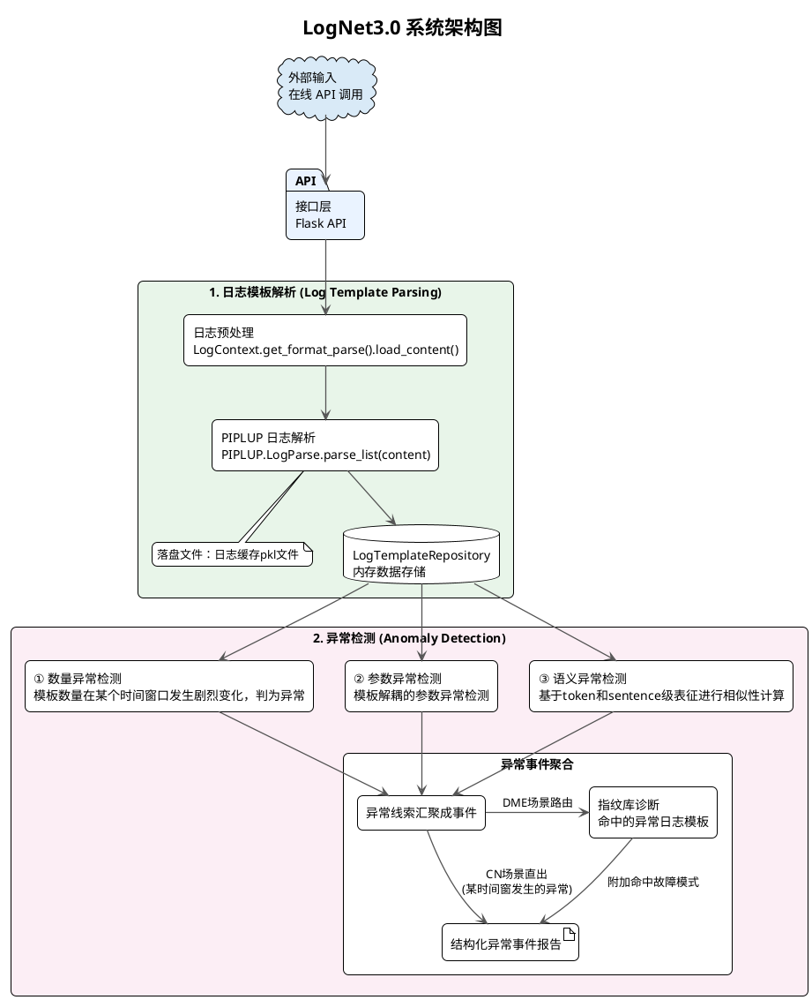
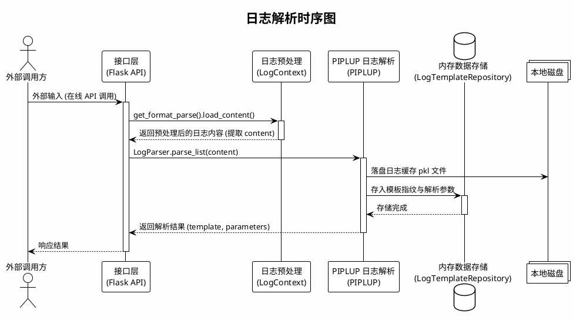
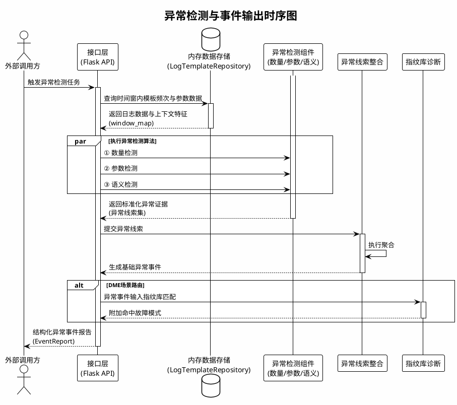
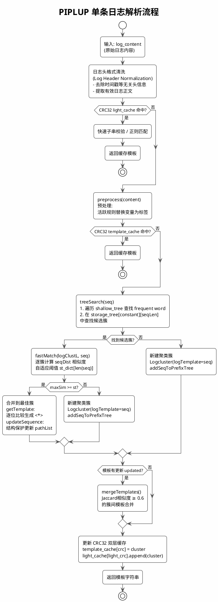
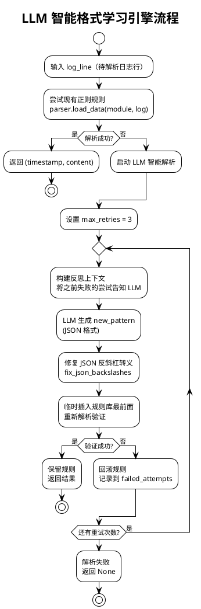
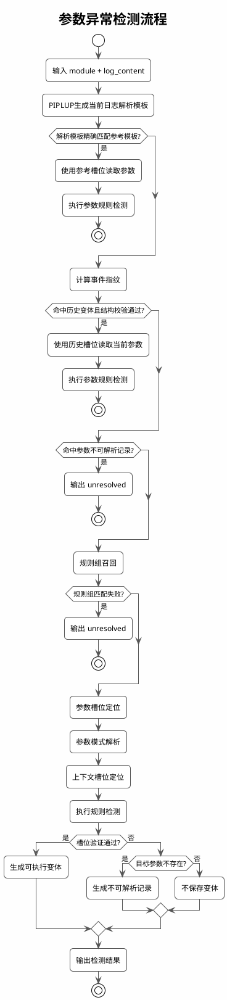
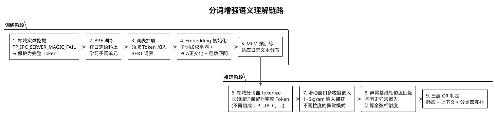
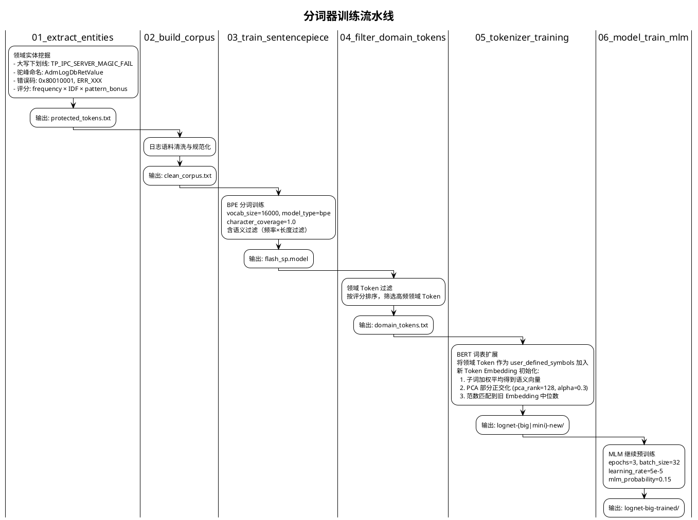
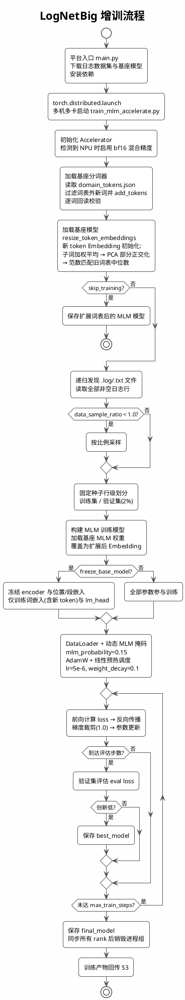
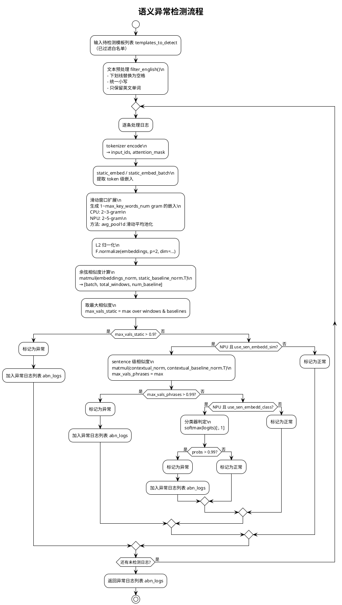

# LogNet3.0 方案设计与实现文档（V12）

| 项目 | 内容 |
|------|------|
| 文档名称 | LogNet3.0 方案设计与实现文档 |
| 版本 | V12.0 |
| 日期 | 2026-10-15 |
| 关键技术点 | 免人工配置异构日志解析、模板解耦的参数异常检测、分词增强语义异常检测 |

---

## 目录

1. [概述](#1-概述)
2. [系统架构设计](#2-系统架构设计)
3. [模块交互与时序设计](#3-模块交互与时序设计)
4. [关键技术点一：免人工配置异构日志解析](#4-关键技术点一免人工配置异构日志解析)
5. [关键技术点二：模板解耦的参数异常检测](#5-关键技术点二模板解耦的参数异常检测)
6. [关键技术点三：分词增强语义异常检测](#6-关键技术点三分词增强语义异常检测)
7. [数量异常检测](#7-数量异常检测)
8. [异常检测结果融合与故障诊断](#8-异常检测结果融合与故障诊断)
9. [评估指标体系](#12-评估指标体系)
13. [端到端示例](#13-端到端示例)

---

## 概述

LogNet3.0 面向海量异构日志，目标是解析与异常检测全程免人工配置。系统有三个核心技术点：

- **免人工配置异构日志解析**：基于自研 PIPLUP（Prefix-tree Indexed Parsing with LLM-assisted Universal Processing）算法，结合 LLM 智能格式学习引擎，自动解析不同模块、不同格式的日志，无需人工逐模块配置正则规则。
- **模板解耦的参数异常检测**：通过业务词匹配实现规则归属，结合通用参数模式解析与上下文槽位锚定动态定位目标参数，并利用事件指纹和结构签名实现槽位复用，使同一组检测规则能够适配字段增删、词序调整及格式变化，降低新版本适配成本。
- **分词增强语义异常检测**：训练领域专用 BERT 分词器，做滑动窗口多粒度嵌入，再与异常基线做相似度匹配，检测日志内容本身的语义异常。

---

## 系统架构设计




---

## 系统时序设计

### 日志解析



### 异常检测



## 关键技术点一：免人工配置异构日志解析

### 技术概述

传统日志解析方案（如 Drain3）要为每种日志格式预配置正则表达式，参数变量的识别也依赖固定规则。LogNet3.0 靠三层机制做到免人工配置：PIPLUP 算法、LLM 智能格式学习引擎、自动预处理剪枝。

### PIPLUP 算法核心设计

**模块输入示例**：`receive data from 192.168.1.100 failed, error code 0x80010001`

**模块输出示例**：`receive data from <*> failed, error code <*>`，并关联对应模板簇。

**具体职责**：消费格式识别模块分离出的日志正文，通过预处理、索引检索、相似度匹配和模板演化生成稳定模板。模板结果交给仓库及后续异常检测模块使用。

#### 数据结构

PIPLUP 采用**双层前缀树**结构：

```
shallow_tree (浅层索引)          storage_tree (深层存储)
┌──────────────────────┐       ┌─────────────────────────────────┐
│ "None": [cluster1,   │       │ "None": {                       │
│         cluster2,...]│       │   7: [cluster1, cluster3],      │
│ "recv": [cluster3,   │       │   5: [cluster2]                 │
│         cluster4,...]│       │ },                              │
│ "start": [cluster5]  │       │ "recv": {                       │
└──────────────────────┘       │   8: [cluster3, cluster4],      │
                                │   6: [cluster5]                 │
  按 frequent word 分组          │ }                               │
  (常量词作为一级索引)            └─────────────────────────────────┘
                                  按 frequent word + 序列长度 二级索引
```

- **shallow_tree**：`dict[str, List[Logcluster]]`，以常量词（frequent word）为键，快速缩小搜索范围
- **storage_tree**：`dict[str, dict[int, List[Logcluster]]]`，在常量词基础上再按序列长度分组
- **Logcluster**：每个聚类簇维护 `logTemplate`（当前模板）、`pathList`（分支路径列表，最多 `br_thresh` 条）、`templateList`（后处理后的候选模板集合）、`hit_time`（命中次数）

#### 解析流程



#### 自适应相似度阈值

PIPLUP 不使用固定相似度阈值，而是按日志序列长度自适应选择：

```python
self.st_dict = {
    1: 1,           # 1个token：必须完全匹配
    2: (2-1)/2,     # 2个token：允许0.5差异
    3: (3-1)/3,     # 3个token：允许0.33差异
    4: (4-1)/4,
    5: (5-2)/5,     # 5个token：允许0.6差异
    6: (6-2)/6,
    7: (7-3)/7,
    8: (8-3)/8,
    9: (9-3)/9,
    'others': 0.5   # 超过9个token：固定0.5
}
```

**设计原理**：短日志对参数变化更敏感，需要更严格的阈值；长日志包含更多常量词，可以容忍更多参数位置差异。

#### CRC32 双层缓存

为加速重复日志的解析，PIPLUP 实现了两级 CRC32 缓存：

| 缓存层级 | 位置 | 键 | 计算方式 | 命中效果 |
|---------|------|---|---------|---------|
| **light_cache** | 预处理前 | `CRC32(数字替换为0后的日志)` | `_light_digit_re.sub('0', content)` → CRC32 | 跳过预处理，通过快速子串校验或正则匹配返回缓存模板 |
| **template_cache** | 预处理后 | `CRC32(预处理后日志)` | `' '.join(logmessageL)` → CRC32 | 跳过树搜索步骤 |

在重复日志高占比的生产场景下，大部分解析降为 O(1) 查表操作。

#### 常量词自动发现（模板演化）

当模板发生变化（`oldTemplate != newTemplate`）或命中次数达到 `update_population`（默认385次），且当前仍在 `'None'` 分组（`first_constant == 'None'`）时，自动提取分组依据：

1. 遍历当前模板中的 token，找到第一个不含 `<*>` 的常量词
2. 将该常量词作为 frequent word 加入 `shallow_tree` 和 `storage_tree`
3. 从 `'None'` 分组中迁移所有包含该常量词的簇到新分组
4. 后续日志优先按 frequent word 检索，候选集随之缩小


#### 后处理：LUNAR 模板校正

`postprocessing.py` 实现模板规范化，主要规则包括：

- **输入示例**：`path = "<*>.<*>"  status = <*>`
- **输出示例**：`path = <*> status = <*>`
- **职责**：消除聚类结果中由标点、连续占位符和赋值形式引入的伪差异，将规范化模板返回 PIPLUP 更新缓存和模板仓库。

- 连续变量折叠：`<*>.<*>` → `<*>`，`<*>,<*>` → `<*>`
- 赋值泛化：`= value` → `= <*>`
- 标点包裹简化：`"<*>"` → `<*>`
- 多空格压缩为单空格

### 预处理掩码

**模块输入示例**：`pid:53912,tid:53969 connect 192.168.1.1:8080`

**模块输出示例**：pid:`<*>,tid:<*> connect <*>`，同时返回本条日志命中的模式类型。

**具体职责**：在 PIPLUP 检索前将高变参数替换为统一占位符，并从样本中自动筛选有效规则。处理后的 token 序列直接进入 PIPLUP 索引和相似度匹配。

| 掩码类型 | 典型模式 | 目的 |
|---|---|---|
| 日志头与时间 | `datetime_full`、`kernel_uptime`、`epoch_ms_13d`、`log_level` | 先消除与业务模板无关的日志头差异 |
| 运行时身份 | `pid_tid_pair`、`serial_num`、`device_serial` | 屏蔽进程、线程和设备实例波动 |
| 结构化复合值 | `brace_hex_value_pair`、`hex_dump`、`embedded_hex`、`xnet_ctx_id` | 先匹配特化结构，避免被通用数字规则切碎 |
| 地址与路径 | `url`、`IPv4_port`、`IPv6`、`Mac_address`、`path` | 统一网络与文件定位参数 |
| 通用值 | `duration`、`size`、`numerical`、`weekday_months` | 作为后置通用兜底 |

执行顺序遵循“复杂、特化模式优先，通用数字模式最后”。

### LLM 智能格式学习引擎（可选）

**模块输入示例**：一条现有格式规则无法分离时间戳和正文的原始日志。

**模块输出示例**：`{"timestamp": "2026-09-15 10:00:00", "content": "disk read failed"}`，以及通过本地验证的候选格式规则。

**具体职责**：只在本地格式规则未命中时生成候选规则，经回放验证成功后才供格式解析器使用。它解决日志头格式的冷启动问题，不参与模板聚类或异常判定。



### 端到端解析示例

**输入日志**：

```
[2026-02-04 11:39:58][12345][ERR]receive data from 192.168.1.100:8080 failed, error code 0x80010001
```

**解析过程**：

1. `LogFormatParser.load_data("osd", log)` 匹配 `format_chaos.json` 中的多组备选正则，提取 `timestamp=2026-02-04 11:39:58`, `content=receive data from ...`
2. `preprocess(content)` 按剪枝后的活跃规则集执行替换（`use_keys=False` 时替换为 `<*>`）：
   - `192.168.1.100:8080` → `<*>`
   - `0x80010001` → `<*>`
3. `PIPLUP.treeSearch()` 在 storage_tree 中查找，未命中 → 新建聚类簇
4. `postprocessing.correct_single_template()` 规范化模板
5. **输出模板**：`receive data from <*> failed, error code <*>`

---

## 关键技术点二：模板解耦的参数异常检测

### 技术概述

在实际生产环境中，同一业务事件的日志格式通常会随着版本迭代、模块演进或打印策略调整发生变化，例如新增上下文字段、调整字段顺序、改变参数分隔方式等。传统参数异常检测通常依赖固定模板位置，将动态字段映射为参数槽位。一旦日志结构发生变化，需要重新维护模板匹配关系和参数提取规则，导致规则迁移成本较高。

针对上述问题，LogNet3.0 设计了一种**模板解耦的参数异常检测机制**。该机制不依赖单一固定日志模板，而是通过规则归属、参数定位和异常判定三个阶段，实现检测规则与日志结构的解耦。具体包括：
1. 规则归属
   判断当前日志适用的参数检测规则集合；
2. 参数定位
   在当前日志结构中定位目标参数对应的位置，并建立参数槽位映射；
3. 异常判定
   基于规则配置对当前日志中的参数值执行异常检测。

首次处理未知日志结构时，系统通过业务词召回确定候选规则组，并结合参数模式解析和上下文槽位定位完成参数提取；对于已经验证有效的日志结构，系统保存参数槽位映射及结构约束信息，形成可复用的日志变体索引。

后续检测过程中，系统通过变体索引快速定位历史结构，并通过结构校验确认参数位置仍然有效，验证通过后直接读取当前日志中的参数值执行检测。

通过上述机制，检测规则与具体日志模板实例解耦，使同一组参数规则能够适配字段增加、位置偏移以及轻量格式变化等日志演进场景，无需针对每个新版本重新维护参数抽取逻辑。

### 规则配置与核心概念

下面以 `ccdb` 模块 Sqlite 失败日志为例，检查参数 `code` 是否为命中黑名单。

```json
{
  "module": "ccdb",
  "template_id": 1,
  "template": "Sqlite step sql fail ( return code = <NUM>",
  "params": [
    {
      "param_name": "code",
      "param_pos": "8",
      "detect_mode": "black_list",
      "detect_detail": ["10"]
    }
  ]
}
```

其中：
- `param_pos=8` 表示参考模板中目标参数对应的初始 token 位置；
- 该位置用于描述参考模板中的参数槽位关系，并非所有日志变体的固定读取位置；
- 当日志结构变化时，检测器会重新定位当前日志中的实际参数位置，并在验证通过后保存新的槽位映射。

系统涉及以下核心概念：

| 概念 | 含义 | 作用 |
|-|-|-|
|规则组|同一模块、同一参考模板关联的一组参数检测规则，如 `ccdb\|1`|定义目标参数集合及异常判断方式|
|参考模板|规则配置关联的标准日志结构|提供初始参数槽位和业务上下文|
|解析模板|PIPLUP 根据当前日志生成的结构化模板，变量表示为 `<*>`|用于模板匹配和结构辅助定位|
|日志变体|已完成参数定位验证的日志结构实例|保存当前结构对应的参数槽位映射|
|事件指纹|对规范化后的业务 token 序列计算得到的结构索引|快速检索历史日志结构|
|结构签名|参数附近固定 token、整体长度等结构约束信息|验证历史槽位是否仍然有效|

其中：
- **规则组解决“当前日志使用哪套检测规则”的问题**；
- **变体索引解决“当前日志如何快速定位参数”的问题**。
两者相互独立：不同日志结构可以属于同一个规则组，但由于字段布局不同，需要维护不同的参数槽位映射。

### 总体检测流程

日志进入参数异常检测模块后，首先经过 PIPLUP 解析获得当前日志结构信息。检测器按照**参考模板匹配 → 变体索引复用 → 泛化定位学习**的优先级执行检测。



**检测结果与槽位学习过程相互独立。**

参数检测结果由当前日志实际取值决定：
- 参数成功提取且命中异常规则，输出 `anomaly`；
- 参数成功提取但未命中规则，输出 `normal`；
- 参数无法确定，输出 `unresolved`。

### 首次检测：规则归属与参数定位

首次遇到未知日志结构时，系统需要完成：

1. 规则组召回；
2. 参数提取；
3. 参数槽位定位；
4. 变体索引生成。

#### 规则组召回

首次遇到未知日志结构时，检测器首先需要确定该日志适用的参数规则集合。

规则归属仅在当前模块范围内进行，通过日志业务词与规则模板之间的关联关系完成候选召回。

匹配前，对日志进行规范化处理：
- 统一大小写；
- 删除时间、数字、十六进制地址等动态值；
- 去除普通分隔符；
- 保留业务相关固定 token。

例如：

参考模板：

```text
Sqlite step sql fail ( return code = <NUM>
```

规范化：

```text
[sqlite, step, sql, fail, return, code]
```

当前日志：

```text
Sqlite step sql fail(return code=10, ctx=30198
```

规范化：

```text
[sqlite, step, sql, fail, return, code, ctx]
```

系统采用两级召回：

| 阶段 | 查询对象 | 作用 |
|---|---|---|
| 业务词覆盖召回 | 当前日志固定 token | 处理新增字段、轻微格式变化 |
| 模板结构相似召回 | PIPLUP解析模板 | 处理字段变化较大的场景 |

**业务词覆盖召回**

定义：

$$
\operatorname{Containment}(Q,C)=\frac{|Q\cap C|}{|C|}
$$

其中：

- `Q` 为当前日志业务 token 集合；
- `C` 为规则模板业务 token 集合。

以上例：

```text
Q = {sqlite, step, sql, fail, return, code, ctx}

C = {sqlite, step, sql, fail, return, code}
```

因此：

$$
\operatorname{Containment}(Q,C)=1.0
$$

新增字段 `ctx` 不影响已有规则匹配。

**模板结构相似匹配召回**

当业务词覆盖不足时，系统基于 PIPLUP 输出模板进一步计算结构相似度。

采用 MinHash 生成 token 集合签名，并估计：

$$
\operatorname{Jaccard}(A,B)=\frac{|A\cap B|}{|A\cup B|}
$$

其中：
- `A` 为当前解析模板 token 集合；
- `B` 为候选规则模板 token 集合。

#### 参数定位

规则组确定后，检测器根据参数定义寻找目标参数。首先进入参数模式解析阶段。

| 参数形式 | 示例 | 提取结果 |
|-|-|-|
| 赋值 | `ret=-1` | `-1` |
| 冒号 | `error code:0x202727d1` | `0x202727d1` |
| 符号包含 | `ret(3)` | `3` |
| is连接 | `status is 5` | `5` |
| to连接 | `status changed to 2` | `2` |
| 空格相邻 | `Func 0xaaaad802e008` | `0xaaaad802e008` |
| 多token | `state(1 0 1 0)` | 首个token |

解析过程同时返回：参数值、原文字符区间、token 坐标。

例如：

```json
{
  "raw_text": "Sqlite step sql fail(return code=10, ctx=30198",
  "param_name": "code",
  "value": "10",
  "span": [33, 35]
}
```

其中：
- span 基于原始日志计算；
- 后续通过 span 映射到 token 坐标，生成参数槽位映射。

这样可以避免因为去除数字、标点等规范化操作导致参数位置偏移。

#### 上下文约束槽位定位

部分参数无法通过通用模式直接提取，例如：

```text
format flag from (21) --> (12)
```

目标参数为箭头右侧的 `12`，但其并未直接跟随参数名称出现，无法通过简单的 `key=value` 或函数调用形式定位。

针对该类场景，系统利用参考模板中的参数槽位信息，通过**上下文约束槽位定位**完成参数迁移。

该方法不依赖目标参数在日志中的绝对位置，而是利用目标参数附近稳定的业务 token 和结构符号生成局部约束窗口，在当前日志中重新搜索目标槽位。

以参考模板为例：

新日志增加了一个前置字段：

```text
trace=900 increase crb vdb recovered(10000), format flag from (21) --> (12). ctx=123349
```

通过原有槽位无法直接取得目标值，此时按下面三步定位。

**第一步：围绕参考模板的目标槽位，生成窗口。**

以 15 号槽位为中心，取左侧最多 8 个、右侧最多 2 个 token。固定词和符号保持原样，左侧其他占位符改为单 token 通配 `*`：

```text
                  左侧锚窗口（8 个 token）       目标槽位    右侧锚窗口
参考模板局部：     format flag from ( <NUM> ) --> ( <NUM>     ) .
转换后的窗口：     format flag from (   *   ) --> ( [待取值]  ) .
```

这里 `*` 吸收旧值；`[待取值]` 表示要捕获的目标 token，不是日志中的方括号。`param_pos` 用来选择参考模板中的目标槽位，实际匹配使用这段上下文。

**第二步：在新日志中查找这段窗口，并取出唯一匹配的目标值。**

```text
窗口：  format flag from (  *  ) --> ( [待取值] ) .
原文片段：format flag from ( 21  ) --> (    12    ) .
                            └─通配          └─捕获

原文 token 下标：
10=format  11=flag  12=from  13=(  14=21  15=)  16=-->  17=(  18=12  19=)  20=.
```

窗口在这条原文中只匹配一次，因此取得 `12`。前置的 `trace=900` 增加了 3 个 token，目标值已经从参考模板的 **15 号移到原文的 18 号**；按旧下标读取会读到 `)`，按窗口则仍能找到箭头右侧的新值。

**第三步：检查取值形态，再执行黑名单规则。**

`12` 符合数字形态，且命中黑名单，输出 `anomaly`。这里旧值 `21` 只被通配吸收，不参与该规则的判定。

若完整窗口未匹配，定位器会缩小窗口，尝试仍保留内容词的局部上下文；最终无法找到唯一匹配时，返回未取到值。例如，同一条日志中重复出现两段完全相同的 `format flag from (...) --> (...).`，无法确定检查哪一段，就不能任选一个值。

#### 生成变体索引：事件指纹与结构签名

首次完成参数定位后，系统将验证通过的参数槽位映射及结构约束持久化至变体知识表，形成可复用的日志变体索引。变体索引由**事件指纹、参数槽位映射和结构签名**三部分组成：事件指纹负责检索历史日志结构，参数槽位映射记录目标参数的实际位置，结构签名通过 token 数量和邻域锚点验证位置有效性。只有参数位置映射及回放校验通过的日志结构，才会登记为可执行变体。

以 `ccdb|1` 规则为例，首次处理 `Sqlite step sql fail(return code=10, ctx=30198` 时，参数模式解析器提取 `code=10`，并将字符区间映射至原文第 8 号 token。系统首先对原文进行规范化分词，剥离数字、十六进制等动态值形态 token，保留有序非值 token 序列，并取 SHA256 哈希的前 16 位生成事件指纹：

```text
原文：Sqlite step sql fail(return code=10, ctx=30198

规范化分词：
[sqlite, step, sql, fail, return, code, =, 10, ctx, =, 30198]

剥离动态值：
[sqlite, step, sql, fail, return, code, =, ctx, =]

事件指纹：128906f162dbf9c1
```

由于事件指纹不包含具体参数取值，`code=10, ctx=30198` 与 `code=21, ctx=30199` 对应相同指纹；当新增 `extra=1` 字段时，规范化 token 序列发生变化，指纹也随之改变。为避免相同指纹下的参数位置偏移，系统进一步构建结构签名，将动态参数值替换为 `<*>`，记录 token 总数、结构序列以及各目标参数的实际位置和左右固定锚点。最终生成的变体知识表记录如下：

```json
{
  "variant_id": "3ead0cf0f1d248df",
  "scope": "main",
  "group_id": "ccdb|1",
  "template_text": "Sqlite step sql fail(return code=<*>, ctx=<*>",
  "event_fingerprint": "128906f162dbf9c1",
  "param_positions_json": {
    "ccdb|1|8|code": 8
  },
  "structural_signature_json": {
    "schema": "legacy_tokens_v1",
    "n_tokens": 12,
    "template_tokens": [
      "Sqlite", "step", "sql", "fail", "(",
      "return", "code", "=", "<*>", "ctx", "=", "<*>"
    ],
    "targets": {
      "ccdb|1|8|code": {
        "position": 8,
        "left_anchor": {
          "index": 7,
          "token": "="
        },
        "right_anchor": {
          "index": 9,
          "token": "ctx"
        }
      }
    }
  },
  "state": "executable"
}
```

其中，`param_positions_json` 记录 `code` 在当前日志结构中的实际位置为 `8`；`structural_signature_json` 则记录该结构包含 12 个 token，目标左侧 `token[7]` 为 `=`，右侧 `token[9]` 为 `ctx`。需要注意，事件指纹与结构签名采用不同的分词表示：前者剥离动态值用于结构检索，后者保留分隔符和参数位置用于槽位校验。因此，**事件指纹命中只代表找到候选变体，并不意味着历史参数位置可以直接复用**。

### 后续检测：基于变体索引的参数槽位复用

后续检测时，系统优先通过事件指纹检索已登记的历史变体，再利用结构签名验证槽位映射是否仍然适用于当前日志。以上述 `ccdb|1` 变体为例，检测器需确认当前日志仍包含 12 个 token，且 `token[7]="="`、`token[9]="ctx"`。验证通过后，直接读取 `token[8]` 作为当前 `code` 的参数值，并重新执行黑名单规则；若校验失败，则放弃历史位置，回退至规则归属和参数定位流程。

不同日志变化下的处理方式如下：

| 日志变化                                    | 变体索引处理                                                | 检测结果                  |
| ------------------------------------------- | ----------------------------------------------------------- | ------------------------- |
| **参数值变化**：`code=21, ctx=30199`        | 指纹不变，结构签名校验通过，复用第 8 号槽位                 | 读取 `21`，输出 `normal`  |
| **参数增加括号**：`code=[21], ctx=30199`    | 指纹不变，但 token 数量和锚点位置变化，放弃旧槽位并重新定位 | 提取 `21`，输出 `normal`  |
| **新增字段**：`code=10, ctx=30198, extra=1` | 事件指纹变化，重新执行规则归属与参数定位                    | 提取 `10`，输出 `anomaly` |

该机制复用的是参数定位关系，而非历史检测结论。即使规则黑名单发生变化，只要目标定义及槽位结构仍然有效，系统仍可复用历史位置，但必须按照当前规则重新判定参数值。对于同一日志中包含多个目标参数的场景，变体索引还支持保存多组槽位映射。例如，`dme_ext|2005` 规则组对应日志 `CLS_FENCING: Node xnet sche timeout(2) block timeout(1) abnormal.`，其 `param_positions_json` 同时保存两个参数的位置：

```json
{
  "dme_ext|2005|7|sche timeout": 10,
  "dme_ext|2005|12|block timeout": 15
}
```

对应结构签名分别记录第 10 号和第 15 号目标槽位及其左右括号锚点，使同一变体能够关联多个参数的取值位置。后续检测通过变体检索及各目标槽位校验后，即可分别读取当前值并执行对应规则，减少重复的规则归属与参数定位开销。

为保证变体复用的可靠性，系统根据参数定位与验证结果采用**正缓存、负缓存和不缓存**三种策略：

| 类型                       | 适用条件与处理方式                                           | 实际示例                                                     |
| -------------------------- | ------------------------------------------------------------ | ------------------------------------------------------------ |
| **正缓存（可执行变体）**   | 参数成功提取，位置映射及回放验证通过，保存可复用的槽位信息   | `code=10, ctx=30198` 首次登记后，`code=21, ctx=30199` 可复用位置并重新检测 |
| **负缓存（参数缺失）**     | 已确定规则组，但全部目标参数均无法提取，保存有效期内可复用的缺失结论 | `Get ns async failed rc(901).` 归属检查 `ret` 的规则组，但未定位目标参数；后续同结构日志可直接输出 `unresolved` |
| **不缓存（位置不可复用）** | 当前参数可提取并完成检测，但无法建立安全的 token 位置映射    | `func=QosFillVolMsgBuf+0x8d` 可提取子串 `0x8d`，但整体 token 无法按位置直接回读该子串，因此不登记变体 |

其中，负缓存仅复用目标参数缺失的结论，`unresolved` 不代表正常；对于已成功提取参数、但槽位映射或回放验证失败的日志，不登记负缓存，以免影响后续重新定位。变体知识通过 SQLite 持久化管理，，避免不同规则或版本之间产生错误复用。

通过上述机制，系统将首次检测获得的参数定位结果转化为**可验证、可复用的日志结构知识**，在未知变体下通过泛化定位保持规则适配能力，在稳定结构下通过槽位复用减少重复计算，实现检测规则与具体日志模板位置的解耦。

### 端到端解析示例

以下以 `ccdb|1` 参数检测规则为例，展示模板解耦参数检测机制如何适应不同日志结构。

**场景一：首次出现，完成规则匹配与槽位学习**

```text
Sqlite step sql fail(return code=10, ctx=30198
```

1. PIPLUP 生成解析模板；未精确命中原规则模板，也没有可复用的变体缓存。
2. 通过业务词召回匹配规则组，包含度为 `1.0`，归属 `ccdb|1`。
3. 参数模式解析器提取 `code=10`，得到值 `10` 和字符区间 `[33, 35)`。
4. 参数值命中黑名单，输出 `anomaly`。
5. 将字符区间映射到 8 号 token，验证回放与固定锚点；登记成功后，该结构拥有可执行变体。

**场景二：参数值变化，直接复用槽位**

```text
Sqlite step sql fail(return code=21, ctx=30201
```

事件指纹相同，且结构签名与受保护词校验通过。检测器按缓存的 8 号位置读取本次值 `21`，未命中黑名单，输出 `normal`，路由为 `exact_variant`。

**场景三：日志结构变化，规则复用但重新定位**

```text
Sqlite step sql fail(return ctx=30201, code=10
```

`ctx` 和 `code` 的顺序改变，事件指纹不同，旧位置不能直接复用。通过业务词召回匹配仍可归属 `ccdb|1`，参数模式解析器重新找到 `code=10`，输出 `anomaly`；若新布局的位置映射通过，再登记新变体。

## 关键技术点三：分词增强语义异常检测

### 技术概述

语义异常检测识别日志内容本身的异常，例如不该出现的错误信息、异常的词组合。LogNet3.0 的做法分三层：领域专用分词器训练、多粒度滑动窗口嵌入、异常基线相似度匹配，统称"分词增强"。



### 领域分词器训练

**模块输入示例**：包含 `TP_IPC_SERVER_MAGIC_FAIL`、错误码和驼峰标识符的脱敏日志语料。

**模块输出示例**：领域词表、SentencePiece 模型、扩展后的 BERT tokenizer 及 MLM 继续预训练权重。

**具体职责**：从日志语料中发现需要整体保留的领域词，扩展通用词表并让模型适应日志文本分布。训练产物交给 LogNetMini/Big 加载。



#### LogNetBig 增训



### 双模型架构

**模块输入示例**：`input_ids + attention_mask`，内容由领域分词器编码。

**模块输出示例**：token 级静态嵌入；NPU 版本可同时输出句子级嵌入和分类 logits。

**具体职责**：为语义异常检测提供统一的向量表示；Mini 用于 CPU 低资源场景，Big 用于 NPU 吞吐和多头判定场景。

#### LogNetMini（CPU 场景）

| 参数 | 值 | 说明 |
|------|---|------|
| D_MODEL | 64 | 隐藏维度 |
| N_LAYERS | 1 | Transformer 层数 |
| N_HEADS | 1 | 注意力头数 |
| max_len | 512 | 最大序列长度 |
| 模型文件 | `lognet-mini/model.pth` | 本地权重 |

**特点**：轻量级 BERT，仅提取 token 级静态嵌入，适合 CPU 推理。

#### LogNetBig（NPU 场景）

| 参数 | 值 | 说明 |
|------|---|------|
| hidden_size | 1024 | 隐藏维度 |
| num_hidden_layers | 24 | Transformer 层数 |
| vocab_size | 250002 | 词表大小 |
| max_position_embeddings | 8192 | 实际最大位置编码长度 |
| 基础模型 | XLM-RoBERTa Large | 预训练骨干网络 |
| 模型文件 | `lognet-big/` | 含 `LogNetUnified`（统一模型） |

**特点**：基于 BGE-M3，同时输出 static（token 级）和 contextual（sentence 级）两种嵌入，外加分类 logits。

### 语义异常检测核心流程

**模块输入示例**：`["metadata corruption found in <*> node"]`，输入前已由上游过滤白名单。

**模块输出示例**：`{"templateId": 42, "anomalyType": ["semantic"], "summary": ["日志内容异常请检查"]}`。

**具体职责**：对模板文本编码，构造多粒度短语嵌入，并与异常基线比较。



### 端到端检测示例

**场景**：DME 存储集群 NPU 节点语义异常检测

**异常基线**（`abn_baseline_DME_NPU.json`）包含历史异常日志的嵌入：

- "disk sector read error unrecoverable"
- "cache data loss detected in volume"
- "metadata corruption found in btree node"

**输入模板**：

```
metadata corruption found in <*> node
```

**检测过程**：

1. `filter_english()`: `metadata corruption found in node`（去除 `<*>` 和标点）
2. `tokenizer encode`: `[CLS] metadata corruption found in node [SEP]` → 7 tokens
3. `static_embed_batch()`: 生成 7（1-gram）+ 6（2-gram）+ 5（3-gram）+ 4（4-gram）+ 3（5-gram）= 25 个窗口嵌入
4. L2 归一化后与基线计算相似度矩阵 `[1, 25, num_baseline]`
5. `max_vals_static = 0.94`（与基线 "metadata corruption found in btree node" 的 4-gram 嵌入高度相似）
6. `0.94 > 0.9` → **静态层判定异常**
7. 输出：`{anomalyType: ["semantic"], summary: ["日志内容异常请检查"]}`

---

## 数量异常检测

### 技术概述

数量异常检测器（`quantitive_detector.py`）基于两种策略：

**模块输入示例**：某模板在连续时间窗中的计数 `[12, 11, 13, 12, 95]`，以及白名单和时间窗大小。

**模块输出示例**：`{"templateId": 42, "timestamp": 1725963825, "log_count": 95, "score": 47}`。

**具体职责**：从模板仓库按时间窗汇总出现次数，检测新模板和频次突变。结果与语义、参数检测使用同一日志身份交给融合模块。

#### 新增模板检测

```python
# quantitive_detector.py:171-191
def find_new_templates_based_on_seq(previous_data, current_data, previous_time_interval, white_list={}):
    prev_data_seq = previous_data['event'] if previous_data else []
    cur_data_seq = current_data['event']
    if sum(prev_data_seq) == 0 and cur_data_seq and str(id) not in white_list:
        for i in range(len(cur_data_seq)):
            if cur_data_seq[i] > 0:
                all_id_results.append(id)
                all_times.append(current_data['time'][i])
                all_counts.append(cur_data_seq[i])
                return ...
```

白名单外且历史无出现的模板 → 标记为新增异常。

#### k-sigma 突变检测（留一法）

```python
# quantitive_detector.py:198-230
def find_change_templates_based_on_sigma(current_data, time_interval, k_sigma=3):
    arr = np.array(cur_data_seq)
    sum_all = np.sum(arr)
    sum_of_squares_all = np.sum(arr ** 2)
    n = len(cur_data_seq)
    for i in range(n):
        # 留一法：去除当前点后计算均值和标准差
        sum_without_x = sum_all - cur_data_seq[i]
        mean = sum_without_x / (n - 1)
        variance = (sum_of_squares_all - cur_data_seq[i]**2 - sum_without_x**2/(n-1)) / (n-1)
        std = math.sqrt(variance)
        # 判定：偏离 k_sigma 倍标准差且绝对差值 > 10
        if abs(cur_data_seq[i] - mean) > k_sigma * std and abs(cur_data_seq[i] - mean) > 10:
            # 记录突变
```

**留一法**：计算去除当前窗口后的均值/标准差，避免异常点自身影响统计量。函数默认 `k_sigma=3`，生产配置中调用方传入 `k_sigma=6`，同时要求绝对差值 > 10 防止低频日志的误报。

#### 评分机制

```python
# quantitive_detector.py:137-168
@staticmethod
def assign_scores(result_dict, order_key, max_score, min_score):
    # 正态分布 CDF 映射分数
    ranks = np.arange(1, num_templates + 1)
    group_scores = norm.ppf((ranks - 0.5) / num_templates) * std_dev + mean_score
    group_scores = np.clip(group_scores, min_score, max_score).round().astype(int).tolist()
```

使用正态分布的百分位点（`scipy.stats.norm.ppf`）将异常程度映射为分数区间，新增模板 [50, 99]，突变模板 [1, 49]。

---

## 异常检测结果融合与故障诊断

### 三路检测结果融合

**模块输入示例**：语义、参数、数量三路检测器输出的列表，元素均带 `template_id`、`log_id`、`timestamp`。

**模块输出示例**：`{"logId": "L-7", "templateId": 42, "anomalyType": ["parametric", "semantic"]}`及对应时间窗事件。

**具体职责**：按稳定日志身份去重、保留同一日志的多种异常类型，再按时间窗聚合成事件。DME 事件继续交给指纹库诊断。

```python
@staticmethod
def merge_results(semantic_data, parametric_data, quantitative_data):
    # 按 (template_id, log_id, timestamp) 三元组去重合并
    anomaly_data_dict = defaultdict(dict)
    for data in semantic_data:
        anomaly_data_dict[(template_id, log_id, timestamp)]["semantic"] = metadata
    for data in parametric_data:
        anomaly_data_dict[(template_id, log_id, timestamp)]["parametric"] = metadata
    for data in quantitative_data:
        anomaly_data_dict[(template_id, log_id, timestamp)]["quantitative"] = metadata
    
    # 生成 anomalyType 列表（可同时命中多种异常）
    for data in anomaly_data:
        one_data = {"logId": ..., "timestamp": ..., "templateId": ...}
        if "parametric" in data["metadata"]:
            one_data["anomalyType"] = ["parametric"]
            one_data["summary"] = [f"日志参数异常,异常参数为 {parameter}"]
        if "quantitative" in data["metadata"]:
            times = data["metadata"]["quantitative"]["log_count"]
            if "anomalyType" in one_data:
                one_data["anomalyType"].append("quantitative")
            else:
                one_data["anomalyType"] = ["changeRecord"]
            one_data["summary"].append(f"日志频率异常,当前时间窗内出现{times}次")
        if "semantic" in data["metadata"]:
            one_data["anomalyType"].append("semantic")
            one_data["summary"].append("日志内容异常请检查")
```

**融合逻辑**：

- 同一条日志可能同时被多种检测器标记为异常
- 按 `(template_id, log_id, timestamp)` 三元组去重
- `anomalyType` 为列表，可包含 `parametric`、`quantitative`（或仅数量异常时为 `changeRecord`）、`semantic` 的任意组合
- 按时间戳聚合为 10 分钟时间窗的 `anomaly_event`

### 指纹库故障诊断（DME 专用）

**模块输入示例**：一个时间窗内去重后的异常模板集合，以及指纹库中的线索模板、权重和案例阈值。

**模块输出示例**：`{"caseID": "CASE_JH_023", "case_name": "控制器内部 CDR 芯片异常", "case_score": 1.12}`。

**具体职责**：将异常事件中的模板与已知故障线索模糊匹配，累加权重并在达到案例阈值时生成诊断候选。该模块消费融合事件，输出只是候选故障，不改写原始检测证据。

```python
# anomaly_detection.py:91-115
for event in anomaly_event:
    for case_name, case_data in finger_print.items():
        case_score = 0
        for template in templates_unique:
            for finger_print in case_data["clues"]:
                for s, weight in finger_print.items():
                    if same_template(s, template):  # 模糊匹配
                        case_score += weight
        if case_score > thresh:  # thresh=0.95
            reports.append({"case_name": ..., "case_score": ..., ...})
```

**指纹库结构**（`finger_print_lib.json`）：

```json
{
  "case1": {
    "caseName": "控制器内部CDR芯片异常",
    "caseID": "CASE_JH_023",
    "clues": [{"模板字符串": 权重}, ...],
    "threshold": 0.95
  }
}
```

**匹配逻辑**：

1. 对每个异常事件中的模板，与指纹库线索模板做 `same_template` 模糊匹配
2. `same_template` 要求 token 数一致、至少 2 个 token 精确匹配、通配符位置兼容
3. 累加匹配到的线索权重，超过阈值则生成故障诊断报告

> **阈值来源差异**：`anomaly_detection` 方法（单案例检测）中阈值硬编码为 `thresh = 0.95`；`all_detect` 方法（全量检测）中阈值从指纹库配置 `case_data["threshold"]` 动态读取，各案例可配置不同阈值。

---

## 评估指标体系

### 模板解析评估指标

| 指标 | 含义 | 计算方式 |
|------|------|---------|
| **GA** (Grouping Accuracy) | 聚类准确率 | 正确分组的行数 / 总行数 |
| **PA** (Parsing Accuracy) | 解析准确率 | 模板完全匹配的行数 / 总行数 |
| **FGA** (F1 of Grouping) | 聚类 F1 | 簇划分的 P/R/F1 |
| **FTA** (F1 of Template) | 模板 F1 | 模板集合的 P/R/F1 |

### 异常检测评估指标

| 指标 | 含义 | 计算方式 |
|------|------|---------|
| **Precision** | 精准率 | TP / (TP + FP) |
| **Recall** | 召回率 | TP / (TP + FN) |
| **F1** | 精确率与召回率的调和平均 | 2PR / (P + R) |
| **Accuracy** | 总体判定正确率 | (TP + TN) / 全部样本 |
| **CompressionRate** | 压缩率 | 评测集日志总数 / 上报异常日志总数 |

**三级统计粒度**：

- **Event level**：以时间窗为单位统计 TP/FP/TN/FN
- **Template level**：以模板为单位统计
- **Log level**：以日志行为单位统计
- **Parameter level**：以原文字符区间对齐具体参数，独立统计 TP/FP/FN

---

## 端到端示例

**场景**：DME 存储集群 osd 模块发生磁盘扇区读取错误

**Step 1：日志采集与解析**

输入日志：

```
[2026-02-04 11:39:58][12345][ERR] disk sector read error unrecoverable, sector 0x1A2B, retry count 5
```

解析过程：

1. `LogFormatParser.load_data()` → `timestamp=2026-02-04 11:39:58`, `content=disk sector read error unrecoverable, sector 0x1A2B, retry count 5`
2. `preprocess(content)` → `disk sector read error unrecoverable, sector NUM_TAG, retry count NUM_TAG`
3. PIPLUP `treeSearch` → 新建聚类簇
4. `postprocessing` → 模板：`disk sector read error unrecoverable, sector <*>, retry count <*>`
5. `generate_template_id` → `CRC32(template) = 3829104765`
6. 存入 `LogTemplateRepository`

**Step 2：异常检测（三路并行）**

**语义检测**：

- `filter_english()`: `disk sector read error unrecoverable sector retry count`
- LogNetBig 编码
- 与异常基线计算相似度 → `max_vals_static = 0.95`
- `0.95 > 0.9` → **语义异常**

**参数检测**：

- 本示例假设规则库已有适用的参考模板，并将 `count` 的字符串值 `5` 配置为黑名单值。
- 缓存未命中时，通过词面匹配找到规则组；通用正则从原文的 `count 5` 中取值，同时记录字符区间。
- 字符串值命中黑名单，输出**参数异常**；若位置映射和回放验证通过，再登记该日志结构的变体缓存。
- 后续同结构日志通过缓存校验后，按位置读取当前值并重新判定；没有适用规则组或无法取值时返回 `unresolved`。

**数量检测**：

- 该模板在 11:30-11:40 时间窗出现 15 次
- 历史均值 2 次/窗，标准差 1.5
- `|15 - 1.75| > 6 × 1.71` 且 `|15 - 1.75| > 10` → **数量异常**

**Step 3：结果融合**

```json
{
    "logId": "log_001",
    "timestamp": 1738646400000,
    "templateId": 3829104765,
    "template": "disk sector read error unrecoverable, sector <*>, retry count <*>",
    "anomalyType": ["semantic", "parametric", "changeRecord"],
    "summary": [
        "日志内容异常请检查",
        "日志参数异常,异常参数为 5",
        "日志频率异常,当前时间窗内出现15次"
    ]
}
```

**Step 4：指纹库故障诊断（DME 专用）**

- 异常模板 `disk sector read error unrecoverable, sector <*>, ...` 与指纹库线索 `disk sector read error <*> sector <*>` 匹配，权重 0.5
- 异常模板与线索 `retry count <*>` 匹配，权重 0.6
- `case_score = 1.1 > threshold 0.95` → 生成诊断报告：

```json
{
    "format_time": "2026-02-04 11:40:00",
    "case_name": "磁盘扇区不可恢复读错误",
    "case_score": 1.1,
    "fault_mode_clue": [
        "disk sector read error unrecoverable, sector <*>, retry count <*>, <*>"
    ],
    "module": "osd",
    "source": "node-01"
}
```
