# LogNet3.0 方案设计与实现文档（V4）

| 项目 | 内容 |
|------|------|
| 文档名称 | LogNet3.0 方案设计与实现文档 |
| 版本 | V4.0 |
| 适用产品 | DME（分布式存储）/ MAE（网络） |
| 日期 | 2026-09-10 |
| 关键技术点 | 免人工配置异构日志解析、模板无关自适应参数异常检测、分词增强语义异常检测 |

---

## 目录

1. [概述](#1-概述)
2. [系统架构设计](#2-系统架构设计)
3. [模块交互与时序设计](#3-模块交互与时序设计)
4. [关键技术点一：免人工配置异构日志解析](#4-关键技术点一免人工配置异构日志解析)
5. [关键技术点二：模板无关自适应参数异常检测](#5-关键技术点二模板无关自适应参数异常检测)
6. [关键技术点三：分词增强语义异常检测](#6-关键技术点三分词增强语义异常检测)
7. [数量异常检测](#7-数量异常检测)
8. [异常检测结果融合与故障诊断](#8-异常检测结果融合与故障诊断)
9. [接口规格定义](#9-接口规格定义)
10. [配置体系](#10-配置体系)
11. [部署与运行](#11-部署与运行)
12. [评估指标体系](#12-评估指标体系)
13. [端到端示例](#13-端到端示例)

---

## 1. 概述

### 1.1 背景与目标

LogNet3.0 是面向 DME 分布式存储和 MAE 网络产品的日志智能感知系统，旨在实现对海量异构日志的**免人工配置解析**与**精准异常检测**。系统通过三大核心技术点实现端到端的高性能日志分析能力：

- **免人工配置异构日志解析**：基于自研 PIPLUP（Prefix-tree Indexed Parsing with LLM-assisted Universal Processing）算法，结合 LLM 智能格式学习引擎，实现对不同模块、不同格式日志的自动解析，无需人工逐模块配置正则规则。
- **模板无关自适应参数异常检测**：通过模糊匹配 + 多模式检测策略（黑名单/白名单/范围/孤立森林），在不依赖固定模板 ID 的前提下自动检测日志参数异常。
- **分词增强语义异常检测**：通过领域专用 BERT 分词器训练 + 滑动窗口多粒度嵌入 + 异常基线相似度匹配，实现日志内容的语义级异常检测。

### 1.2 功能矩阵

| 场景 | 模板解析 | 数量异常 | 语义异常 | 参数异常 |
|------|---------|---------|---------|---------|
| DME & CN: CPU | PIPLUP / Drain | k-sigma | LogNetMini（轻量 BERT） | 多模式检测 |
| DME & CN: NPU | PIPLUP / Drain | k-sigma | LogNetBig（MPNet 12层） | 多模式检测 |

### 1.3 代码仓库结构

```
TIG_LogAnalysis/
├── main.py                          # Flask 服务入口，提供 /lognet_parse 和 /abnormal-check 接口
├── config/                          # 配置文件（格式定义、白名单、参数检测配置等）
├── src/
│   ├── common/                      # 公共组件
│   │   ├── llm_client.py            # LLM 客户端
│   │   ├── constant.py              # 常量定义
│   │   ├── atomic_op.py             # 原子操作
│   │   ├── global_config.py         # 全局配置
│   │   └── distributed_lock.py      # 分布式锁
│   ├── data_process/
│   │   ├── log_context.py           # 日志上下文管理（Drain 树、白名单、PIPLUP 实例）
│   │   ├── data_basic_structs/      # 基础数据结构（LRUCache）
│   │   ├── template_extractor/      # 模板提取核心模块
│   │   │   ├── log_formatter_parse.py        # 日志格式解析器
│   │   │   ├── log_template_parsing_process.py         # Drain 解析流程
│   │   │   ├── log_template_parsing_process_piplup.py  # PIPLUP 解析适配器
│   │   │   ├── log_template_repository.py    # 日志模板仓库（内存存储）
│   │   │   ├── parsing_algorithm/
│   │   │   │   ├── PIPLUP.py                 # PIPLUP 核心算法
│   │   │   │   ├── template_miner.py         # Drain3 算法
│   │   │   │   ├── template_miner_config.py  # Drain3 配置
│   │   │   │   ├── preprocessing.py          # 预处理（24种正则）
│   │   │   │   ├── postprocessing.py         # 后处理（LUNAR 模板校正）
│   │   │   │   ├── LogAutoParsingEngine.py   # LLM 智能格式学习引擎
│   │   │   │   ├── extractor.py              # 格式提取器
│   │   │   │   ├── masking.py                # 掩码工具
│   │   │   │   ├── file_persistence.py       # 文件持久化
│   │   │   │   ├── persistence_handler.py    # 持久化处理器
│   │   │   │   ├── simple_profiler.py        # 性能分析器
│   │   │   │   ├── template_config.py        # 模板配置
│   │   │   │   ├── tools/llm_client_all.py   # LLM 客户端集合
│   │   │   │   └── prompts/                  # LLM Prompt 模板
│   │   │   └── multi_process.py
│   │   └── offline_data_plugin/    # 离线数据处理工具（DME/MAE 离线检测、参数配置生成等）
│   ├── anomaly_detection/
│   │   ├── anomaly_detection.py     # 异常检测编排器（三路检测融合）
│   │   ├── semantic_anomaly/        # 语义异常检测
│   │   │   ├── semantic_anomaly.py
│   │   │   ├── data_models.py       # 语义数据模型
│   │   │   ├── utils.py             # 语义工具函数
│   │   │   ├── semantic_detectors/  # 语义检测器基类
│   │   │   ├── bert_model/
│   │   │   │   ├── LogNetMini.py    # CPU 轻量 BERT 模型
│   │   │   │   └── LogNetBig.py     # NPU MPNet 模型
│   │   │   └── configurations/      # 异常基线、指纹库
│   │   ├── parameter_anomaly/       # 参数异常检测
│   │   │   ├── param_detector.py
│   │   │   └── configuration/       # 参数检测配置
│   │   │       ├── load_param_config.py  # 配置加载器
│   │   │       └── param_config.py       # 参数配置定义
│   │   ├── quantitive_anomaly/      # 数量异常检测
│   │   │   └── quantitive_detector.py
│   │   └── anomaly_base/            # 数据模型基类
│   └── evaluation/                  # 评估指标
│       ├── ParserMetrics.py         # 解析质量评估（GA/PA/FGA/FTA）
│       ├── metrics.py               # 检测指标评估
│       └── LogAnalysis.py           # 三级评估器
├── pre_train/                       # 预训练分词器与模型
│   └── LogTokenizerTraining/        # 6步分词器训练流水线
├── agent/                           # 现网案例复核与故障注入评估
├── test/                            # 测试用例
├── bin/start.sh                     # 部署启动脚本
└── design_doc/                      # 已有设计文档
```

---

## 2. 系统架构设计

### 2.1 架构总览图

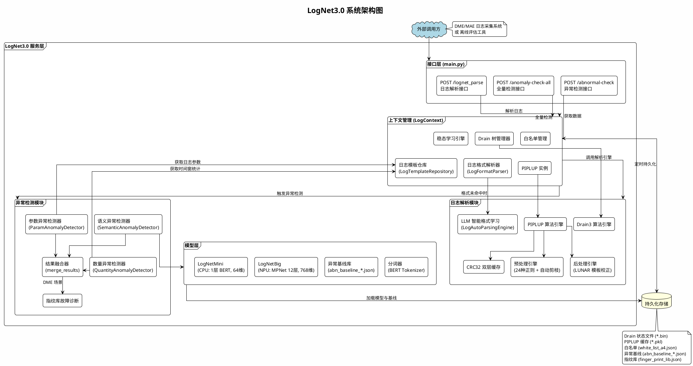

### 2.2 核心模块说明

| 模块 | 代码位置 | 职责 |
|------|---------|------|
| **接口层** | `main.py` | Flask Web 服务，提供日志解析和异常检测 REST 接口 |
| **上下文管理** | `src/data_process/log_context.py` | 管理全局状态：Drain 树映射、PIPLUP 实例、白名单、稳态学习、日志仓库 |
| **日志解析** | `src/data_process/template_extractor/` | PIPLUP / Drain 双引擎日志模板提取，含预处理、后处理、LLM 智能格式学习 |
| **语义异常检测** | `src/anomaly_detection/semantic_anomaly/` | 基于 BERT 嵌入 + 异常基线相似度匹配的日志内容异常检测 |
| **参数异常检测** | `src/anomaly_detection/parameter_anomaly/` | 基于模板配置 + 模糊匹配的多模式参数异常检测 |
| **数量异常检测** | `src/anomaly_detection/quantitive_anomaly/` | 基于 k-sigma 留一法的日志频率突变检测 |
| **结果融合** | `src/anomaly_detection/anomaly_detection.py` | 三路检测结果按三元组去重合并，生成异常事件与诊断报告 |
| **模型层** | `src/anomaly_detection/semantic_anomaly/bert_model/` | LogNetMini（CPU）和 LogNetBig（NPU）双模型 |
| **预训练** | `pre_train/LogTokenizerTraining/` | 6步分词器训练流水线 + MLM 预训练 |

---

## 3. 模块交互与时序设计

### 3.1 整体时序图：在线日志解析与异常检测

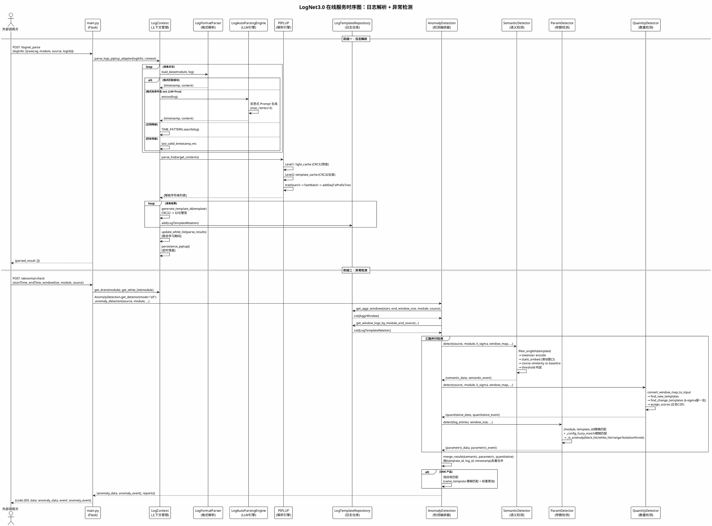

### 3.2 模块间交互接口

| 源模块 | 目标模块 | 接口方法 | 输入参数 | 返回值 |
|--------|---------|---------|---------|--------|
| main.py | LogContext | `parse_logs_piplup_adapter(log_info, context)` | `log_info: List[dict]`, `context: LogContext` | `List[dict]` (parse_results) |
| main.py | AnomalyDetection | `get_detector(mode, product).anomaly_detection(...)` | `source, module, start_time, end_time, window_size, repository, template_cache, white_list` | `(anomaly_data, anomaly_event[, reports])` |
| LogContext | LogFormatParser | `load_data(module, log)` | `module: str`, `log: str` | `(timestamp, content)` |
| LogContext | PIPLUP | `parser_piplup.parse_list(contents)` | `contents: List[str]` | `List[str]` (templates) |
| LogContext | LogTemplateRepository | `log_repository.add(LogTemplateRelation)` | `LogTemplateRelation(source, time, log_id, template_id, module, param_list)` | void |
| AnomalyDetection | SemanticAnomalyDetector | `detect(source, module, k_sigma, window_map, template_cache, white_list_dict)` | 6参数 | `(data, event)` |
| AnomalyDetection | QuantityAnomalyDetector | `detect(source, module, window_map, template_cache, white_list, k_sigma)` | 6参数 | `(data, event)` |
| AnomalyDetection | ParamAnomalyDetector | `detect(log_entries, window_size, output_path)` | 3参数 | `(outliers, events, count)` |
| AnomalyDetection | merge_results | `merge_results(semantic_data, parametric_data, quantitative_data)` | 3路结果列表 | `(combined_data, anomaly_event)` |
| SemanticAnomalyDetector | LogNetMini/Big | `model(input_ids, attention_mask)` | Tensor | `embeddings / logits` |
| ParamAnomalyDetector | config_build_*.json | `template_config_dict.get((module, template_id))` | `(module, template_id)` | 配置项 dict |

---

## 4. 关键技术点一：免人工配置异构日志解析

### 4.1 技术概述

传统日志解析方案（如 Drain3）需要为每种日志格式预配置正则表达式，且对参数变量的识别依赖固定规则。LogNet3.0 通过 **PIPLUP 算法** + **LLM 智能格式学习引擎** + **自动预处理剪枝** 三层机制，实现真正的"免人工配置"。

### 4.2 PIPLUP 算法核心设计

PIPLUP（Prefix-tree Indexed Parsing with LLM-assisted Universal Processing）是自研的日志模板解析算法，核心代码位于 `src/data_process/template_extractor/parsing_algorithm/PIPLUP.py`。

#### 4.2.1 数据结构

PIPLUP 采用**双层前缀树**结构：

```
shallow_tree (浅层索引)          storage_tree (深层存储)
┌──────────────────────┐       ┌─────────────────────────────────┐
│ "None": [cluster1,   │       │ "None": {                       │
│         cluster2,...]│       │   7: [cluster1, cluster3],      │
│ "recv": [cluster3,   │       │   5: [cluster2]                 │
│         cluster4,...]│       │ },                              │
│ "start": [cluster5]  │       │ "recv": {                       │
└──────────────────────┘       │   8: [cluster3, cluster4],      │
                                │   6: [cluster5]                 │
  按 frequent word 分组          │ }                               │
  (常量词作为一级索引)            └─────────────────────────────────┘
                                  按 frequent word + 序列长度 二级索引
```

- **shallow_tree**：`dict[str, List[Logcluster]]`，以常量词（frequent word）为键，快速缩小搜索范围
- **storage_tree**：`dict[str, dict[int, List[Logcluster]]]`，在常量词基础上再按序列长度分组
- **Logcluster**：每个聚类簇维护 `logTemplate`（当前模板）、`pathList`（分支路径列表，最多 `br_thresh` 条）、`templateList`（后处理后的候选模板集合）、`hit_time`（命中次数）

#### 4.2.2 解析流程


#### 4.2.3 自适应相似度阈值

PIPLUP 不使用固定相似度阈值，而是按日志序列长度自适应选择（`PIPLUP.py:146-158`）：

```python
self.st_dict = {
    1: 1,           # 1个token：必须完全匹配
    2: (2-1)/2,     # 2个token：允许0.5差异
    3: (3-1)/3,     # 3个token：允许0.33差异
    4: (4-1)/4,
    5: (5-2)/5,     # 5个token：允许0.6差异
    6: (6-2)/6,
    7: (7-3)/7,
    8: (8-3)/8,
    9: (9-3)/9,
    'others': 0.5   # 超过9个token：固定0.5
}
```

**设计原理**：短日志对参数变化更敏感，需要更严格的阈值；长日志包含更多常量词，可以容忍更多参数位置差异。

#### 4.2.4 CRC32 双层缓存

为加速重复日志的解析，PIPLUP 实现了两级 CRC32 缓存：

| 缓存层级 | 位置 | 键 | 计算方式 | 命中效果 |
|---------|------|---|---------|---------|
| **light_cache** | 预处理前 | `CRC32(数字替换为0后的日志)` | `_light_digit_re.sub('0', content)` → CRC32 | 跳过预处理，通过快速子串校验或正则匹配返回缓存模板 |
| **template_cache** | 预处理后 | `CRC32(预处理后日志)` | `' '.join(logmessageL)` → CRC32 | 跳过树搜索步骤 |

在重复日志高占比的生产场景下，大部分解析降为 O(1) 查表操作。

#### 4.2.5 常量词自动发现（模板演化）

当模板发生变化（`oldTemplate != newTemplate`）或命中次数达到 `update_population`（默认385次），且当前仍在 `'None'` 分组（`first_constant == 'None'`）时，自动提取分组依据（`PIPLUP.py:512-545`）：

1. 遍历当前模板中的 token，找到第一个不含 `<*>` 的常量词
2. 将该常量词作为 frequent word 加入 `shallow_tree` 和 `storage_tree`
3. 从 `'None'` 分组中迁移所有包含该常量词的簇到新分组
4. 后续日志优先按 frequent word 检索，大幅缩小候选集


#### 4.2.6 后处理：LUNAR 模板校正

`postprocessing.py` 实现模板规范化，主要规则包括：

- 连续变量折叠：`<*>.<*>` → `<*>`，`<*>,<*>` → `<*>`
- 赋值泛化：`= value` → `= <*>`
- 标点包裹简化：`"<*>"` → `<*>`
- 多空格压缩为单空格

### 4.3 预处理引擎与自动剪枝

#### 4.3.1 24种正则模式

`preprocessing.py` 定义了覆盖 DME 存储日志的 24 种正则模式，按特定顺序执行：

| 序号 | 模式名 | 正则 | 匹配目标示例 |
|------|--------|------|-------------|
| 1 | datetime_full | `\d{4}-\d{2}-\d{2}\s\d{2}:\d{2}:\d{2}` | `[2026-02-04 11:39:58]` |
| 2 | kernel_uptime | `(?<=\[)\s*\d+\.\d+(?=\])` | `[ 4247.652837]` |
| 3 | epoch_ms_13d | `(?<=\[)\d{13}(?=\])` | `[1500001430000]` |
| 4 | log_level | `\b(WARN\|ERR\|EMER\|INFO\|DBG)\b` | `ERR` |
| 5 | code_line_num | `(?<=,)\d+(?=\])` | `[...,178]` 中的 `178` |
| 6 | pid_tid_pair | `pid:\d+,tid:\d+` | `pid:53912,tid:53969` |
| 7 | sn_parentheses | `(?<=sn\()[A-Za-z0-9]+(?=\))` | `sn(2102312HGY)` |
| 8 | IPv4_port | `(\d+\.){3}\d+(:\d+)?` | `192.168.1.1:8080` |
| 9-24 | ... | ... | path, block, Mac, IPv6, size 等 |

#### 4.3.2 正则模式自动剪枝

```python
# PIPLUP.py:454-466
if idx < 2000:
    logmessageL, sequence, matched = preprocess(content, estimation_stage=True)
    matched_types.extend(matched)
    use_sequence = sequence
else:
    if idx == 2000:
        matched_types = set(matched_types)
        use_sequence = [i for i in use_sequence if i in matched_types]
    logmessageL = preprocess(content, estimation_stage=False, use_sequence=use_sequence)
```

**机制**：前 2000 行日志进入估算阶段，记录哪些正则实际命中；第 2001 行起只保留命中的正则，减少无效替换开销。这是"免人工配置"的核心体现——**系统自动学习哪些预处理规则对当前数据集有效**。

### 4.4 LLM 智能格式学习引擎

`LogAutoParsingEngine.py` 实现了当预置正则无法匹配日志格式时，自动调用 LLM 生成新的正则规则。

#### 4.4.1 核心流程

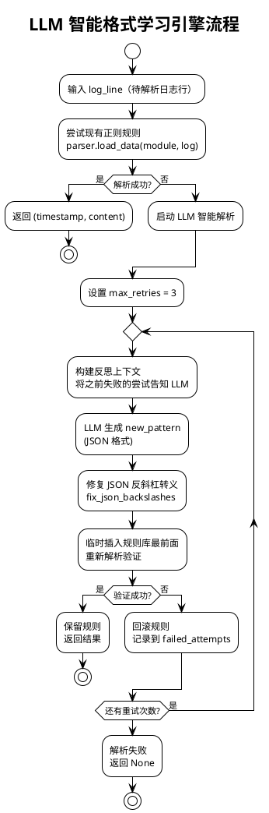

#### 4.4.2 反思机制

```python
# LogAutoParsingEngine.py:84-91
def _generate_pattern_with_reflection(self, log_line, failed_patterns):
    reflection_context = ""
    if failed_patterns:
        reflection_context = "\n【注意：以下是你之前的错误尝试，请不要重复使用，并分析其匹配失败的原因】:\n"
        for i, p in enumerate(failed_patterns):
            reflection_context += f"{i + 1}. {p}\n"
    prompt = build_prompt(log_line, reflection_context)
```

每次失败后，将错误尝试告知 LLM，避免重复犯错，实现反思式学习。

### 4.5 复杂度分析

| 算法 | 检索复杂度 | 空间复杂度 | 备注 |
|------|-----------|-----------|------|
| Drain3 | O(d+k) 平均, O(n) 最坏 | O(n·d) | d=树深度, k=候选簇数 |
| PIPLUP | O(\|C\|+k) 平均 | O(n·br_thresh) | C=常量词数, br_thresh=分支阈值 |
| PIPLUP + CRC32缓存 | O(1) 缓存命中 | O(m) | m=缓存条目数, 重复日志场景 |

### 4.6 端到端解析示例

**输入日志（DME osd 模块）**：
```
[2026-02-04 11:39:58][12345][ERR][osd.123][dsware][plog][osd][run][blk-12345] receive data from 192.168.1.100:8080 failed, error code 0x80010001, pid:53912,tid:53969
```

**解析过程**：
1. `LogFormatParser.load_data("osd", log)` 匹配 `format_chaos.json` 中 osd 的多组备选正则，提取 `timestamp=2026-02-04 11:39:58`, `content=receive data from ...`
2. `preprocess(content)` 执行 24 种正则替换（`use_keys=False` 时替换为 `<*>`）：
   - `192.168.1.100:8080` → `<*>`
   - `0x80010001` → `<*>`
   - `pid:53912,tid:53969` → `<*>`
   - `blk-12345` → `<*>`
3. `PIPLUP.treeSearch()` 在 storage_tree 中查找，未命中 → 新建聚类簇
4. `postprocessing.correct_single_template()` 规范化模板
5. **输出模板**：`receive data from <*> failed, error code <*>`

---

## 5. 关键技术点二：模板无关自适应参数异常检测

### 5.1 技术概述

传统参数异常检测依赖精确的 `template_id` 匹配与人工编写的正则规则，当模板发生微小变化或面对新域日志时检测即失效。新版方案通过 **GLiNER 零样本实体提取** + **VAE 变分自编码器重构检测** + **多策略融合引擎** 三层机制，实现真正的"模板无关"和"自适应"参数异常检测。

系统提供两个版本：
- **预研版（RND）**：GLiNER + VAE + 上下文分析 + 时序分析 + LLM 增强 + 多策略融合，追求检测精度上限
- **生产版（REL）**：规则引擎 + 模式匹配器 + 参数提取器 + 可选 VAE 后处理，追求毫秒级响应与低资源消耗

### 5.2 系统架构核心设计

系统采用模块化流水线设计，核心代码位于 `tech_evo/anomaly_detection/parameter_anomaly/`。

#### 5.2.1 整体架构

```
预研版架构 (preresearch_version)
┌─────────────────────────────────────────────────────────────────┐
│  LogGenerator → SmartLogParser → SemanticExtractor              │
│                   (Drain3)          (GLiNER + Regex)             │
│                        │                        │               │
│                        ▼                        ▼               │
│                 FeatureEngineer ← 域感知特征映射                 │
│                 (Robust Scaling + 特征权重)                      │
│                        │                                        │
│                        ▼                                        │
│  ┌──────────────────────────────────────────────────────────┐   │
│  │            多策略融合检测引擎                                │   │
│  │  VAE重构  │ 统计MAD/IQR │ 上下文分析 │ 时序分析 │ LLM分析 │   │
│  │     │         │            │          │         │        │   │
│  │     └─────────┴────────────┴──────────┴─────────┘        │   │
│  │                    加权融合引擎                             │   │
│  └──────────────────────────────────────────────────────────┘   │
└─────────────────────────────────────────────────────────────────┘

生产版架构 (implemented_version)
┌─────────────────────────────────────────────────────────────────┐
│  日志输入 → SmartLogExtractor (参数提取器)                        │
│              ├─ Drain3 模板聚类 (可选)                            │
│              ├─ GLiNER NER 提取 (可选)                            │
│              └─ 正则表达式提取 (必需)                              │
│                    │                                             │
│         ┌──────────┼──────────┐                                 │
│         ▼          ▼          ▼                                 │
│  RuleEngine  PatternMatcher  VAE Detector (可选)                │
│  (规则)      (模式)           (VAE/Z-score 兜底)                 │
│         └──────────┼──────────┘                                 │
│                    ▼                                            │
│             ResultFormatter → 输出 (JSON/CSV/Text)              │
└─────────────────────────────────────────────────────────────────┘
```

#### 5.2.2 检测流水线

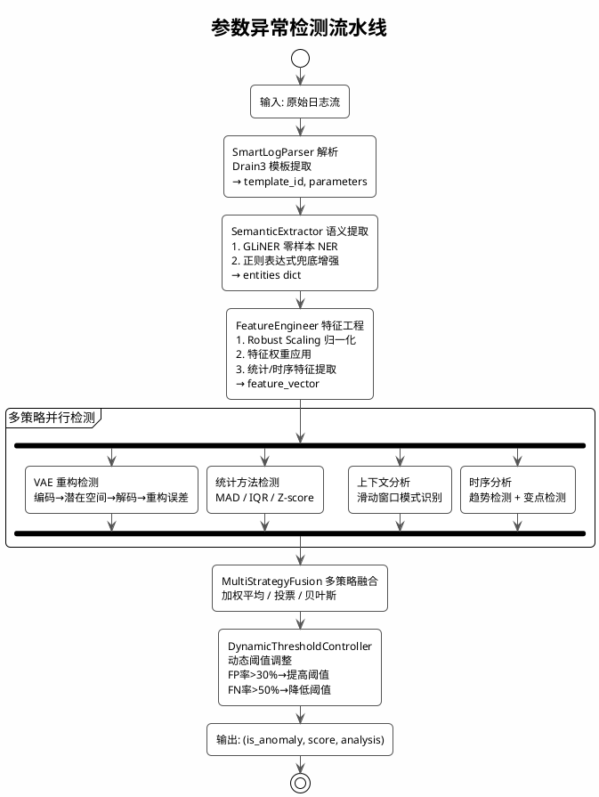

### 5.3 GLiNER 零样本语义提取引擎

`SemanticExtractor`（`semantic_extractor.py`）是"模板无关"的核心——摒弃传统正则配置，利用 GLiNER 通用命名实体识别模型，仅需提供标签列表即可从任意非结构化日志中提取参数。

#### 5.3.1 实体标签体系

```python
# semantic_extractor.py
class SemanticExtractor:
    # 基础实体标签（跨域通用）
    BASE_LABELS = [
        "duration", "status_code", "error_message", "ip_address", "hostname",
        "username", "request_id", "memory_usage", "cpu_usage", "disk_usage"
    ]

    # 域特定实体标签
    DOMAIN_LABELS = {
        LogDomain.NETWORK: ["url_path", "http_method", "content_type",
                            "user_agent", "cdn_location", "cache_status", ...],
        LogDomain.STORAGE: ["database_name", "table_name", "query_type",
                            "row_count", "lock_count", "replication_lag", ...],
        LogDomain.COMPUTE: ["job_id", "task_id", "gpu_memory", "batch_size",
                            "learning_rate", "model_name", "accuracy", ...],
        LogDomain.SECURITY: ["auth_method", "risk_score", "threat_level",
                             "vulnerability_count", "permission_level", ...],
        LogDomain.MICROSERVICE: ["service_name", "circuit_breaker_status",
                                 "queue_depth", "consumer_group", "rate_limit", ...],
        LogDomain.IOT: ["sensor_id", "firmware_version", "battery_level",
                        "signal_strength", "temperature", "humidity", ...],
    }
```

**设计原理**：
- 基础标签覆盖 10 种跨域通用参数类型，无需域信息即可工作
- 域特定标签按 `LogDomain` 枚举扩展，支持 6 大域（网络/存储/计算/安全/微服务/IoT）
- 新增标签只需在列表中追加，GLiNER 自动理解新标签语义——**零训练成本扩展**

#### 5.3.2 双通道提取流程

```python
# semantic_extractor.py:158-185
def extract(self, text: str) -> Dict[str, Any]:
    entities = {}

    # 1. GLiNER 零样本提取（主通道）
    if self.use_gliner and self.gliner_model:
        gliner_entities = self._extract_gliner(text)
        entities.update(gliner_entities)

    # 2. 正则表达式兜底/增强（辅助通道）
    regex_entities = self._regex_extract(text)
    for ent_type, ent_data in regex_entities.items():
        # 保留置信度更高的结果
        if ent_type not in entities or \
           entities[ent_type]["confidence"] < ent_data["confidence"]:
            entities[ent_type] = ent_data

    # 3. 语义标准化
    entities = self._normalize_entities(entities)
    return entities
```

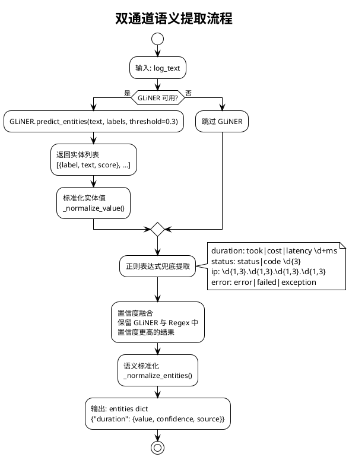

**"模板无关"的体现**：
- GLiNER 基于零样本 NER，不依赖任何预定义模板或 `template_id`
- 正则兜底使用语义模式（如 `took|cost|latency`），而非位置索引
- 即使日志格式完全变化，GLiNER 仍能通过语义理解提取参数

### 5.4 VAE 变分自编码器异常检测

`AnomalyDetector`（`anomaly_detector.py`）使用 VAE 学习正常日志参数的潜在分布，通过重构概率判定异常。

#### 5.4.1 网络架构

```python
# anomaly_detector.py:30-76
class VAE(nn.Module):
    def __init__(self, input_dim: int, hidden_dim: int = 64, latent_dim: int = 8):
        super(VAE, self).__init__()
        # Encoder: input_dim → hidden_dim → hidden_dim//2 → latent_dim
        self.encoder = nn.Sequential(
            nn.Linear(input_dim, hidden_dim),
            nn.LeakyReLU(0.2),
            nn.Dropout(0.2),
            nn.Linear(hidden_dim, hidden_dim // 2),
            nn.LeakyReLU(0.2),
        )
        self.fc_mu = nn.Linear(hidden_dim // 2, latent_dim)
        self.fc_logvar = nn.Linear(hidden_dim // 2, latent_dim)

        # Decoder: latent_dim → hidden_dim//2 → hidden_dim → input_dim
        self.decoder = nn.Sequential(
            nn.Linear(latent_dim, hidden_dim // 2),
            nn.LeakyReLU(0.2),
            nn.Linear(hidden_dim // 2, hidden_dim),
            nn.LeakyReLU(0.2),
            nn.Linear(hidden_dim, input_dim),
        )

    def forward(self, x):
        mu, logvar = self.encode(x)
        z = self.reparameterize(mu, logvar)  # 重参数化采样
        return self.decode(z), mu, logvar
```

```
Encoder                                          Decoder
┌──────────────┐                                ┌──────────────────┐
│ input_dim    │                                │ latent_dim       │
│ (e.g. 68)    │                                │ (e.g. 8)         │
│      │       │                                │      │           │
│      ▼       │                                │      ▼           │
│ hidden_dim   │     ┌──────────────┐           │ hidden_dim//2    │
│ (e.g. 64)    │     │  reparameterize│          │ (e.g. 32)        │
│      │       │     │  z = μ + ε·σ  │           │      │           │
│      ▼       │     └──────┬───────┘           │      ▼           │
│ hidden_dim//2│            │                   │ hidden_dim       │
│ (e.g. 32)    │            │                   │ (e.g. 64)        │
│      │       │            │                   │      │           │
│   ┌──┴──┐    │            │                   │      ▼           │
│   ▼     ▼    │            │                   │ input_dim        │
│  μ    logvar │────────────┘                   │ (重构输出)        │
│ (8)   (8)    │                                │                  │
└──────────────┘                                └──────────────────┘
  LeakyReLU(0.2) + Dropout(0.2)                   LeakyReLU(0.2)
```

#### 5.4.2 损失函数

```python
# anomaly_detector.py:79-82
def vae_loss_function(recon_x, x, mu, logvar, beta: float = 1.0):
    MSE = nn.functional.mse_loss(recon_x, x, reduction='sum')
    KLD = -0.5 * torch.sum(1 + logvar - mu.pow(2) - logvar.exp())
    return MSE + beta * KLD
```

- **重构项（MSE）**：衡量解码器输出与输入的偏差，正常样本重构误差低
- **正则项（KLD）**：约束潜在空间分布接近标准正态分布，防止过拟合
- `beta` 参数控制两者权衡，`beta > 1`（β-VAE）鼓励更解耦的潜在表示

#### 5.4.3 统计阈值兜底

当 PyTorch 不可用时，自动降级为统计方法（`MockThresholds`）：

```python
# anomaly_detector.py:120-150
class MockThresholds:
    DURATION_WARNING = 500.0
    DURATION_CRITICAL = 2000.0
    DURATION_HIGH = 5000.0

    WEIGHT_STATUS = 30.0
    WEIGHT_DURATION = 35.0
    WEIGHT_ERROR = 25.0
    WEIGHT_ZSCORE = 10.0

    ANOMALY_THRESHOLD = 25.0
    ZSCORE_THRESHOLD = 3.0
    IQR_MULTIPLIER = 1.5
```

| 统计方法 | 计算方式 | 判定条件 | 特点 |
|---------|---------|---------|------|
| Z-score | `\|x - mean\| / std` | > 3.0 | 简单快速，假设正态分布 |
| IQR | `Q25 - 1.5·IQR` ~ `Q75 + 1.5·IQR` | 超出范围 | 不依赖分布假设 |
| MAD | `\|x - median\| / MAD` | > 3.0 | 对极端异常值最鲁棒 |

### 5.5 多策略融合引擎

`MultiStrategyFusion`（`multi_strategy_fusion.py`）是"自适应"的核心——整合多种检测策略的结果，通过加权融合和共识机制降低误报率。

#### 5.5.1 策略注册与权重

```python
# multi_strategy_fusion.py:29-38
class DetectionStrategy(Enum):
    VAE_RECONSTRUCTION = "vae_reconstruction"   # VAE 重构误差 - 高可靠
    STATISTICAL = "statistical"                 # 统计方法 - 高可靠
    CONTEXTUAL = "contextual"                   # 上下文分析 - 中可靠
    TIME_SERIES = "time_series"                 # 时序分析 - 中可靠
    LLM_ANALYSIS = "llm_analysis"               # LLM 分析 - 较低可靠
    RULE_BASED = "rule_based"                   # 规则匹配 - 较低可靠
    ISOLATION_FOREST = "isolation_forest"       # 孤立森林 - 中可靠
    ONE_CLASS_SVM = "one_class_svm"             # 单类 SVM - 中可靠
```

```python
# multi_strategy_fusion.py:61-70
FusionConfig.weights = {
    "vae_reconstruction": 0.30,    # 高可靠：深度学习重构，量化误差明确
    "statistical": 0.20,           # 高可靠：数学统计，分布假设清晰
    "contextual": 0.18,            # 中可靠：上下文关联分析
    "time_series": 0.15,           # 中可靠：时序模式检测
    "isolation_forest": 0.10,      # 中可靠：孤立森林
    "one_class_svm": 0.05,         # 中可靠：单类 SVM
    "llm_analysis": 0.02,          # 低可靠：LLM 可能误判
    "rule_based": 0.00,            # 最低可靠：规则易产生 FP
}
```

**权重设计原理**：策略可靠性越高权重越大，VAE 重构（0.30）和统计方法（0.20）合计占 50%，确保数学上可验证的策略主导决策，LLM 和规则仅作为辅助参考。

#### 5.5.2 四种融合方法

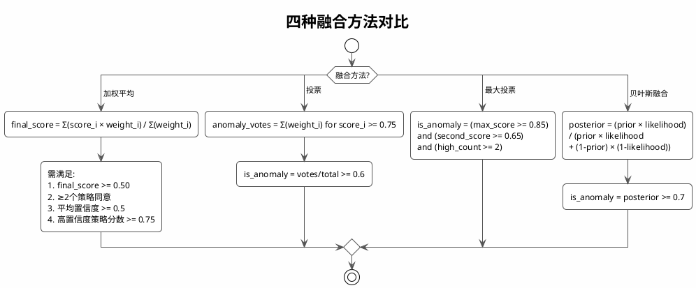

#### 5.5.3 加权平均融合核心逻辑

```python
# multi_strategy_fusion.py:188-311
def _fuse_weighted_average(self, results):
    total_weight = 0.0
    weighted_score = 0.0
    agreeing_strategies = []

    for result in results:
        weight = self.strategy_weights.get(key, 0.1)
        weighted_score += result.score * weight
        total_weight += weight
        if result.score >= 0.75:  # 策略内阈值
            agreeing_strategies.append(result)

    final_score = weighted_score / total_weight

    # 四条件全部满足才判定为异常
    is_anomaly = (
        final_score >= self.config.confidence_threshold and      # 综合分数达标
        len(agreeing_strategies) >= self.config.min_strategies_agree and  # 策略共识
        avg_confidence >= 0.5 and                                 # 置信度达标
        (high_confidence_weight == 0 or high_conf_avg >= 0.75)   # 高置信度策略达标
    )
    return is_anomaly, final_score, analysis
```

**设计原理**：AND 逻辑确保所有条件同时满足才判定异常，牺牲部分召回率换取高精确率，减少误报。

#### 5.5.4 动态阈值控制

```python
# run_pipeline.py:68-78
@dataclass
class DynamicThresholdController:
    initial_threshold: float = 0.65
    min_threshold: float = 0.50
    max_threshold: float = 0.85
    adjustment_step: float = 0.02
    window_size: int = 50

    def adjust_threshold():
        # FP 率 > 30% → 提高阈值（更保守）
        if fp_rate > 0.3:
            current_threshold += adjustment_step
        # FN 率 > 50% → 降低阈值（更敏感）
        if fn_rate > 0.5:
            current_threshold -= adjustment_step
```

**"自适应"的体现**：系统根据运行时的误报率（FP）和漏报率（FN）动态调整阈值，无需人工干预。

#### 5.5.5 分层异常判定

```python
# 基于实体参数和策略评分的分层判定
if entity_score >= 0.6:
    is_anomaly = True                           # 实体参数明确异常
elif entity_score >= 0.4:
    is_anomaly = strategy_anomaly_count >= 2    # 需≥2个策略支持
elif entity_score >= 0.2:
    is_anomaly = strategy_anomaly_count >= 3    # 需≥3个策略支持
else:
    is_anomaly = strategy_anomaly_count >= 3    # 需多策略一致
```

### 5.6 特征工程

`FeatureEngineer`（`feature_engineer.py`）将异构实体参数转化为 VAE 可处理的统一特征张量。

#### 5.6.1 Robust Scaling 归一化

```python
# feature_engineer.py:28-36
@dataclass
class FeatureConfig:
    normalize_method: str = "robust"       # 默认 Robust Scaling
    feature_dim: int = 64
    enable_temporal: bool = True
    enable_statistical: bool = True
    duration_threshold_ms: float = 2000.0
```

```python
# Robust Scaling (对异常值不敏感)
normalized = (value - median) / iqr
# 限制到 [-3, 3] 范围，然后转换到 [0, 1]
```

**选择 Robust Scaling 而非 Z-Score 的原因**：中位数和 IQR 对极端异常值不敏感，避免异常样本本身污染归一化参数。

#### 5.6.2 特征权重与正常范围

```python
# feature_engineer.py:61-83
FEATURE_WEIGHTS = {
    "duration": 2.5,      # 响应时间异常指示
    "status_code": 2.0,   # HTTP状态码异常指示
    "has_error": 3.0,     # 错误标识最重要
    "retry_count": 1.8,   # 重试次数
    "timeout": 2.5,       # 超时标识
    "memory_usage": 1.5,  # 内存异常
    "cpu_usage": 1.5,     # CPU异常
}

NORMAL_RANGES = {
    "duration": (0, 2000),      # 0-2000ms 正常
    "status_code": (200, 500),  # 2xx-4xx 正常
    "cpu_usage": (0, 90),       # 0-90% 正常
    "memory_usage": (0, 85),    # 0-85% 正常
    "retry_count": (0, 3),      # 0-3次正常
}
```

### 5.7 上下文分析与时序分析

#### 5.7.1 上下文异常模式

`ContextAnalyzer`（`context_analyzer.py`）通过滑动窗口识别参数间的上下文异常：

| 模式 | 描述 | 检测条件 |
|------|------|---------|
| `fast_failure` | 快速失败 | duration < 100ms 且 status >= 400 |
| `slow_success` | 幽灵成功 | duration > 5000ms 且 200 <= status < 300 |
| `degraded_performance` | 性能下降 | 持续上升趋势（梯度 > 阈值） |
| `sudden_spike` | 突变异常 | Z-score > 3.0 |

**示例**：`cost 5ms status 500` — 耗时极短但返回错误码，表明请求被提前拒绝，属于上下文异常。

#### 5.7.2 时序分析三重检测

`TimeSeriesAnalyzer`（`time_series_analyzer.py`）对参数值序列执行三重统计检测：

```python
# 1. Z-score 检测
z_score = abs(value - mean) / std
if z_score > 3.0: → 异常

# 2. IQR 检测
iqr = q75 - q25
if value < q25 - 1.5*iqr or value > q75 + 1.5*iqr: → 异常

# 3. MAD 检测 (对异常值更鲁棒)
mad_score = abs(value - median) / mad
if mad_score > 3.0: → 异常
```

### 5.8 生产版轻量化设计

生产版（`implemented_version`）针对毫秒级响应场景进行轻量化设计。

#### 5.8.1 规则引擎

`rule_engine.py` 支持 5 种规则类型：

| 类型 | 说明 | 操作符 |
|------|------|--------|
| threshold | 阈值规则 | gt, gte, lt, lte, eq, ne |
| range | 范围规则 | in, not_in |
| pattern | 模式规则 | contains, matches, eq, ne |
| count | 计数规则 | gt, gte |
| composite | 复合规则 | and, or |

```python
# rule_engine.py:56-71
@dataclass
class Rule:
    name: str
    type: RuleType
    field: str           # 支持嵌套: "entity.duration"
    operator: Operator
    value: Any
    severity: str = "warning"
    conditions: List[Dict] = field(default_factory=list)
    logic: str = "and"   # 复合规则逻辑
    window_seconds: int = 0  # 时间窗口
```

#### 5.8.2 模式匹配器

`pattern_matcher.py` 预编译 11 种正则模式，支持三种匹配策略：

| 策略 | 说明 |
|------|------|
| `FIRST` | 只匹配第一个 |
| `ALL` | 匹配所有 |
| `COUNT` | 计数匹配 |

**性能优化**：正则预编译 + LRU 结果缓存 + 短路匹配。

#### 5.8.3 可选 VAE 后处理

```python
# vae_para_detector.py
# 模式 1: VAE 模式（有 PyTorch）
#   变分自编码器重构检测
# 模式 2: 统计模式（无 PyTorch）
#   baseline_mean + 3 * baseline_std
#   滑动窗口大小: 100
```

### 5.9 复杂度与性能分析

| 环节 | 预研版复杂度 | 生产版复杂度 | 备注 |
|------|------------|------------|------|
| 日志解析 | O(d+k) Drain3 | O(d+k) Drain3 | d=树深度, k=候选簇 |
| 实体提取 | O(n·L) GLiNER | O(n·R) 正则 | L=序列长度, R=正则数 |
| 特征工程 | O(n·f) | O(n·f) | f=特征维度 |
| VAE 检测 | O(n·E) | O(n·E) | E=网络前向计算 |
| 统计检测 | O(n) | O(n) | 滑动窗口 |
| 融合引擎 | O(n·S) | O(n·S) | S=策略数 |
| **总吞吐量** | ~10K 条/秒 | ~100K 条/秒 | 生产版纯规则模式 |
| **单条延迟** | ~10ms | ~0.1ms | |
| **内存占用** | ~500MB | <100MB | 无 PyTorch 时 |

### 5.10 模板无关自适应的完整链路

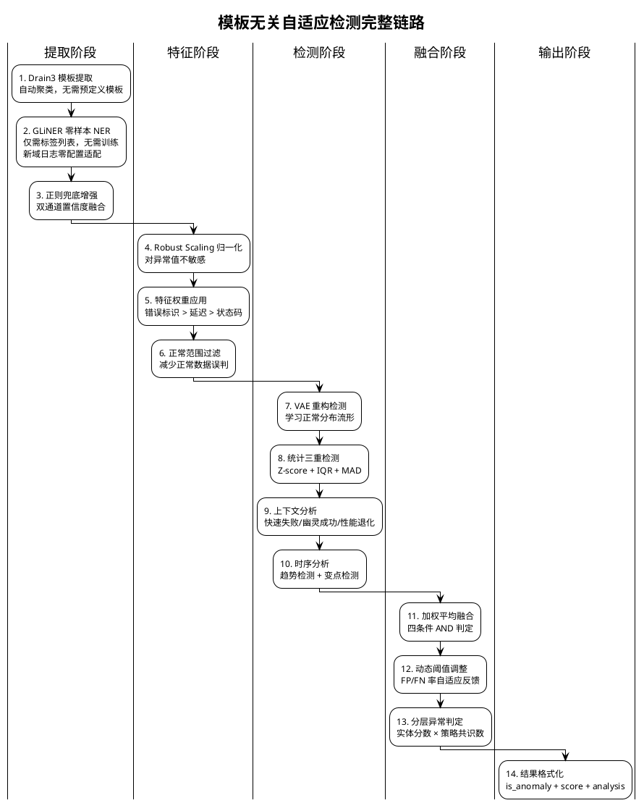

### 5.11 端到端检测示例

**场景**：微服务域 API 请求延迟异常检测

**输入日志**：
```
2026-09-10 10:23:45 Service call to user-service, status 200, cost 8500ms
```

**检测过程**：

1. **Drain3 解析**：模板 = `Service call to <IP>, status <NUM>, cost <NUM>ms`，参数 = `[user-service, 200, 8500]`

2. **GLiNER 提取**：
   ```json
   {
     "duration": {"value": "8500ms", "confidence": 0.92, "source": "gliner"},
     "status_code": {"value": "200", "confidence": 0.95, "source": "gliner"},
     "service_name": {"value": "user-service", "confidence": 0.88, "source": "gliner"}
   }
   ```

3. **特征工程**：
   - duration: 8500 → Robust Scaling → 0.92（超出正常范围 0-2000ms）
   - status_code: 200 → 正常范围 → 0.15
   - 特征权重：duration × 2.5 = 高权重异常信号

4. **多策略检测**：
   | 策略 | 分数 | 判定 |
   |------|------|------|
   | VAE 重构 | 0.85 | 异常（重构误差大） |
   | 统计 MAD | 0.90 | 异常（8500 远超中位数） |
   | 上下文分析 | 0.70 | 异常（slow_success 模式：200 状态但 8500ms） |
   | 时序分析 | 0.65 | 异常（Z-score = 4.2 > 3.0） |

5. **多策略融合**（加权平均）：
   ```
   final_score = (0.85×0.30 + 0.90×0.20 + 0.70×0.18 + 0.65×0.15) / 0.83
              = 0.79
   agreeing_strategies = 4 (全部 >= 0.75 的有 2 个)
   ```
   - `final_score 0.79 >= 0.50` ✓
   - `agreeing_count 2 >= 2` ✓
   - `avg_confidence >= 0.5` ✓
   - **判定：异常**

6. **输出**：
   ```json
   {
     "is_anomaly": true,
     "score": 0.79,
     "severity": "warning",
     "matched_rules": ["slow_success"],
     "entities": {"duration": "8500ms", "status_code": "200"},
     "analysis": "幽灵成功模式：状态码200但耗时8500ms远超正常范围"
   }
   ```

---

## 6. 关键技术点三：分词增强语义异常检测

### 6.1 技术概述

语义异常检测的目标是识别日志内容本身的异常（如出现不应出现的错误信息、异常组合等）。LogNet3.0 通过**领域专用分词器训练** + **多粒度滑动窗口嵌入** + **异常基线相似度匹配**三层机制实现"分词增强"的语义异常检测。

### 6.2 领域分词器训练流水线

`pre_train/LogTokenizerTraining/` 实现了 6 步分词器训练流水线：

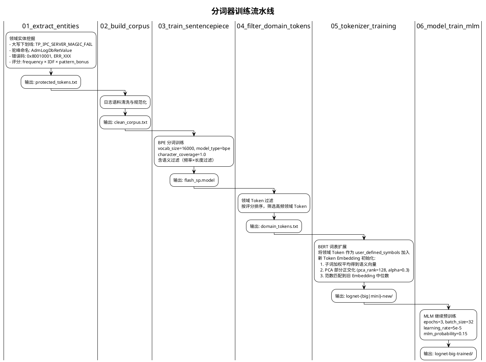

### 6.3 双模型架构

#### 6.3.1 LogNetMini（CPU 场景）

| 参数 | 值 | 说明 |
|------|---|------|
| D_MODEL | 64 | 隐藏维度 |
| N_LAYERS | 1 | Transformer 层数 |
| N_HEADS | 1 | 注意力头数 |
| max_len | 512 | 最大序列长度 |
| 模型文件 | `lognet-mini/model.pth` | 本地权重 |

**特点**：轻量级 BERT，仅提取 token 级静态嵌入，适合 CPU 推理。

#### 6.3.2 LogNetBig（NPU 场景）

| 参数 | 值 | 说明 |
|------|---|------|
| hidden_size | 768 | 隐藏维度 |
| num_hidden_layers | 12 | Transformer 层数 |
| vocab_size | 31582 | 词表大小 |
| max_position_embeddings | 514 | 最大位置编码长度 |
| 基础模型 | MPNet | 预训练骨干网络 |
| 模型文件 | `lognet-big/` | 含 `LogNetUnified`（统一模型） |

**特点**：基于 MPNet 的 12 层大模型，同时输出 static（token 级）和 contextual（sentence 级）嵌入 + 分类 logits。

### 6.4 语义异常检测核心流程

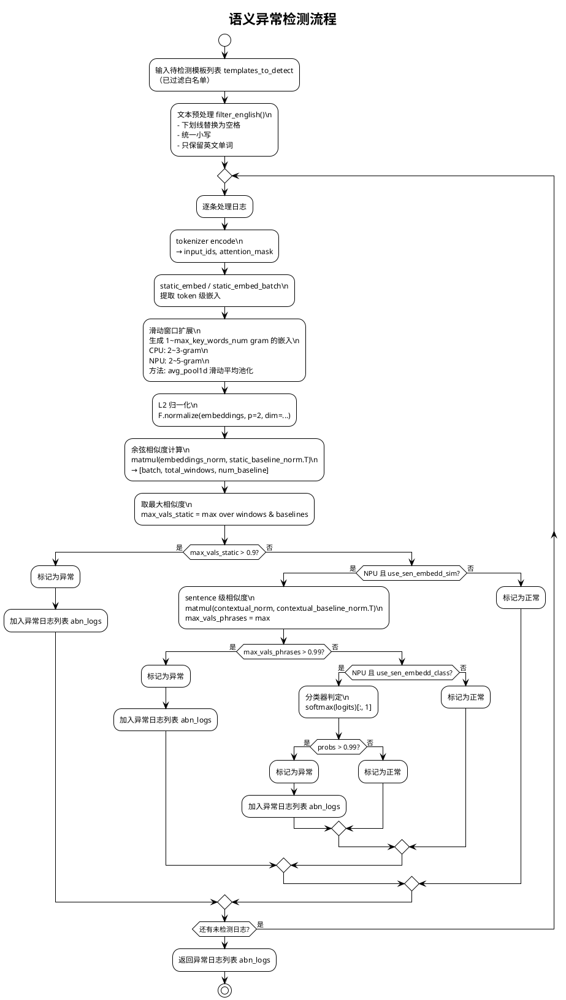

### 6.5 关键算法详解

#### 6.5.1 滑动窗口多粒度嵌入

```python
# semantic_anomaly.py:419-427 (CPU 版本)
def static_embed(self, static_inputs):
    static_embeddings = self.static_embedding(static_inputs).squeeze(0).detach()[1:]
    max_key_words_num = 5 if self.device.upper()=='NPU' else 3
    extend_embeddings = []
    for l in range(2, max_key_words_num+1):
        extend_embeddings.extend(
            [torch.mean(static_embeddings[i:i+l], dim=0) 
             for i in range(len(static_embeddings)-l+1)]
        )
    if len(extend_embeddings):
        static_embeddings = torch.cat((static_embeddings, torch.stack(extend_embeddings, dim=0)), dim=0)
    return static_embeddings
```

**原理**：
- 单 token 嵌入只能捕获词级异常
- 2~5-gram 滑动窗口平均池化生成多粒度短语嵌入
- 将原始 token 嵌入与所有 n-gram 嵌入拼接，形成丰富的特征表示
- **分词增强的体现**：领域专用分词器确保关键术语不被切碎，滑动窗口在完整语义单元上生成嵌入

#### 6.5.2 批量推理优化（NPU）

```python
# semantic_anomaly.py:429-482 (NPU 批量版本)
def static_embed_batch(self, static_embeddings, mask):
    static_embeddings = static_embeddings[:, 1:, :]  # 去掉 CLS
    mask = mask[:, 1:]
    batch, seq_len, emb_dim = static_embeddings.shape
    max_key_words_num = 5
    extend_embeddings = [static_embeddings]
    extend_masks = [mask]
    
    emb_t = static_embeddings.transpose(1, 2)  # [batch, emb, seq]
    mask_t = mask.unsqueeze(1)  # [batch, 1, seq]
    
    for l in range(2, max_key_words_num + 1):
        if seq_len < l:  # 短序列保护：序列长度不足时跳过当前窗口
            continue
        sum_pool = F.avg_pool1d(emb_t * mask_t, kernel_size=l, stride=1) * l
        counts = F.avg_pool1d(mask_t, kernel_size=l, stride=1) * l
        counts = counts.clamp(min=1e-6)
        window_avg = (sum_pool / counts).transpose(1, 2)
        window_mask = (counts.squeeze(1) > 0).float()
        extend_embeddings.append(window_avg)
        extend_masks.append(window_mask)
    
    return torch.cat(extend_embeddings, dim=1), torch.cat(extend_masks, dim=1)
```

**优化点**：使用 `F.avg_pool1d` 替代 Python 循环，在 GPU/NPU 上实现高效的批量滑动窗口池化。

#### 6.5.3 三层 OR 判定机制（NPU）

```python
# semantic_anomaly.py:384-390
final_mask = torch.zeros(len(logs), dtype=torch.bool, device=support_device)
final_mask |= (max_vals_static > self.static_threshold)          # 静态 token 级
if self.use_sen_embedd_sim:
    final_mask |= (max_vals_phrases > self.contextual_threshold_sim)  # 上下文相似度
if self.use_sen_embedd_class:
    final_mask |= (probs > self.contextual_threshold_class)           # 分类器
abnormal_indices = final_mask.nonzero().flatten().cpu().tolist()
```

| 层级 | 阈值 | 检测能力 |
|------|------|---------|
| 静态 token 级 | 0.9 | 关键词异常、错误码异常 |
| 上下文相似度 | 0.99 | 短语组合异常、语义偏移 |
| 分类器 | 0.99 | 端到端学习的异常模式 |

三层判定采用 OR 逻辑，任一层级触发即判定为异常，实现互补检测。

#### 6.5.4 异常基线

异常基线 `abn_baseline_{case}_{device}.json` 是预计算的异常日志嵌入向量库：

```json
{
  "static_baseline_norm": [[...768维向量...], ...],
  "contextual_baseline_norm": [[...768维向量...], ...]
}
```

检测时计算输入日志嵌入与基线的最大余弦相似度，超过阈值即判异常。基线由历史标注的异常日志通过模型编码并 L2 归一化后生成。

> **部署注意**：`abn_baseline_DME_NPU.json` 存在于 `pre_train/LogTokenizerTraining/configurations/` 目录，运行时需手动复制到 `src/anomaly_detection/semantic_anomaly/configurations/` 目录下，否则 DME NPU 场景语义检测将因基线文件缺失而无法加载。

#### 6.5.5 动态分桶

```python
# semantic_anomaly.py:295-322
def bucketize_logs(self, logs, max_bucket_diff=20):
    tokens = self.static_tokenizer(logs, padding=False)
    lengths = [len(x) for x in tokens['input_ids']]
    sorted_idx = sorted(range(len(logs)), key=lambda i: lengths[i])
    buckets = []
    current_bucket = []
    last_len = None
    for idx in sorted_idx:
        l = lengths[idx]
        if last_len is None or l - last_len <= max_bucket_diff:
            current_bucket.append(idx)
        else:
            buckets.append(current_bucket)
            current_bucket = [idx]
        last_len = l
    if current_bucket:
        buckets.append(current_bucket)
    return buckets
```

按 token 长度分桶，同桶内 padding 到相同长度，减少 padding 浪费，提升推理效率。

### 6.6 分词增强的完整链路

```plantuml
@startuml Tokenizer_Enhancement
!theme plain
title 分词增强语义理解链路

|训练阶段|
:1. 领域实体挖掘
TP_IPC_SERVER_MAGIC_FAIL → 保护为完整 Token;
:2. BPE 训练
在日志语料上学习子词单元;
:3. 词表扩展
将领域 Token 作为 user_defined_symbols
加入 BERT 词表;
:4. Embedding 初始化
新 Token = 子词加权平均 + PCA正交化 + 范数匹配;
:5. MLM 预训练
在日志语料上继续训练，适应日志文本分布;

|推理阶段|
:6. 领域分词器 tokenize
TP_IPC_SERVER_MAGIC_FAIL → [TP_IPC_SERVER_MAGIC_FAIL]
(而非 [TP, _IP, C, _SERVER, ...]);
:7. 滑动窗口多粒度嵌入
1~5-gram 嵌入捕获不同粒度的异常模式;
:8. 异常基线相似度匹配
与历史异常嵌入计算余弦相似度;
:9. 三层 OR 判定
静态 + 上下文 + 分类器互补;

@enduml
```

### 6.7 端到端检测示例

**场景**：DME 存储集群 NPU 节点语义异常检测

**异常基线**（`abn_baseline_DME_NPU.json`）包含历史异常日志的嵌入：
- "disk sector read error unrecoverable"
- "cache data loss detected in volume"
- "metadata corruption found in btree node"

**输入模板**：
```
metadata corruption found in <*> node
```

**检测过程**：
1. `filter_english()`: `metadata corruption found in node`（去除 `<*>` 和标点）
2. `tokenizer encode`: `[CLS] metadata corruption found in node [SEP]` → 7 tokens
3. `static_embed_batch()`: 生成 7（1-gram）+ 6（2-gram）+ 5（3-gram）+ 4（4-gram）+ 3（5-gram）= 25 个窗口嵌入
4. L2 归一化后与基线计算相似度矩阵 `[1, 25, num_baseline]`
5. `max_vals_static = 0.94`（与基线 "metadata corruption found in btree node" 的 4-gram 嵌入高度相似）
6. `0.94 > 0.9` → **静态层判定异常**
7. 输出：`{anomalyType: ["semantic"], summary: ["日志内容异常请检查"]}`

---

## 7. 数量异常检测

### 7.1 算法原理

数量异常检测器（`quantitive_detector.py`）基于两种策略：

#### 7.1.1 新增模板检测

```python
# quantitive_detector.py:171-191
def find_new_templates_based_on_seq(previous_data, current_data, previous_time_interval, white_list={}):
    prev_data_seq = previous_data['event'] if previous_data else []
    cur_data_seq = current_data['event']
    if sum(prev_data_seq) == 0 and cur_data_seq and str(id) not in white_list:
        for i in range(len(cur_data_seq)):
            if cur_data_seq[i] > 0:
                all_id_results.append(id)
                all_times.append(current_data['time'][i])
                all_counts.append(cur_data_seq[i])
                return ...
```

白名单外且历史无出现的模板 → 标记为新增异常。

#### 7.1.2 k-sigma 突变检测（留一法）

```python
# quantitive_detector.py:198-230
def find_change_templates_based_on_sigma(current_data, time_interval, k_sigma=3):
    arr = np.array(cur_data_seq)
    sum_all = np.sum(arr)
    sum_of_squares_all = np.sum(arr ** 2)
    n = len(cur_data_seq)
    for i in range(n):
        # 留一法：去除当前点后计算均值和标准差
        sum_without_x = sum_all - cur_data_seq[i]
        mean = sum_without_x / (n - 1)
        variance = (sum_of_squares_all - cur_data_seq[i]**2 - sum_without_x**2/(n-1)) / (n-1)
        std = math.sqrt(variance)
        # 判定：偏离 k_sigma 倍标准差且绝对差值 > 10
        if abs(cur_data_seq[i] - mean) > k_sigma * std and abs(cur_data_seq[i] - mean) > 10:
            # 记录突变
```

**留一法**：计算去除当前窗口后的均值/标准差，避免异常点自身影响统计量。函数默认 `k_sigma=3`，生产配置中调用方传入 `k_sigma=6`，同时要求绝对差值 > 10 防止低频日志的误报。

#### 7.1.3 评分机制

```python
# quantitive_detector.py:137-168
@staticmethod
def assign_scores(result_dict, order_key, max_score, min_score):
    # 正态分布 CDF 映射分数
    ranks = np.arange(1, num_templates + 1)
    group_scores = norm.ppf((ranks - 0.5) / num_templates) * std_dev + mean_score
    group_scores = np.clip(group_scores, min_score, max_score).round().astype(int).tolist()
```

使用正态分布的百分位点（`scipy.stats.norm.ppf`）将异常程度映射为分数区间，新增模板 [50, 99]，突变模板 [1, 49]。

---

## 8. 异常检测结果融合与故障诊断

### 8.1 三路检测结果融合

`anomaly_detection.py:279-374` 的 `merge_results` 方法实现三路检测结果融合：

```python
@staticmethod
def merge_results(semantic_data, parametric_data, quantitative_data):
    # 按 (template_id, log_id, timestamp) 三元组去重合并
    anomaly_data_dict = defaultdict(dict)
    for data in semantic_data:
        anomaly_data_dict[(template_id, log_id, timestamp)]["semantic"] = metadata
    for data in parametric_data:
        anomaly_data_dict[(template_id, log_id, timestamp)]["parametric"] = metadata
    for data in quantitative_data:
        anomaly_data_dict[(template_id, log_id, timestamp)]["quantitative"] = metadata
    
    # 生成 anomalyType 列表（可同时命中多种异常）
    for data in anomaly_data:
        one_data = {"logId": ..., "timestamp": ..., "templateId": ...}
        if "parametric" in data["metadata"]:
            one_data["anomalyType"] = ["parametric"]
            one_data["summary"] = [f"日志参数异常,异常参数为 {parameter}"]
        if "quantitative" in data["metadata"]:
            times = data["metadata"]["quantitative"]["log_count"]
            if "anomalyType" in one_data:
                one_data["anomalyType"].append("quantitative")
            else:
                one_data["anomalyType"] = ["changeRecord"]
            one_data["summary"].append(f"日志频率异常,当前时间窗内出现{times}次")
        if "semantic" in data["metadata"]:
            one_data["anomalyType"].append("semantic")
            one_data["summary"].append("日志内容异常请检查")
```

**融合逻辑**：
- 同一条日志可能同时被多种检测器标记为异常
- 按 `(template_id, log_id, timestamp)` 三元组去重
- `anomalyType` 为列表，可包含 `parametric`、`quantitative`（或仅数量异常时为 `changeRecord`）、`semantic` 的任意组合
- 按时间戳聚合为 10 分钟时间窗的 `anomaly_event`

### 8.2 指纹库故障诊断（DME 专用）

```python
# anomaly_detection.py:91-115
for event in anomaly_event:
    for case_name, case_data in finger_print.items():
        case_score = 0
        for template in templates_unique:
            for finger_print in case_data["clues"]:
                for s, weight in finger_print.items():
                    if same_template(s, template):  # 模糊匹配
                        case_score += weight
        if case_score > thresh:  # thresh=0.95
            reports.append({"case_name": ..., "case_score": ..., ...})
```

**指纹库结构**（`finger_print_lib.json`）：
```json
{
  "case1": {
    "caseName": "控制器内部CDR芯片异常",
    "caseID": "CASE_JH_023",
    "clues": [{"模板字符串": 权重}, ...],
    "threshold": 0.95
  }
}
```

**匹配逻辑**：
1. 对每个异常事件中的模板，与指纹库线索模板做 `same_template` 模糊匹配
2. `same_template` 要求 token 数一致、至少 2 个 token 精确匹配、通配符位置兼容
3. 累加匹配到的线索权重，超过阈值则生成故障诊断报告

> **阈值来源差异**：`anomaly_detection` 方法（单案例检测）中阈值硬编码为 `thresh = 0.95`；`all_detect` 方法（全量检测）中阈值从指纹库配置 `case_data["threshold"]` 动态读取，各案例可配置不同阈值。

---

## 9. 接口规格定义

### 9.1 日志解析接口

```
POST /lognet_parse
Content-Type: application/json
```

**请求体**：
```json
{
    "logInfo": [
        {
            "rawLog": "[2026-02-04 11:39:58][ERR][osd] receive data from 192.168.1.100 failed",
            "module": "osd",
            "source": "node-01",
            "logId": "log_001"
        }
    ]
}
```

**响应体**：
```json
{
    "parsed_result": []
}
```

**处理逻辑**：日志经 PIPLUP 解析后存入内存仓库 `LogTemplateRepository`，稳态学习期间自动更新白名单。接口本身返回空的 `parsed_result` 列表（解析结果存入内存仓库供后续异常检测使用，不直接返回）。

### 9.2 异常检测接口

```
POST /abnormal-check
Content-Type: application/json
```

**请求体**：
```json
{
    "startTime": 1738646400000,
    "endTime": 1738648200000,
    "windowSize": 180000,
    "module": "osd",
    "source": "node-01"
}
```

**响应体**：
```json
{
    "code": 200,
    "message": "OK",
    "data": [
        {
            "logId": "log_001",
            "timestamp": 1738646400000,
            "templateId": 1234567890,
            "template": "receive data from <*> failed",
            "anomalyType": ["semantic", "parametric"],
            "summary": ["日志内容异常请检查", "日志参数异常,异常参数为 0x0B1C"]
        }
    ],
    "event": [
        {
            "timestamp": 1738646400,
            "template_id": [1234567890],
            "log_id": ["log_001"],
            "template": ["receive data from <*> failed"],
            "summary": "2026-02-04 11:40:00-2026-02-04 11:50:00 语义异常检出1个 参数异常检出1个"
        }
    ]
}
```

### 9.3 全量检测接口

```
POST /anomaly-check-all
Content-Type: application/json
```

**请求体**：
```json
{
    "startTime": 1738646400000,
    "endTime": 1738648200000,
    "windowSize": 180000
}
```

**响应体**：
```json
{
    "code": 200,
    "message": "OK",
    "data": [
        {
            "module": "osd",
            "source": "node-01",
            "detectLine": [...],
            "detectEvent": [...],
            "reports": [...]  // 仅 DME 场景返回故障诊断报告，MAE 场景不返回此字段
        }
    ]
}
```

---

## 10. 配置体系

### 10.1 配置文件总览

| 配置文件 | 位置 | 用途 |
|---------|------|------|
| `config.json` | `config/` | 服务端口、稳态学习开关、持久化间隔 |
| `format_chaos.json` | `config/` | DME 60+模块日志格式定义 |
| `format_mae.json` | `config/` | MAE 网络日志格式定义 |
| `time_format.json` | `config/` | 60+模块时间戳格式映射 |
| `white_list_a4.json` | `config/` | 稳态白名单（按模块组织 template_id 列表） |
| `config_build_dme.json` | `src/.../configuration/` | DME 参数检测配置 |
| `config_build_mae.json` | `src/.../configuration/` | MAE 参数检测配置 |
| `abn_baseline_*.json` | `src/.../configurations/` | 语义异常基线向量 |
| `finger_print_lib.json` | `src/.../configurations/` | DME 故障模式指纹库 |

### 10.2 核心配置参数

#### 10.2.1 服务配置（`config.json`）

| 参数 | 默认值 | 说明 |
|------|--------|------|
| `host` | 127.0.0.1 | 服务监听地址 |
| `port` | 5001 | 服务监听端口 |
| `persistence_time_minutes` | 5 | 持久化间隔（分钟） |
| `learning_switch` | off | 稳态学习开关 |
| `learning_mode` | new | 学习模式（new/goon） |
| `learning_time_hours` | 24 | 学习时长（小时） |
| `persistence_duration` | 86400000 | 内存数据保留时长（ms，=24小时） |
| `print_invalid_log` | false | 是否打印无效日志信息 |

#### 10.2.2 PIPLUP 参数

| 参数 | 默认值 | 说明 |
|------|--------|------|
| `br_thresh` | 5 | 分支路径合并阈值 |
| `update_population` | 385 | 触发常量词发现的命中次数 |
| `sim_thresh` | 'default' | 自适应阈值字典 |
| `use_cache` | False | 是否启用 pickle 持久化 |
| `use_template_cache` | True | 是否启用 CRC32 模板缓存 |

#### 10.2.3 语义检测参数

| 参数 | CPU 值 | NPU 值 | 说明 |
|------|--------|--------|------|
| `static_threshold` | 0.9 | 0.9 | 静态相似度阈值 |
| `contextual_threshold_sim` | - | 0.99 | 上下文相似度阈值 |
| `contextual_threshold_class` | - | 0.99 | 分类置信度阈值 |
| `max_key_words_num` | 3 | 5 | 最大 n-gram 长度 |
| `D_MODEL` | 64 | 768 | 模型隐藏维度 |
| `N_LAYERS` | 1 | 12 | Transformer 层数 |

#### 10.2.4 参数检测参数

| 参数 | 默认值 | 说明 |
|------|--------|------|
| `FUZZY_MATCH_ALPHA` | 0.6 | 模板模糊匹配相似度阈值 |
| `contamination` | 0.1 | IsolationForest 污染率 |
| `k_sigma` | 6 | k-sigma 参数（数量检测） |

---

## 11. 部署与运行

### 11.1 部署架构

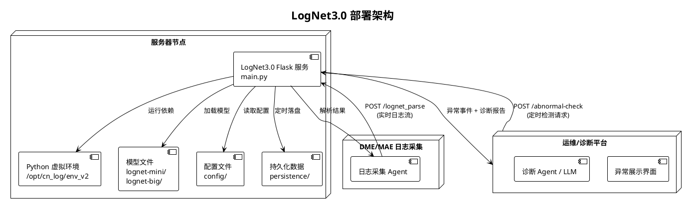

### 11.2 启动方式

```bash
# 在线服务
bin/start.sh
# 或直接运行
python main.py

# 离线检测（DME）
python src/data_process/offline_data_plugin/offline_detection_tool_with_piplup.py

# 离线检测（MAE）
python src/data_process/offline_data_plugin/offline_mae_detection_tool.py
```

### 11.3 持久化机制

| 数据类型 | 存储路径 | 触发条件 |
|---------|---------|---------|
| Drain 树状态 | `config/persistence/{module}_extractor_state.bin` | 每 `persistence_time_minutes` 分钟 |
| PIPLUP 缓存 | `config/persistence/{module}_piplup_cache.pkl` | 每 `persistence_time_minutes` 分钟 |
| 白名单 | `config/white_list_a4.json` | 稳态学习期间，每 `persistence_time_minutes` 分钟 |
| 模型权重 | `src/.../lognet-mini/model.pth` | 离线训练生成 |

### 11.4 稳态学习生命周期

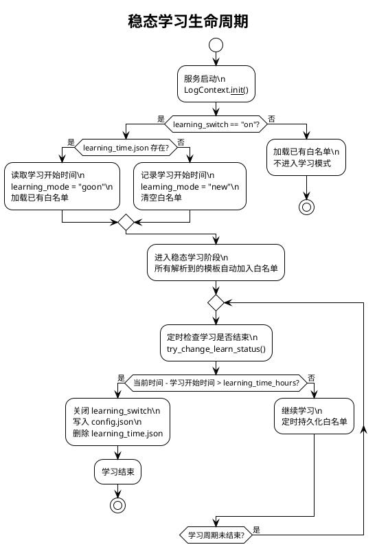

---

## 12. 评估指标体系

### 12.1 模板解析评估指标

| 指标 | 含义 | 计算方式 |
|------|------|---------|
| **GA** (Grouping Accuracy) | 聚类准确率 | 正确分组的行数 / 总行数 |
| **PA** (Parsing Accuracy) | 解析准确率 | 模板完全匹配的行数 / 总行数 |
| **FGA** (F1 of Grouping) | 聚类 F1 | 簇划分的 P/R/F1 |
| **FTA** (F1 of Template) | 模板 F1 | 模板集合的 P/R/F1 |

### 12.2 异常检测评估指标

| 指标 | 含义 | 计算方式 |
|------|------|---------|
| **Precision** | 精准率 | TP / (TP + FP) |
| **Recall** | 召回率 | TP / (TP + FN) |
| **CompressionRate** | 压缩率 | 评测集日志总数 / 上报异常日志总数 |

**三级统计粒度**：
- **Event level**：以时间窗为单位统计 TP/FP/TN/FN
- **Template level**：以模板为单位统计
- **Log level**：以日志行为单位统计

**Trade-off 策略**：
- 供运维人员分析：优先保障 Precision
- 供诊断 Agent/LLM 分析：优先保障 Recall，不断提升压缩率

---

## 13. 端到端示例

### 13.1 完整流程示例：DME 存储集群异常检测

**场景**：DME 存储集群 osd 模块发生磁盘扇区读取错误

**Step 1：日志采集与解析**

输入日志：
```
[2026-02-04 11:39:58][12345][ERR][osd.123][dsware][plog][osd][run][blk-12345] disk sector read error unrecoverable, sector 0x1A2B, retry count 5, pid:53912,tid:53969
```

解析过程：
1. `LogFormatParser.load_data("osd", log)` → `timestamp=2026-02-04 11:39:58`, `content=disk sector read error unrecoverable, sector 0x1A2B, retry count 5, pid:53912,tid:53969`
2. `preprocess(content)` → `disk sector read error unrecoverable, sector NUM_TAG, retry count NUM_TAG, pid:NUM_TAG,tid:NUM_TAG`
3. PIPLUP `treeSearch` → 新建聚类簇
4. `postprocessing` → 模板：`disk sector read error unrecoverable, sector <*>, retry count <*>, <*>`
5. `generate_template_id` → `CRC32(template) = 3829104765`
6. 存入 `LogTemplateRepository`

**Step 2：异常检测（三路并行）**

**语义检测**：
- `filter_english()`: `disk sector read error unrecoverable sector retry count`
- LogNetBig 编码 → 25 个窗口嵌入（1~5-gram）
- 与异常基线计算相似度 → `max_vals_static = 0.95`
- `0.95 > 0.9` → **语义异常**

**参数检测**：
- 模糊匹配命中配置：`disk sector read error unrecoverable, sector <*>, retry count <*>, <*>`
- `param_pos=5` → `sector 0x1A2B` 中的 `0x1A2B`
- `detect_mode=black_list`, `0x1A2B` 在黑名单 → **参数异常**

**数量检测**：
- 该模板在 11:30-11:40 时间窗出现 15 次
- 历史均值 2 次/窗，标准差 1.5
- `|15 - 1.75| > 6 × 1.71` 且 `|15 - 1.75| > 10` → **数量异常**

**Step 3：结果融合**

```json
{
    "logId": "log_001",
    "timestamp": 1738646400000,
    "templateId": 3829104765,
    "template": "disk sector read error unrecoverable, sector <*>, retry count <*>, <*>",
    "anomalyType": ["semantic", "parametric", "changeRecord"],
    "summary": [
        "日志内容异常请检查",
        "日志参数异常,异常参数为 0x1A2B",
        "日志频率异常,当前时间窗内出现15次"
    ]
}
```

**Step 4：指纹库故障诊断（DME 专用）**

- 异常模板 `disk sector read error unrecoverable, sector <*>, ...` 与指纹库线索 `disk sector read error <*> sector <*>` 匹配，权重 0.5
- 异常模板与线索 `retry count <*>` 匹配，权重 0.6
- `case_score = 1.1 > threshold 0.95` → 生成诊断报告：

```json
{
    "format_time": "2026-02-04 11:40:00",
    "case_name": "磁盘扇区不可恢复读错误",
    "case_score": 1.1,
    "fault_mode_clue": [
        "disk sector read error unrecoverable, sector <*>, retry count <*>, <*>"
    ],
    "module": "osd",
    "source": "node-01"
}
```

### 13.2 性能数据

基于已有评估数据（CN 数据集，20250917 批次）：

| 指标 | 值 |
|------|---|
| 整体召回率 | 83% |
| 整体精准率 | 79% |
| 压缩比 | < 0.001 |

PIPLUP 解析覆盖率较 Drain3 提升显著（尤其在格式不规则的日志模块上），CRC32 双层缓存在重复日志高占比场景下可将大部分解析降为 O(1) 查表。

---

## 附录

### A. 依赖环境

| 依赖 | 版本 | 用途 |
|------|------|------|
| Flask | 3.1.1 | Web 服务 |
| torch | - | 深度学习框架 |
| transformers | - | BERT 模型 |
| openai | 1.97.0 | LLM 客户端 |
| pydantic | 2.11.7 | 数据模型 |
| scikit-learn | - | IsolationForest |
| scipy | 1.16.0 | 统计计算 |
| regex | 2024.11.6 | 正则匹配 |

### B. 关键文件索引

| 功能 | 文件路径 |
|------|---------|
| 服务入口 | `main.py` |
| 上下文管理 | `src/data_process/log_context.py` |
| PIPLUP 算法 | `src/data_process/template_extractor/parsing_algorithm/PIPLUP.py` |
| Drain3 算法 | `src/data_process/template_extractor/parsing_algorithm/template_miner.py` |
| 预处理 | `src/data_process/template_extractor/parsing_algorithm/preprocessing.py` |
| 后处理 | `src/data_process/template_extractor/parsing_algorithm/postprocessing.py` |
| LLM 格式学习 | `src/data_process/template_extractor/parsing_algorithm/LogAutoParsingEngine.py` |
| PIPLUP 适配器 | `src/data_process/template_extractor/log_template_parsing_process_piplup.py` |
| 日志格式解析 | `src/data_process/template_extractor/log_formatter_parse.py` |
| 日志仓库 | `src/data_process/template_extractor/log_template_repository.py` |
| 语义异常检测 | `src/anomaly_detection/semantic_anomaly/semantic_anomaly.py` |
| LogNetMini 模型 | `src/anomaly_detection/semantic_anomaly/bert_model/LogNetMini.py` |
| LogNetBig 模型 | `src/anomaly_detection/semantic_anomaly/bert_model/LogNetBig.py` |
| 参数异常检测 | `src/anomaly_detection/parameter_anomaly/param_detector.py` |
| 数量异常检测 | `src/anomaly_detection/quantitive_anomaly/quantitive_detector.py` |
| 检测编排器 | `src/anomaly_detection/anomaly_detection.py` |
| 评估指标 | `src/evaluation/ParserMetrics.py`, `src/evaluation/metrics.py`, `src/evaluation/LogAnalysis.py` |
| 分词器训练 | `pre_train/LogTokenizerTraining/` |
