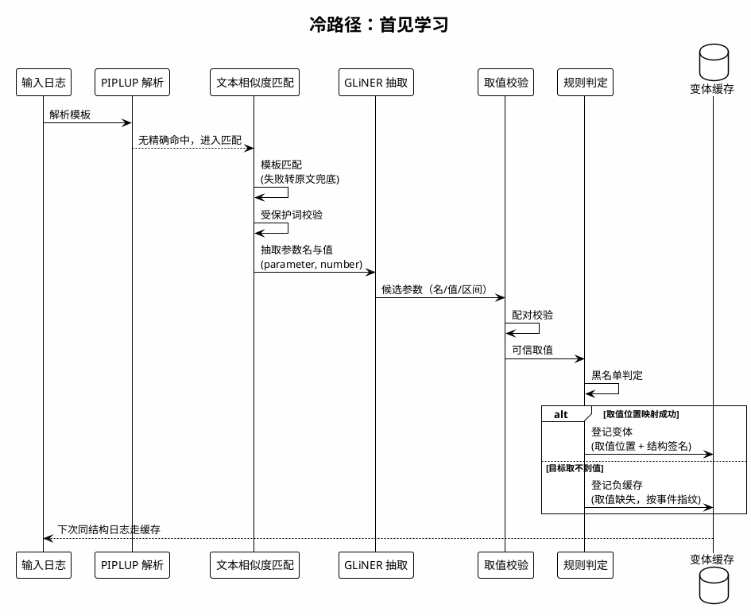
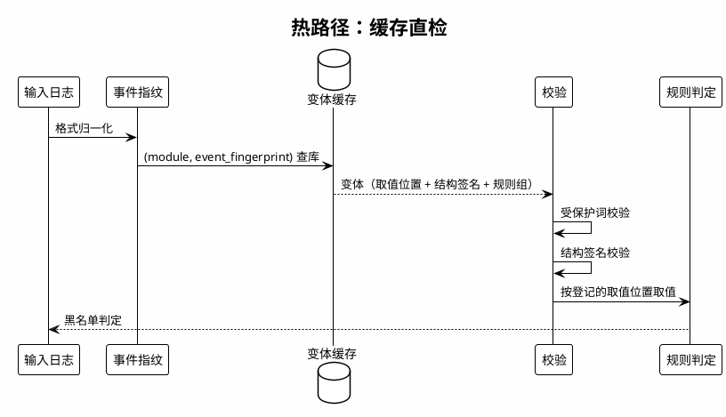

# 参数异常检测系统实验报告

本报告记录系统构建过程中的四组实验：抽取模型选型、抽取标签组合、通用正则兜底、负缓存。前三组确定抽取环节的配置，第四组解决真实比例流量下的模型调用开销。每组实验按背景与目的、实验方法、实验结果、结论四部分展开。

评测在合成语料上完成：真实业务日志无法获取，线上统计仅用于确定语料配比。系统的最终评测结果见本目录 `README.md` 的结果速览表，逐条数据与模板表在 `run_11k/`、`run_110k/`。

---

## 一、评测口径

**系统构成**。系统处理日志分冷热两条路径：首次见到的结构走冷路径，由模型完成抽取与位置学习；同结构日志再次出现时走热路径，按缓存直接判定，不调用模型。





**指标定义**：

| 系统输出 | 金标异常（必在辖） | 金标正常·在辖 | 金标正常·不在辖 |
|---|---|---|---|
| anomaly | TP | FP | FP |
| normal | FN | TN | TN |
| unresolved | FN | **UE** | TN |

P=TP/(TP+FP)，R=TP/(TP+FN)，Acc=(TP+TN)/N。

"在辖"指日志属于规则库覆盖的模板，系统对其有判定权；"不在辖"指日志不属于任何规则模板，业务定义上不会发生参数异常，系统的正确行为是不报警。在辖正常样本被判 unresolved 的记为 UE 单独统计，不计入 TN。理由：TN 表示系统给出了正常判定，unresolved 表示系统放弃了判定，二者性质不同；若把 UE 并入 TN，一个对所有日志都返回 unresolved 的系统会得到虚高的准确率。不在辖样本的 unresolved 则计入 TN，因为对没有判定权的日志作出保留判定是正确行为。

---

## 二、实验一：抽取模型选型

### 2.1 背景与目的

参数抽取是检测链路的第一环：抽取环节若无法定位参数名与参数值，后续的规则判定没有输入。本实验在统一金标上比较六个候选模型，选取抽取主模型。

候选模型与版本：`fastino/gliner2.5-multi-v1`（287M，多语言）、`fastino/gliner2.5-small-v1`（74M，英文）、`urchade/gliner_small-v2.1`（经典 span 架构）、`numind/NuNER_Zero-span`（零样本 span）、`numind/NuExtract-1.5-tiny`（模板化抽取，生成式）、`Qwen/Qwen3.5-0.8B`（生成式小语言模型）。

### 2.2 实验方法

- **数据**：DME 参数类模板的人工金标，16 个模板、151 行参数、141 个唯一参数。其中 18 行的参数名以散文式表述、无法唯一锚定字符区间，予以剔除，span 赛道在 133 行上评分。
- **评分协议**：exact-span 严格匹配，模型给出的起止区间须与金标完全一致，部分重叠不计分（重叠率仅作诊断记录）。
- **生成式模型的坐标处理**：模型只输出原文词面，字符区间由程序在原文中定位回填。自报坐标不被采信，实测依据见结果一节。
- **资源测量**：同一设备（Apple Silicon），batch=1 记录 p50 与 p95延迟、批量吞吐与峰值内存。

### 2.3 实验结果

zero-shot 条件下各模型在 span 赛道的表现：

| 模型 | name P/R/F1 | value P/R/F1 | overall F1 | 单条 p50 |
|---|---|---|---|---|
| **gliner2.5-multi-v1** | **0.903 / 0.699 / 0.788** | **0.733 / 0.744 / 0.739** | **0.7619** | 56.5ms |
| Qwen3.5-0.8B | 0.741 / 0.301 / 0.428 | 0.564 / 0.233 / 0.330 | 0.3787 | 5935ms |
| NuNER_Zero-span | 0.851 / 0.429 / 0.570 | 0.188 / 0.023 / 0.040 | 0.3438 | 109ms |
| NuExtract-1.5-tiny | 0.733 / 0.083 / 0.149 | 0.667 / 0.075 / 0.135 | 0.1419 | 951ms |
| gliner2.5-small-v1 | 0.857 / 0.135 / 0.234 | 0 / 0 / 0 | 0.1224 | 55ms |
| gliner_small-v2.1 | 0.278 / 0.038 / 0.066 | 0.125 / 0.008 / 0.014 | 0.0411 | 65ms |

三项结果需要说明：

1. **生成式模型的自报坐标不可靠**。Qwen3.5-0.8B 首轮运行的 span F1为 0.0。排查结论：模型输出的字符偏移全部有误，即模型识别到了参数的位置，但报告的区间是错的。改为"模型只输出词面、程序回填区间"后，F1 升至 0.3787。该结论被写入后续所有实验的协议。
2. **NuExtract 的官方模板在零样本下不可用**。治理字段赛道中 99.28%的输出为空模板，需要针对性的 schema 提示才能工作。
3. **gliner2.5-small 只能识别参数名**。name 侧精确率 0.857 与多语言版接近，value 侧 F1 为 0，即未能对任何值给出正确区间。74M 的英文模型无法处理中英文混排的日志文本。
4. **NuNER_Zero-span 名值两侧失衡**。name 侧精确率 0.851 与多语言版接近，value 侧 F1 仅 0.040，无法完成名值配对，而黑名单检测依赖的是配对结果。

**输入/输出示例**（金标格式示意，模型行为取自实际记录）：

```text
输入：Get ns async failed, "s:[13,"ret(3).
期望输出：s → 13（区间 [25,27]），ret → 3（区间 [33,34]）

gliner2.5-multi-v1   两个参数的词面与区间均与金标一致（exact-span 命中）
Qwen3.5-0.8B（首轮）  词面正确，自报字符区间与金标不符（坐标校验失败，F1=0）
Qwen3.5-0.8B（回填后）词面正确，区间由程序回填，F1 0.3787
NuExtract-1.5-tiny   输出空模板
gliner2.5-small-v1   参数名词面正确，值侧未给出正确区间（value F1=0）
NuNER_Zero-span      参数名正确率 0.851，值侧 F1 0.040（名值未能配对）
```

### 2.4 结论

选取 `gliner2.5-multi-v1`：overall span F1 0.7619，较第二名高 38 个百分点，单条延迟 56.5ms（第二名 5935ms），CPU 可运行。后续所有实验与生产配置均以该模型为基础。

---

## 三、实验二：抽取标签组合

### 3.1 背景与目的

抽取模型确定后，需要确定向模型提交的标签组合。标签名决定模型如何理解"参数名"与"参数值"两类实体的边界。本实验比较四种组合。

| 臂 | 标签组合 |
|---|---|
| A | ("parameter", "value") |
| B | ("name", "number") |
| C | ("parameter", "number") |
| D | ("name", "value") |

差异集中在两处：参数名一侧使用语义明确的 `parameter` 还是泛化词`name`；值一侧使用泛化词 `value` 还是带数值约束的 `number`。

### 3.2 实验方法

- **数据**：1,100 条合成数据，22 条规则各 50 条，55 条异常，六类变换（原版、头增、尾增、句中插入、删词、参数调序）。
- **流水线**：解析 → 语义匹配（exact Jaccard，阈值 0.5）→ GLiNER 抽取（阈值 0.5）→ 按规则参数名取值 → 黑名单判定。四臂仅标签不同，其余配置一致，每臂 GLiNER 调用 901 次。
- **指标**：检测四项指标。该轮使用早期口径，unresolved 的正常样本计入 TN；后续修正为 UE 单列，故本节的 Accuracy 与最终口径不可直接横向比较。

### 3.3 实验结果

**输入/输出示例**。以同一条件日志为例，四臂的抽取输出：

```text
输入：Get ns async failed, "s:[13,"ret(3).
期望输出：s → 13（黑名单值，应判异常），ret → 3
```

```text
A (parameter, value)   →  ret→3, s→13        两个参数均正确配对
B (name, number)       →  ns→3               将命名空间缩写识别为参数名，目标参数 s 缺失
C (parameter, number)  →  s→3, ns→13         识别出 s，但本例配对错误（应为 13）
D (name, value)        →  ns→3               与 B 相同
```

四臂整体指标：

| 臂 | 标签 | P | R | F1 | Acc | 计数 |
|---|---|---|---|---|---|---|
| A | parameter, value | 0.760 | 0.691 | 0.724 | 0.974 | TP38 FP12 FN17 |
| B | name, number | 1.000 | 0.182 | 0.308 | 0.959 | TP10 FP0 FN45 |
| **C** | **parameter, number** | **1.000** | **0.618** | **0.764** | **0.981** | TP34 FP0 FN21 |
| D | name, value | 1.000 | 0.273 | 0.429 | 0.964 | TP15 FP0 FN40 |

结果呈现两条规律。其一，参数名一侧必须使用 `parameter`：使用泛化词`name` 时模型无法区分普通词汇与参数名，B、D 两臂的召回仅为 0.18 与0.27。其二，值一侧使用 `number` 可消除误配对：A 臂的 12 条误报全部来自 `value` 标签将非目标值配给参数名，`number` 的数值约束排除了词面值。

### 3.4 结论

选取臂 C `("parameter", "number")`：F1 0.764 为四臂最高，且无误报。该组合成为后续所有实验与生产配置的标准标签。

---

## 四、实验三：通用正则兜底

### 4.1 背景与目的

GLiNER 在部分日志上无法抽取目标参数，表现为目标参数缺失或整体抽取为空。本实验验证：在 GLiNER 失败处引入通用形态正则，能否在不引入误报的前提下提升召回。

### 4.2 实验方法

- **正则形态**：五种通用样式，不针对任何具体模板：`ret=: -2`、`ret=-1`、`ret(3)`、`ret: 5`、`status is 5`。
- **两条限制**：词边界，防止参数 `s` 匹配到 `status:` 的词尾；值形态校验，抽取结果必须是数字或十六进制。后者来自一次实测缺陷：早期版本将 `from`、`is` 这类普通词作为取值缓存进模板库，产生错位条目，该缺陷已由值形态校验堵住。
- **触发时机**：仅在 GLiNER 提取失败处（目标参数缺失、整体抽取为空）触发，不影响 GLiNER 正常输出的样本。
- **数据与对照**：1,100 条数据（22 规则 × 50，55 异常，六类变换）。对照组为仅用 GLiNER 结果判定，实验组在失败处叠加正则结果。

### 4.3 实验结果

| 指标 | GLiNER-only | GLiNER+正则 |
|---|---|---|
| Precision | 1.000 | 1.000 |
| Recall | 0.545 | **0.655** |
| F1 | 0.706 | **0.791** |
| Accuracy（修正口径） | 0.753 | **0.919** |
| UE 率 | 23.6% | 6.6% |

两臂的唯一判定差异为 6 条样本，均为漏检转为检出：

| 日志 | GLiNER 结果 | 正则结果 |
|---|---|---|
| `Get ns async failed, is_mgr_last:1 ret(3).`（3 个变体） | 未抽取 ret | 取到 3，命中 10306 黑名单 |
| `Active Func 0xaaaad802e008 Trampoline proc failed.`（2 个变体） | 未抽取 Func | 取到 0xaaaad802e008，命中 ml\|2 黑名单 |
| `Activating of Patch --USER_HP0101.pat failed, error code: 0x202727d1`（2 个变体） | 未抽取 error code | 取到 0x202727d1，命中 ml\|3 黑名单 |

**输入/输出示例**（取上表第一条）：

```text
输入：Get ns async failed, is_mgr_last:1 ret(3).
GLiNER 输出：未抽取 ret（目标参数缺失）
正则兜底输出：ret = 3
规则判定：3 属于 eds|10306 黑名单 → anomaly
```

六条样本的共同特征是参数名与取值在日志中明确存在，GLiNER 未识别，而形态正则可以直接定位。

需要记录的是对照组的另一类漏检：两臂共有的 19 条漏检中，多数为误配对（GLiNER 将取值配给了错误的参数名），正则无法修正 GLiNER 已给出的错误结果。该类问题后续由判定路径的配对校验处理。

### 4.4 结论

通用正则兜底使召回提升 11 个百分点，误报未增加，UE 率由 23.6% 降至6.6%。此后 GLiNER 加通用正则兜底成为标准组合。使用边界为：正则仅出现在两处：GLiNER 提取失败的判定取值、变体入库时的位置定位；不做复合取值的二次猜测，不针对具体模板编写专用模式。

---

## 五、实验四：负缓存

### 5.1 背景与目的

真实业务统计显示，与规则模板相关的日志占全部日志的 13.59%，其中参数异常占模板日志的 0.0027%，即 86.41% 的日志不属于任何规则模板。这类不在辖日志中有一部分会被路由到规则组，但目标参数取不到值（典型为易混淆日志：参数名不同、词面相似），因此没有位置可存，无法登记正变体。

该类结构的处理开销在 110,000 条真实比例语料的评测中暴露（产物见`run_110k/`）：单轮模型调用 22,898 次，其中 20,676 次来自上述日志，而这 20,676 次调用只对应 22 个唯一事件结构。即模型为同一结构重复调用近千次，该开销超过链路中其他所有成本之和。本实验验证负缓存能否消除这笔开销，且不改变任何判定。

### 5.2 机制设计

负缓存按事件指纹（值剥离后的有序 token 序列哈希，与正变体缓存同一身份定义）记录"该结构的目标取不到值"。同结构日志再次出现时直接返回无法判定，不调用模型。

关键设计在存储内容上：**只缓存取不到值的结构**。命中时校验目标定义修订（参数名集合变化即失效），其余与正缓存一致。负缓存条目不进入匹配索引，仅按指纹查表，因此不影响路由开销。

**输入/输出示例**：

```text
首次出现（冷路径，模型参与）：
  输入：Get ns async failed rc(901).
  过程：路由到 eds|10305（原文包含度 0.80），GLiNER 未抽取 ret
  输出：unresolved；登记负缓存 {事件指纹 → 目标取值缺失}

同结构再次出现（命中负缓存）：
  输入：Get ns async failed rc(902).
  输出：unresolved，模型调用 0 次
```

### 5.3 一次设计失误与修正

初版实现同时缓存了冷路径的取值。该实现在 11k 语料上产生 161 条误报，机制如下：某删除类结构的首个出现恰为异常样本（s=13 为黑名单值），缓存中记录了值 13；后续同结构的正常日志（s=26、28、30 等）命中缓存后，按缓存中的旧值 13 完成判定，全部判为异常。

根因是取值随日志逐条变化，而缓存键只表示结构。正缓存存储的是取值位置，重放时取到的是当前日志的值，因此不存在该问题；负缓存若存储取值，则同结构不同值的日志会被旧值污染。

```text
误报案例（修正前的错误设计）：
  结构：Get ns async failed, "s:[26.  及其同结构变体（删除类）
  首次出现为异常样本：s = 13（黑名单值）→ 缓存记录取值 13
  后续正常样本 s = 26 / 28 / 30：命中缓存后按旧值 13 判定 → 误报
```

修正为只缓存"取不到值"这一类与取值无关的事实，并在命中路径上忽略任何存量取值。修正后 11k 恢复到零误报。

### 5.4 实验结果

同一语料、同一系统版本的前后对比：

| 语料 | GLiNER 调用 | 用时 | 判定 |
|---|---|---|---|
| 11k（无负缓存） | 1,305 | 176.6s | 基准 |
| 11k（有负缓存） | **554** | **103.1s** | 逐项一致 |
| 110k（无负缓存） | 22,898 | 2,727s | 基准 |
| 110k（有负缓存） | **874** | **190.7s** | 逐条一致 |

110k 语料上模型调用降低 96.3%，用时降至原来的十五分之一，逐条判定与基准完全一致（异常 1 / 正常 13,999 / 未判定 96,000）。

**缓存规模**：110k 条语料共产生 52 条负缓存条目（命中 22,024 次），每条约 147 字节。条目数由不同事件结构的数量决定，与日志条数无关，值的变化不改变事件指纹。因此生产环境中该表的增长取决于新结构出现的速度，而非流量规模；如需容量上限，可加存活期策略（过期后该结构多执行一次冷路径，代价可接受）。

### 5.5 结论

负缓存消除了真实配比下最重的成本项。至此系统单线程吞吐约 580 条/秒（真实配比），缓存充分预热后约 2,000 条/秒。该实验同时确认了一条通用原则：缓存的存储内容必须与缓存键（结构）一一对应，任何随日志变化的量（取值）都不能进入缓存。

---

## 六、结论与已知边界

四组实验依次确定了抽取模型、标签组合、兜底策略与缓存机制，最终系统的评测结果（11k 受控配比与 110k 真实配比）见本目录 `README.md` 的结果速览表。

已知边界如下。两个数据集共同的漏检来源：

1. **取值粒度**。`format flag from (x) --> (y)` 一类措辞中，参数名与取值的距离超出邻近校验的容忍范围；`func=QosFillVolMsgBuf+0x8d` 的偏移位于复合 token 内部。取值失败时系统如实返回无法判定。该类问题应在接入新模板时于配置或抽取层解决，不增加模板专用的兜底逻辑——更换规则库后专用逻辑即失效。
2. **家族删词歧义**。`eds|10306`、`eds|10309` 删除区分字段后，日志与`eds|10305` 在结构上真性不可分。
3. **相邻取值**。形如黑名单值 ±1、±2 的近邻值不会误触发，但该安全性由精确匹配与值形态校验共同保证，更换为范围类规则后需重新验证。
